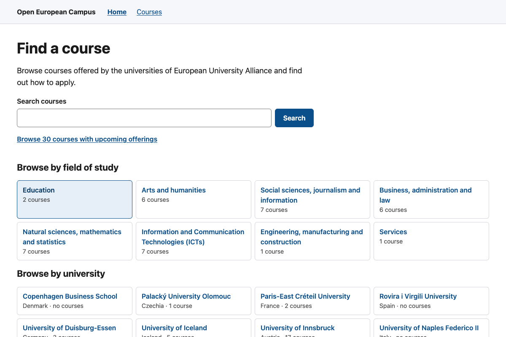

<!-- SPDX-FileCopyrightText: 2026 Lluís Alfons Ariño -->
<!-- SPDX-License-Identifier: EUPL-1.2 -->

# Open Alliance Course Catalogue (OACC)

The open course catalogue for European University alliances.

Status: 0.12.0, pre-production (no partner connected yet; the first real course data, the Aurora Virtual Campus 2026-27 courses, tested on the development stack only); specification v4.1 (as built); later changes in the Unreleased section of the [changelog](CHANGELOG.md)

OACC is a sovereign, open-source course-catalogue portal for European
University alliances. It collects the courses that the partner universities of
an alliance open to each other's students, normalises them into one data model,
and publishes them as one searchable public catalogue and one standards-based
read API. Everything is open source under the EUPL-1.2 and runs on open
components only, so an alliance can host it itself without licence costs or
dependence on an external managed platform.

The full specification is [docs/spec-v4.1.md](docs/spec-v4.1.md). An index of
all documentation is in [docs/README.md](docs/README.md).


## Name

The project started as the Open European Campus Portal (OECP) and was renamed Open Alliance Course Catalogue (OACC) on 2026-10-22. `oecp` remains the internal code name in configuration variables, package names, container images, error codes and the API extension (`ext.oecp`), and the repository keeps its address for now.

## The problem it solves

An alliance of universities wants one place where students can find every
course offered across the alliance: which university teaches it, in which
language and mode, how many ECTS, when it runs, when to apply and how. The
universities, however, are very different: some expose a modern course API,
some can export a spreadsheet, some can only type courses in by hand. Their
course data follows different conventions, and some of the information the
alliance wants to show (educational hubs, sustainability goals, whether a
course is open to all partners) does not exist in any university system.

OACC absorbs that diversity so that the alliance gets one consistent catalogue
without forcing every partner into the same tooling:

- **Three ways in, one model out.** A partner can be harvested automatically
  from its Open Education API (OEAPI, the SURF standard formerly called OOAPI),
  upload CSV files from a published template, or maintain courses in a web
  form. All three land in the same canonical model, with the same validation
  and the same audit trail.
- **Alliance-specific data without forking the standard.** Each alliance
  defines its own course attributes (for Aurora: educational hub, SDGs,
  micro-credential, free course, target audience) that become tags and filters
  in the catalogue, next to the standard fields.
- **Local edits that survive automation.** Alliance staff can correct or
  enrich a harvested course; those overrides are kept per field and survive
  every later harvest, and the partner's original value stays visible.
- **The catalogue is itself harvestable.** The published offer is exposed
  again as an OEAPI v5-compatible read API, so other platforms and alliances
  can consume it.
- **No student data.** OACC publishes the offer and points students to the
  partner's own application process. It never handles applications,
  enrolment or student records, which keeps its data-protection footprint
  small.



## Main modules

| Module | What it does |
|---|---|
| **Public catalogue** | Server-rendered portal with full-text search in several languages, filters (partner, mode, language, ISCED field, level, ECTS, alliance attributes), sorting by start date or application deadline, course pages with texts per language, offerings, seats and "how to apply", structured data for search engines, sitemap, no cookies; optional header image and alliance logo supplied by the deployment (branding). |
| **Harvester (channel A)** | Scheduled pull of each partner's OEAPI v5 endpoint through an anti-corruption layer: validation, mapping to the canonical model, change detection by content hash, withdrawal of courses that disappear, and a full audit of every run and every original payload (minimised of person data). |
| **CSV upload (channel B)** | Versioned CSV template, validated in the browser before upload with the same validator the server uses, all-or-nothing processing, row-and-column error reports. |
| **Web form (channel C)** | A stepped editor for courses and offerings, including alliance attributes and per-language texts; on harvested organisations it works as an overrides editor. |
| **Administration panel** | Invitations (refused while the organization's identity provider is not enabled in Keycloak), integration settings per partner (endpoint, credentials, host approval, test connection, sync now), sync history and error reports, organisations and administrators, network status with a health indicator per partner, maintenance runs. |
| **Identity** | Keycloak as the only identity component: each organization's administrators sign in either through their own university (SAML / eduGAIN) or with local accounts, never a mix within one organization, always with a second factor; roles are assigned inside OACC, never derived from the identity provider. The public portal needs no sign-in. |
| **OEAPI read API** | The alliance catalogue published in OEAPI v5 shapes, plus two documented JSON APIs of OACC's own (public and administration). |
| **Maintenance** | Daily jobs for history partitions, retention periods, dormant-administrator review, account clean-up and identity-provider metadata refresh from eduGAIN, all recorded and runnable on demand from the panel. |
| **Operations** | In the reference deployment: scheduled pgBackRest backups with point-in-time recovery and a restore drill; Prometheus metrics, alert rules (harvests, backups, disk, maintenance jobs, expiring partner IdP and TLS certificates) and e-mail or webhook notifications; container logs shipped to Loki with time-based retention; Grafana dashboards. |

## Who uses it

| Role | Needs an account? | What they do |
|---|---|---|
| **Students and visitors** | No | Search and browse the catalogue, read course pages, follow the link or instructions to apply at the partner university. |
| **Partner administrator** (one or more per university) | Yes: the university's identity provider or a local account, with MFA | Keeps the university's courses current: configures the OEAPI integration, uploads CSV files, edits courses and offerings in the form, reviews sync reports and completeness warnings. |
| **Alliance administrator** (the alliance office or foundation) | Yes, same | Onboards universities and their administrators, approves partner endpoints, watches the network status, runs maintenance, defines the alliance attributes and decides what is published. |
| **Hosting operator** | No OACC account | Deploys and operates the reference Docker Compose stack, backups, secrets, logs and upgrades (see [Guide E](docs/onboarding/hosting-operator.md) and the [runbook](docs/production/runbook.md)). |
| **Other platforms** | No | Harvest the alliance catalogue through the OEAPI v5 read API. |

The data-protection roles for the first deployment are documented in the
decisions log: the Aurora Foundation decides what is published (controller),
Universitat Rovira i Virgili hosts the service (processor), and each partner
university is an independent controller of the data it supplies.

## Architecture

- **Edge:** Traefik v3 terminates TLS, routes, rate-limits and sets security headers ([ADR-0003](docs/adr/0003-traefik-edge-proxy.md)).
- **Web:** Nuxt 4 / Vue 3 renders the public catalogue server-side and the administration panel client-side ([ADR-0002](docs/adr/0002-vue3-nuxt-ssr-catalogue.md)).
- **Backend:** one NestJS modular monolith, one image, two processes: `api` (HTTP) and `worker` (jobs on BullMQ / Valkey) ([ADR-0001](docs/adr/0001-modular-monolith-on-nestjs.md)).
- **Data:** PostgreSQL 16 holds the canonical model, full-text search and the ingestion history; ingestion is pull-only OEAPI harvesting plus CSV and form ([ADR-0005](docs/adr/0005-pull-only-oeapi-harvesting-canonical-model.md), [ADR-0010](docs/adr/0010-overrides-on-harvested-records.md)).
- **Identity:** Keycloak authenticates administrators only, with one SAML identity provider per partner (eduGAIN) or local accounts for an organization without one, and mandatory MFA; the public portal never touches it ([ADR-0004](docs/adr/0004-keycloak-only-identity-one-saml-idp-per-partner.md)).
- **Operations:** pgBackRest backups (profile `backup`) and Prometheus, Alertmanager, Loki with Grafana Alloy, and Grafana (profile `observability`) in the same Compose file.
- **Alliance-agnostic:** the alliance name, branding images, partners, attributes and hosts are configuration (the portal interface is English-only in 0.12.0); one deployment serves one alliance. The first deployment targets the Aurora European Universities Alliance.

The same architecture as four diagrams (context, deployment, API modules,
course data flow) is in [docs/architecture.md](docs/architecture.md). All
architecture decisions are recorded in [docs/adr](docs/adr/README.md).

## Repository layout

```
.
├── apps/
│   ├── api/              NestJS backend: `api` and `worker` processes, migrations, CLI
│   └── web/              Nuxt public catalogue and administration panel
├── packages/
│   └── schemas/          Canonical model, CSV template, OEAPI DTOs, error codes (Zod + JSON Schema)
├── identity/
│   └── keycloak/         Realm as code, SP metadata notes
├── deploy/
│   ├── compose/          Docker Compose reference deployment, test SAML IdP (dev profile),
│   │                     backups, observability, branding/ (the deployment's images, not committed)
│   └── helm/             Helm chart (planned)
├── tools/
│   ├── oeapi-mock/       Simulated OEAPI v5 partner for development and tests
│   └── e2e-identity/     Playwright E2E suite of the administrator onboarding (local and federated), run in CI
└── docs/
    ├── spec-v4.1.md      Specification as built
    ├── adr/              Architecture decision records (MADR)
    ├── onboarding/       Guides for the alliance and the three partner profiles
    ├── guides/           Data-provider guides: API integration, CSV authoring, web form
    ├── api/              OpenAPI documents of the public and administration APIs
    ├── data/             Real course data transcribed into the CSV template (Aurora Virtual Campus)
    ├── images/           Screenshots of the portal, the administration panel and operations
    ├── production/       GDPR, accessibility and operations templates for go-live
    ├── research/         Background research (partner endpoints, Aurora portal, IT Handbook)
    ├── decisions-log.md  Owner decisions
    └── backlog.md        What is deferred and why
```

## Quick start

The reference deployment is Docker Compose; the verified first-run path
(services, secrets, migrations, first alliance administrator, optional
`dev` profile with a mail sink, a simulated OEAPI partner and a test SAML
identity provider) is in [deploy/compose/README.md](deploy/compose/README.md).
To onboard an alliance or a university, start from
[docs/onboarding/README.md](docs/onboarding/README.md).

## Contributing

Contributions are welcome. Please read [CONTRIBUTING.md](CONTRIBUTING.md)
(Developer Certificate of Origin sign-off, no CLA),
the [Code of Conduct](CODE_OF_CONDUCT.md), [GOVERNANCE.md](GOVERNANCE.md) and,
for vulnerabilities, [SECURITY.md](SECURITY.md). Releases follow
[docs/RELEASING.md](docs/RELEASING.md); notable changes are recorded in
[CHANGELOG.md](CHANGELOG.md).

## Licence

Copyright 2026 Lluís Alfons Ariño  
Licensed under the EUPL

OACC is licensed under the [European Union Public Licence v. 1.2](LICENSE)
(EUPL-1.2), English version. The EUPL's network clause means that anyone who
operates a modified version of OACC as a network service must make the source
code of that version available. Trivial configuration files are dedicated to
the public domain (CC0-1.0). Licensing information for every file is declared
in [REUSE.toml](REUSE.toml) following the [REUSE](https://reuse.software)
specification; the licence texts are in [LICENSES/](LICENSES/).
