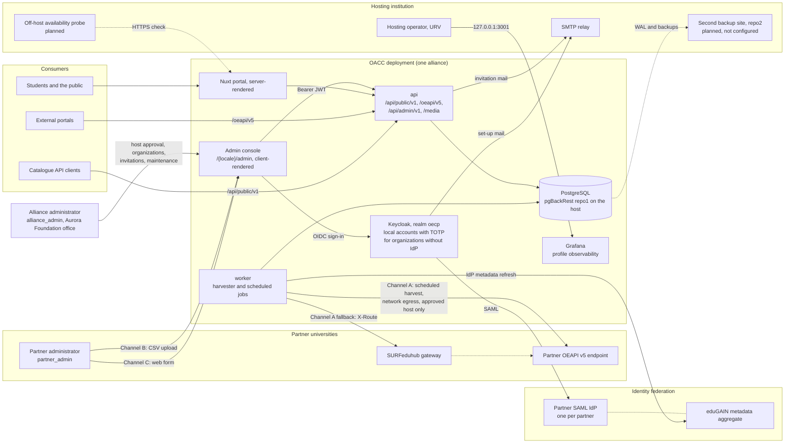
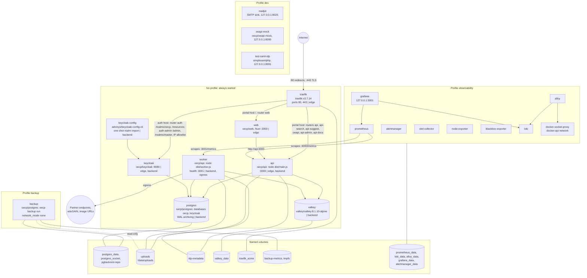
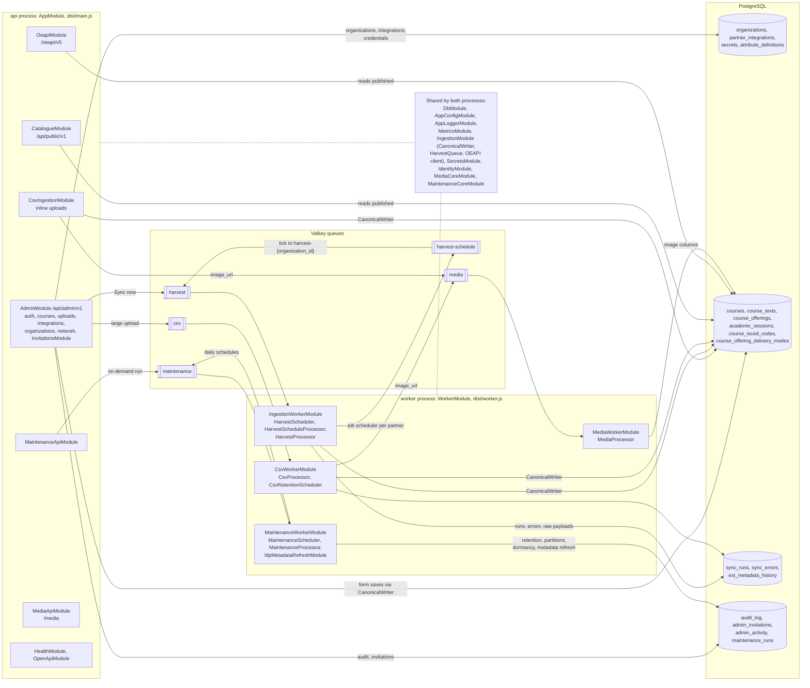
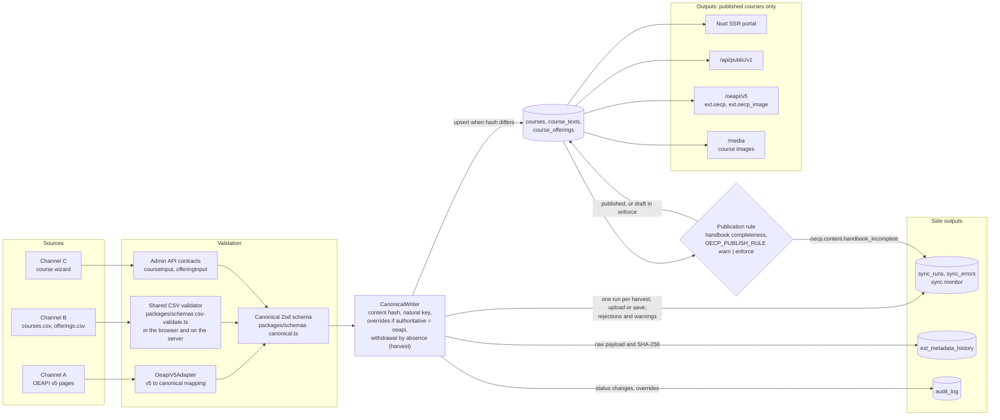

<!-- SPDX-FileCopyrightText: 2026 Lluís Alfons Ariño -->
<!-- SPDX-License-Identifier: EUPL-1.2 -->

# OACC architecture

OACC is a **modular monolith**: one NestJS codebase built into one image (`oecp/api`) that runs as two processes, `api` (HTTP, `dist/main.js`) and `worker` (BullMQ jobs on Valkey, `dist/worker.js`), next to a Nuxt portal (`oecp/web`), Keycloak, PostgreSQL and Valkey behind Traefik ([ADR-0001](adr/0001-modular-monolith-on-nestjs.md), [spec §3](spec-v4.1.md#3-architecture)). One deployment serves **one alliance**: the alliance's name, branding, partner organizations, course attributes and host names are configuration, and the first deployment is the Aurora alliance hosted by URV.

Course data enters through three **ingestion channels** that all end in the same canonical model ([spec §6](spec-v4.1.md#6-ingestion-anti-corruption-layer)): **Channel A**, the worker harvests a partner's OEAPI v5 endpoint (or the SURFeduhub gateway) on a schedule; **Channel B**, a partner administrator uploads `courses.csv` and `offerings.csv` in the admin console; **Channel C**, a partner administrator edits courses in the console's web form. Each organization has one authoritative channel; the others can only add overrides ([ADR-0010](adr/0010-overrides-on-harvested-records.md)). The four diagrams below go from the outside in: who surrounds a deployment, how it runs on one host, how the API is split into modules, and how a course travels from a source to the public outputs.

## 1. Solution context

- **Channel A** is pull-only ([ADR-0005](adr/0005-pull-only-oeapi-harvesting-canonical-model.md)): the worker calls a partner endpoint only once an alliance administrator has approved its host (`partner_integrations.approved_host`), only over `https` on port 443 and only to public addresses (`apps/api/src/ingestion/oeapi/net-guard.ts`); see [ADR-0009](adr/0009-direct-partner-oeapi-access-with-host-approval.md), [spec §6.1](spec-v4.1.md#61-common-pipeline-implemented) and [§6.2](spec-v4.1.md#62-channel-a-scheduled-oeapi-harvester-implemented-mock-verified) (6.2.6 for the outbound rules). The `api` process also reaches the endpoint for "Test connection".
- **Channels B and C** are the console's CSV upload and course wizard: [spec §6.3](spec-v4.1.md#63-channel-b-csv-upload-implemented), [§6.4](spec-v4.1.md#64-channel-c-web-form-implemented), [ADR-0011](adr/0011-csv-uploads-all-or-nothing-shared-validator.md); the [data-provider guides](guides/README.md) explain all three channels.
- **Identity** is Keycloak only, for administrators only; the public portal never loads OIDC code. A federated organization signs in through its own SAML IdP ([ADR-0004](adr/0004-keycloak-only-identity-one-saml-idp-per-partner.md)), whose metadata the worker refreshes from the signed eduGAIN aggregate ([ADR-0017](adr/0017-idp-metadata-refresh-from-pinned-signature-aggregate.md)); an organization without IdP uses local accounts with TOTP (decision 22 in [decisions-log.md](decisions-log.md)). Details in [spec §4](spec-v4.1.md#4-identity).
- **Roles** are those of the [onboarding index](onboarding/README.md): alliance administrator, partner administrator and hosting operator (no OACC account).
- **Operations**: repo2 and the off-host probe are open items of [Guide E](onboarding/hosting-operator.md); Grafana is reachable on the host's loopback only.

## 2. Deployment on one host (Docker Compose)

- **Profiles** follow `deploy/compose/compose.yaml`: eight services always run (`keycloak-config` exits after the realm import), `dev` adds the SMTP sink, the OEAPI mock partner and a test SAML IdP, `backup` adds the pgBackRest scheduler, `observability` adds metrics, alerts, traces and logs.
- **Networks**: `edge` (`oecp-edge`, Traefik and what it routes to; not internal, so `api` and `keycloak` also reach the SMTP relay), `backend` (`oecp-backend`, internal: data stores), `egress` (`oecp-egress`, the worker's outbound access) and `docker-api` (`oecp-docker-api`, internal: Alloy to the socket proxy). `backup` has no network; repo2 needs `egress` on `postgres` and `backup`.
- **Routers** (labels on `api`, `keycloak`, `web`): `api` matches `/api`, `/oeapi` and `/media`; `api-search` and `api-suggest` (`/api/public/v1/courses`, `/suggest`), `oeapi` (`/oeapi/v5`) and `api-admin` (`/api/admin`) add per-IP rate limits; `api-docs` serves `/api/public/v1/docs`, `/api/admin/v1/docs` and `/api/docs-assets/`. Middlewares are in `deploy/compose/traefik/dynamic/`.
- **Ports**: only 80 and 443 are published on all interfaces; the Traefik dashboard (8080, local development), Grafana (3001) and the `dev` ports listen on 127.0.0.1.
- **One image, two processes**: `api` and `worker` both run `oecp/api` and share the volumes `uploads` (CSV uploads and course images) and `idp-metadata`. Detail: [spec §3](spec-v4.1.md#3-architecture) and §10, [deploy/compose/README.md](../deploy/compose/README.md), [ADR-0003](adr/0003-traefik-edge-proxy.md) and [Guide E](onboarding/hosting-operator.md).

## 3. Modules of the API and their relations

- **Modules** are the directories of `apps/api/src/`: `catalogue`, `oeapi`, `admin` (subdirectories `auth`, `courses`, `uploads`, `integrations`, `organizations`, `network`, `invitations`; only `invitations` is a module of its own), `ingestion` (`oeapi/` harvester client and adapter, `csv/`, `canonical-writer.service.ts`), `identity` (Keycloak admin client, `metadata-refresh/`), `maintenance`, `media`, `secrets`, `health`, `openapi`, `metrics`, `db`, `config`, `logging`, `common` (problem details) and `cli` (the `oecp` command, not loaded by either process).
- **The two root modules** are `app.module.ts` (`AppModule`) and `worker.module.ts` (`WorkerModule`); the worker has no public HTTP, only `/health`, `/ready` and `/metrics` on port 3001. `IngestionModule` registers the BullMQ connection and the `harvest` queues in both processes; the processors exist only in the worker.
- **Queues** (constants in `harvest.constants.ts`, `csv/csv.constants.ts`, `media/media.constants.ts`, `maintenance/maintenance.constants.ts`): `harvest-schedule`, `harvest`, `csv` (uploads and the daily `csv-retention`), `media` (CSV `image_url` fetches) and `maintenance` (`history-partitions`, `idp-metadata-refresh`, `retention`, `dormancy`, `account-cleanup`). Schedules and job ids are in [spec §3, "Queues"](spec-v4.1.md#3-architecture).
- **Tables** come from `apps/api/db/migrations/0001_init.sql` to `0010_sync_run_files.sql`. Administrators are Keycloak users, not a table; the IdP metadata cache is the `idp-metadata` volume, and the refresh writes Keycloak's IdP configuration and `audit_log`. Credentials in `secrets` are encrypted with the master key ([ADR-0008](adr/0008-partner-credentials-encrypted-in-postgresql.md)).
- **Read paths** (`catalogue`, `oeapi`) only read published records; full-text search runs in PostgreSQL ([ADR-0007](adr/0007-full-text-search-in-postgresql.md)). Admin API detail: [spec §8.2](spec-v4.1.md#82-admin-api-apiadminv1-implemented) and the [OpenAPI documents](api/README.md).

## 4. Data flow of a course

- **Validation** differs per channel and meets in one canonical schema: the harvester maps v5 in `apps/api/src/ingestion/oeapi/oeapi-v5.adapter.ts` ([spec §6.2.4](spec-v4.1.md#62-channel-a-scheduled-oeapi-harvester-implemented-mock-verified)); CSV files go through `validateCsvFiles` of `packages/schemas/src/csv-validate.ts`, the same code in the console (`apps/web/app/utils/csvConsole.ts`) and in `CsvIngestionService`, and an upload is all or nothing ([ADR-0011](adr/0011-csv-uploads-all-or-nothing-shared-validator.md)); the form posts to the admin API, validated by the Zod contracts of `packages/schemas/src/admin-courses.ts`.
- **`CanonicalWriter`** (`apps/api/src/ingestion/canonical-writer.service.ts`) hashes the RFC 8785 serialisation with SHA-256 (`content_hash`): an equal hash only refreshes `last_seen_at`, so every channel is idempotent ([spec §6.1](spec-v4.1.md#61-common-pipeline-implemented)). On an `oeapi`-authoritative organization, CSV or form changes become per-field `overrides` that survive the next harvest ([ADR-0010](adr/0010-overrides-on-harvested-records.md), [spec §5.3](spec-v4.1.md#53-overrides-dl-12-implemented)). A course missing from 3 complete harvests (`withdraw_after_absences`) is withdrawn, unless 30 % or more of the published courses are missing at once ([ADR-0015](adr/0015-withdrawal-by-absence-with-mass-absence-guard.md), spec §6.2.5).
- **The publication rule** is `completeness()` of `packages/schemas/src/handbook.ts`, applied after a course and its offerings are written: `warn` publishes with a warning, `enforce` keeps an incomplete course as `draft` (decision 21c, [ADR-0016](adr/0016-handbook-publish-rule-with-warn-and-enforce.md)). Nothing is rejected because of it.
- **Outputs** read the same tables: the portal renders server-side from the public API ([ADR-0002](adr/0002-vue3-nuxt-ssr-catalogue.md), [spec §7](spec-v4.1.md#7-public-portal)); `/oeapi/v5` carries what v5 cannot express in `ext.oecp` and `ext.oecp_image` ([spec §9](spec-v4.1.md#9-public-read-api-oeapi-v5-compatible-implemented), [ADR-0014](adr/0014-strict-consumer-semantics-on-oeapi-read-api.md)); course images are WebP files under `/data/uploads/media/courses/`, uploaded in the form or fetched by the `media` queue from a CSV `image_url`, and served at `/media/courses/{courseId}/{file}`.
- **Side outputs**: each harvest, upload or form save is one `sync_runs` row with its `sync_errors`, shown in the console's sync history; raw payloads (without person data) go to the monthly partitions of `ext_metadata_history`; status changes and overrides are written to `audit_log`.
