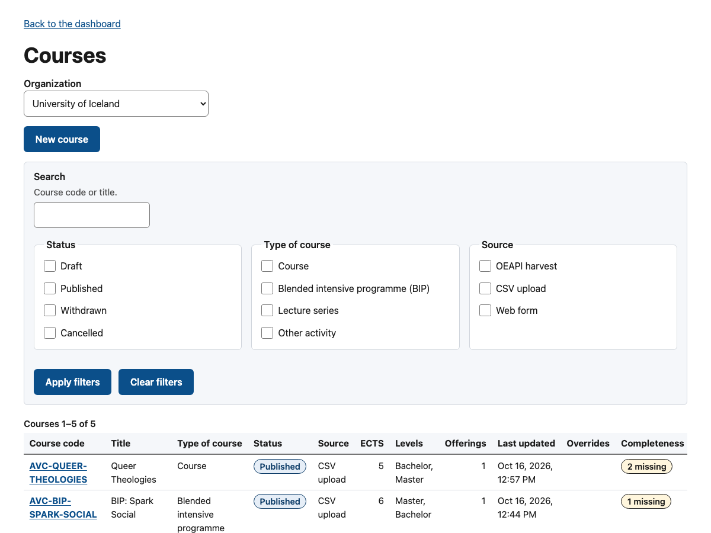
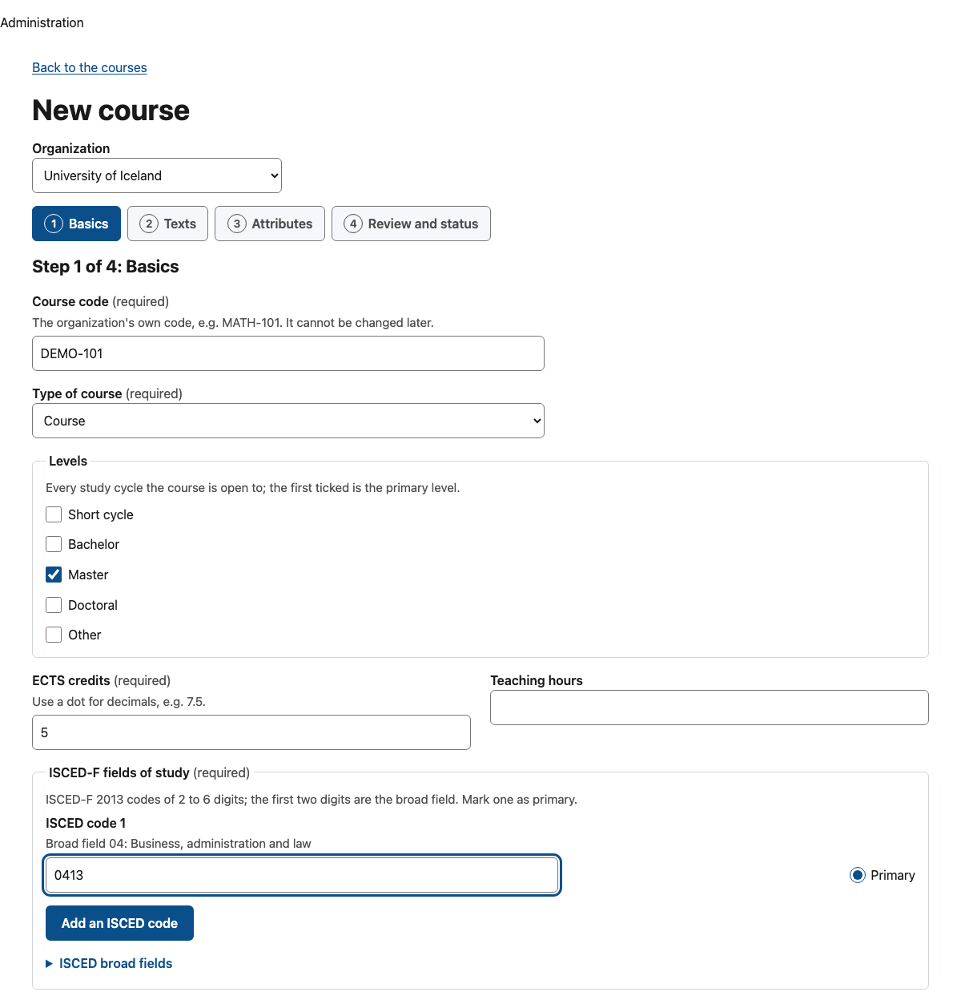
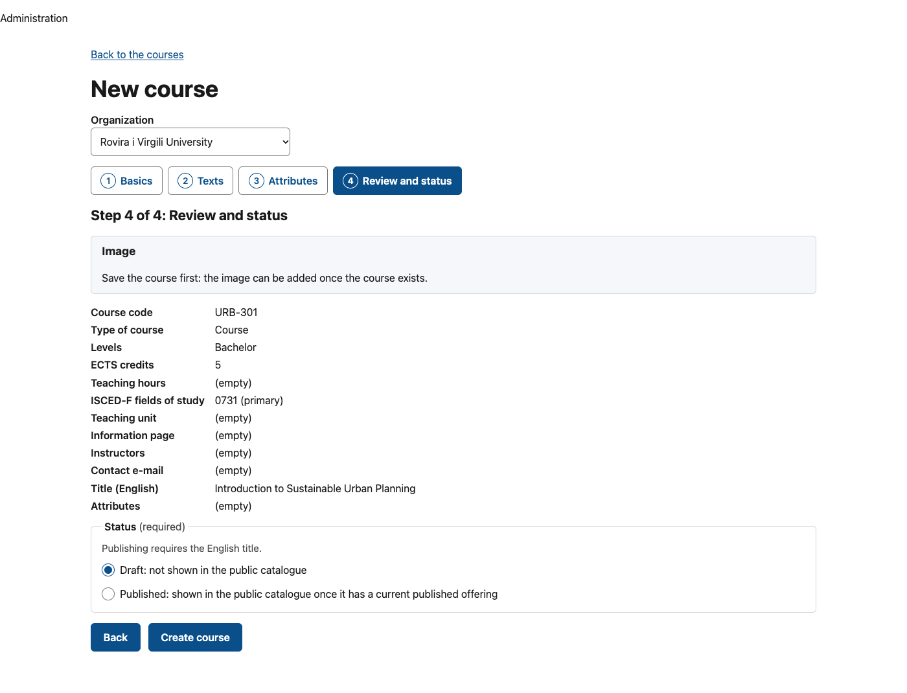
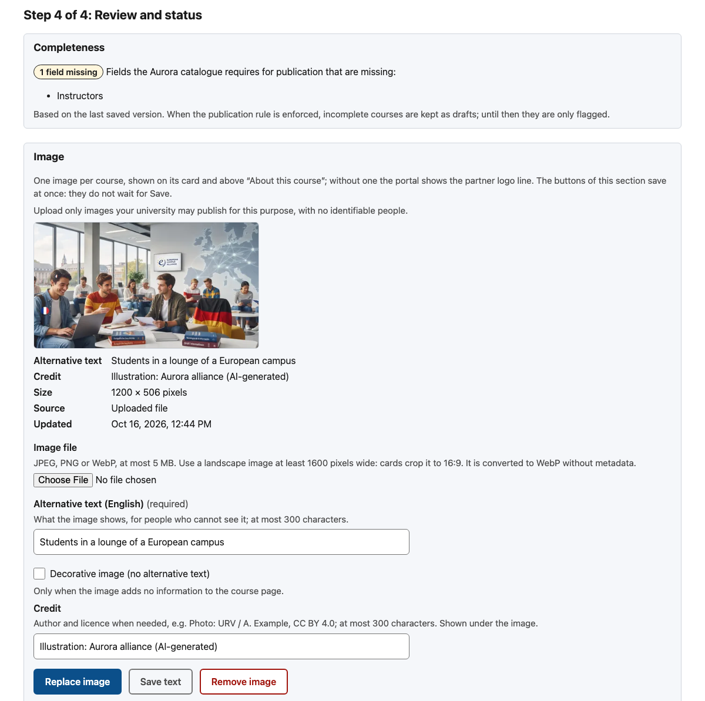
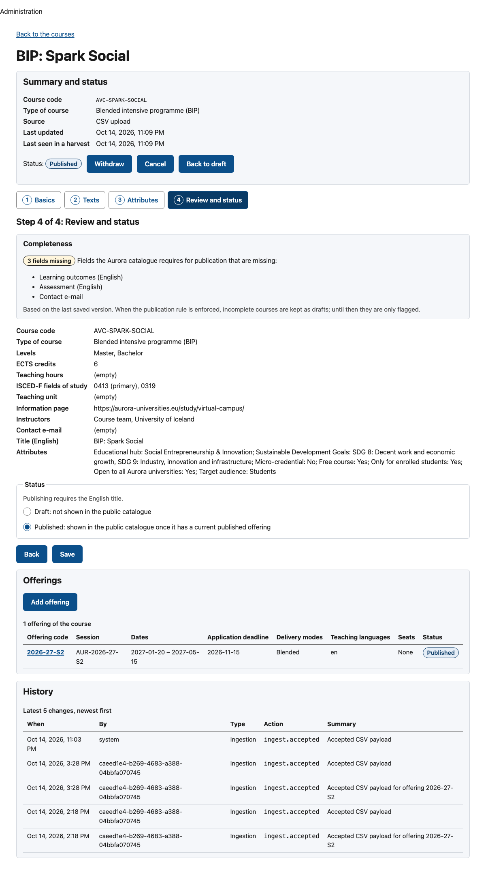
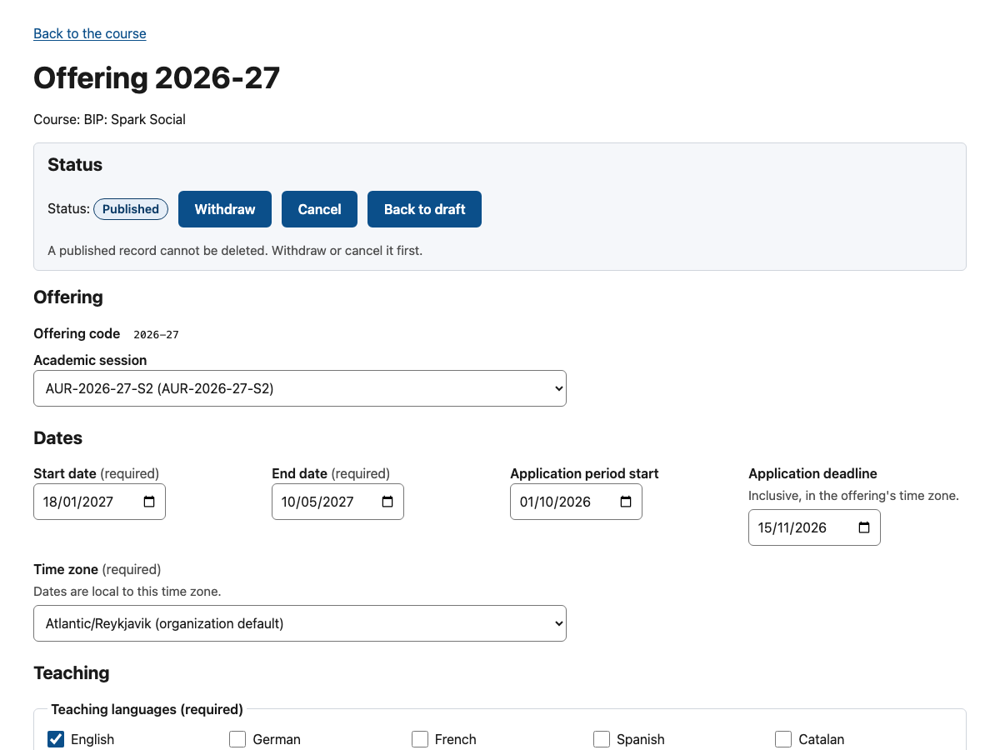
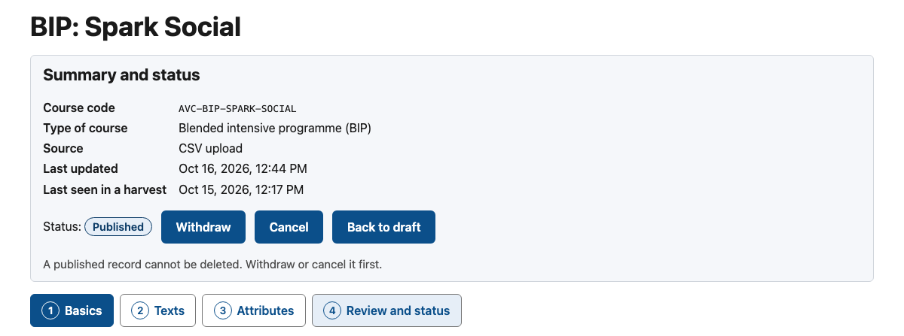
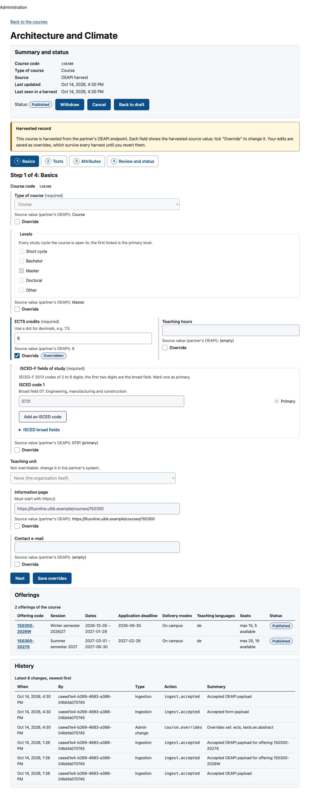

<!-- SPDX-FileCopyrightText: 2026 Lluís Alfons Ariño -->
<!-- SPDX-License-Identifier: EUPL-1.2 -->

# Web form: the course wizard and offerings

For partner administrators who maintain courses by hand (Channel C, spec §6.4), and for administrators of harvested organizations who correct or complete harvested data with overrides. Getting an account (invitation, password and TOTP) is covered by the onboarding guide [D. Partner without integration capacity](../onboarding/partner-manual.md); the shared data rules are in the [guides README](README.md#common-data-quality-rules).

The admin console lives at `/{locale}/admin` (English only). An `alliance_admin` first picks the organization (kept in `?org=`); a `partner_admin` works on their own organization and its sub-units. The session is kept in memory: reloading the page restores it while your login session is alive (30 minutes idle, 8 hours at most), but **unsaved changes are lost**.

## Two modes

The mode follows the organization's authoritative channel (`GET …/reference` returns it as `form_mode`):

| Authoritative channel | Mode | What the form does |
|---|---|---|
| `form`, `csv` or none | `write` | Create, edit (full replace), change status and delete courses and offerings. CSV uploads write the same records. |
| `oeapi` | `overrides` | Records come from the harvester. The form cannot create or delete; it stores **overrides** on harvested fields and status. |

## Courses list

**Courses** lists every course of the organization, any status, with filters for text (code or any title), status, type and source channel, 25 per page. Each row shows code, title (English, else the first language), status, source, ECTS, offerings, last update, whether overrides exist and **Completeness** against the [publication rule](#publication-rule-completeness): a tick for a complete course, else a badge with the number of obligatory fields still missing ("*3 missing*"; the course's Completeness card lists them). **New course** opens the wizard (write mode only).



## The course wizard

Four steps. A new course is filled in order and each step is checked before **Next**; an existing course opens on any step and can be saved from any of them. Server errors are mapped back to their fields and listed in an error summary at the top.



**1. Basics**

| Field | Rules |
|---|---|
| Course code | Your own code, `^[A-Za-z0-9][A-Za-z0-9._/-]{0,199}$`. **Cannot be changed later.** |
| Type of course | `Course`, `Blended Intensive Programme (BIP)`, `Lecture series`, `Other` |
| Levels | At least one of short cycle, bachelor, master, doctoral, other; the first ticked is the primary level |
| ECTS credits | > 0, ≤ 120, up to 2 decimals with a dot |
| Teaching hours | optional, > 0, 1 decimal |
| ISCED-F fields of study | 1 to 10 codes of 2–6 digits with a known broad field (shown next to the code); mark one as primary |
| Teaching unit | optional; a sub-unit of your organization that has a code |
| Information page, Contact e-mail | optional; `https://` only; e-mail address (without one, the organization's contact is shown) |
| Instructors | optional; **one name per line**, primary first, at most 50 names of up to 200 characters (blank lines and repeats are dropped). Names (or role descriptions such as "Course team, Faculty of Law") of the teaching staff exactly as your university already publishes them for this course; they are shown on the public course page. Do not add e-mail addresses or names your university does not publish. Required by the [publication rule](#publication-rule-completeness) |

**2. Texts.** One tab per language; English is always present and its title is required by the form. Add languages from the 29 EU/EEA languages offered. Per language: title (required for that language, ≤ 500), abstract (shown on course cards, first 300 characters), description, learning outcomes, prerequisites, assessment (each ≤ 20,000) and keywords (separated by commas or new lines, ≤ 50 of ≤ 100 characters). **More texts (optional)**, collapsed under each language, holds the five optional texts of the Aurora course data model (each ≤ 20,000): *Methods*, *Mode of repetition* (how often the course is offered, e.g. every winter semester), *Literature*, *Remarks* and *Privacy notice*. Each appears on the public course page only when filled in, after Assessment; the privacy notice comes last, in smaller print. Methods, literature and remarks are searchable. For the publication rule, description, learning outcomes, prerequisites and assessment are needed in English. A language whose fields are all empty is not sent; on save, **languages you removed are deleted**, except English.

**3. Attributes.** One control per alliance attribute definition: a checkbox group for `multi_enum` (Aurora: educational hub, SDGs, target audience), a list for `enum` (competence framework, with "Not set"), three choices for `boolean` (micro-credential, free course, enrolled only, open to the alliance): **Not set** (the attribute is left out), **Yes** (`true`) or **No** (`false`), so an explicit "no" can be stored from the form as from CSV; a text field for `text` (≤ 500).

**4. Review and status.** A summary of everything entered and, for a saved course, the **Completeness** card: *Complete*, or the list of fields the Aurora catalogue requires that are still missing (for the last saved version, offerings included), and the **Image** card ([below](#course-image); for a new course it only says to save the course first). Then the status: **Draft** (not shown in the public catalogue) or **Published** (requires the English title). A new course starts as draft. For an existing course that is withdrawn or cancelled the choice stays empty and saving keeps that status; use the status actions to change it. **Create course** sends `POST`, **Save** sends `PUT` (a full replace of the record).



## Course image

One image per course (decision 27), shown on the course card and above *About this course* on the public course page; without one the portal shows the partner logo line as before. It is set in the **Image** card of the Review step, which appears once the course exists (save a new course first). Its buttons act **at once**: they do not wait for **Save**, and they keep what you have typed but not yet saved in the other steps.



- **Image file.** JPEG, PNG or WebP, at most **5 MB**; the browser checks the type and the size before anything is sent. Use a landscape image at least 1600 pixels wide: cards crop it to 16:9. OECP stores its own copy, re-encoded to WebP without metadata (no EXIF, location or camera data): a large version inside 1600×1600 and a card version inside 640×640, never enlarged. The original file is not kept.
- **Alternative text (English).** Required, at most 300 characters: what the image shows, for people who cannot see it. Tick **Decorative image (no alternative text)** only when the image adds no information; the text field is then disabled and emptied.
- **Credit.** Optional, at most 300 characters (author and licence, e.g. *Photo: URV / A. Example, CC BY 4.0*), shown in small print under the image.
- **Upload image** (or **Replace image** when there is one) sends the file with its text; replacing deletes the previous files. **Save text** changes only the alternative text, the decorative flag and the credit of the current image (enabled when one of them changed). **Remove image** asks for confirmation, then deletes the image with its text and credit.
- The card shows the current image (the card version) with its alternative text, credit, size, source (an uploaded file, or the URL a [CSV](csv-authoring.md#course-image-image_url) `image_url` was fetched from) and date. Each change is a *History* entry (`course.image_set`, `course.image_removed`).
- **Harvested courses** use the same card: OEAPI v5 carries no image, so the harvester never sets or changes it, and there is no source value or override to manage.
- **Rights and people.** Upload only images your university may publish for this purpose, and no identifiable people: the partner declares the rights for every image ([art. 28 checklist](../production/art28-processor-checklist.md)).

## Publication rule (completeness)

The Aurora IT Handbook shows a course only when every obligatory field is filled: English title, description, learning outcomes, prerequisites and assessment; ECTS; at least one level; a contact (the course's e-mail or the organization's); at least one instructor; and at least one **published** offering with start and end dates, application period start, application deadline, a teaching language and a delivery mode. After every save of a course or of one of its offerings, and after a status action, OECP checks the course if it is (or is being) published. What it does depends on the deployment's `OECP_PUBLISH_RULE`:

| Mode | Incomplete course you publish |
|---|---|
| `warn` (default, transition period) | Published; the save records the warning `oecp.content.handbook_incomplete` with the missing fields |
| `enforce` | Kept as **draft** with the same warning. A new course needs its offerings first: create it as draft, add a published offering, then **Publish** |

A save is never refused because of this rule. In `enforce` mode, withdrawing or deleting the last published offering of a published course, or emptying an obligatory field, turns the course back to draft. The Completeness column and card always show the result for the saved version, whatever the status and the mode.



## Offerings

The course page lists its offerings; **Add offering** (write mode) opens the offering form, which has five sections:

| Section | Fields |
|---|---|
| Offering | Offering code (cannot be changed later, unique within the course), status (draft or published on save), academic session: one from the list, none, or "Other session code…" (an unknown code creates a minimal session: type `period`, name = code, the offering's dates) |
| Dates | Start and end date, application period start, application deadline (inclusive), time zone (organization default first; dates are local to it) |
| Teaching | Teaching languages (from the 29 form languages) and delivery modes (the deployment's active modes), at least one each; campus (≤ 200) |
| Seats | Maximum students (empty = no limit), seats reserved for the alliance, seats available now; neither may exceed the maximum. Saving a "seats available" figure records the date shown as "as of" in the portal. |
| How to apply | Application page (`https://`) and application instructions per language (≤ 20,000), e.g. a nomination by the home university |

Date rules: end ≥ start, deadline ≤ end, application period start ≤ deadline.



## Status actions

Course and offering pages show the current status and the actions available from it; each asks for confirmation.

| Current status | Actions offered |
|---|---|
| Draft | Publish, Cancel |
| Published | Withdraw, Cancel, Back to draft |
| Withdrawn | Publish, Back to draft |
| Cancelled | Publish, Back to draft |



What each state means for the public portal:

| Status | Course | Offering |
|---|---|---|
| Draft | hidden | hidden |
| Published | listed and searchable; the default search shows it while it has a published offering that has not ended; its page stays reachable | shown on the course page (past ones included); counts for "upcoming" |
| Withdrawn | hidden, offerings included | hidden |
| Cancelled | hidden (use Withdraw for courses) | shown with a "cancelled" badge until it starts, without seats or the apply button |

An offering is only visible when its course is published.

**Delete** is a soft delete for records created by mistake. The page offers it only where the API accepts it, and otherwise says why in its place:

| Record | Delete offered? |
|---|---|
| Harvested record (source channel `oeapi`), or any record of an organization in overrides mode | No: withdraw or cancel it with a status action (`oecp.content.harvested_not_deletable`, `oecp.sync.channel_disabled`) |
| Published course or offering | No: withdraw or cancel it first (`oecp.content.published_not_deletable`) |
| Course with a published offering | No: withdraw or cancel those offerings first (`oecp.content.has_published_offerings`) |
| Draft, withdrawn or cancelled record in write mode | Yes, after confirmation |

A deleted code **comes back** when it is written again: re-creating it in the wizard, or uploading a CSV row with it, writes it as new without its old overrides (audit `course.revive` or `course_offering.revive`); the offerings of a revived course stay deleted until they are written again. Deleted records are purged for good after 12 months (`OECP_RETENTION_SOFT_DELETED_MONTHS`).

## Overrides mode (harvested organizations)

When the organization is harvested from its OEAPI endpoint, course and offering pages show a banner and every overridable field shows its **source value** ("Source value (partner's OEAPI): …") with an **Override** checkbox:

- Tick **Override** to enable the control and enter your value; the field is marked "Overridden".
- Untick a saved override to **revert**: on save the field returns to the source value at once.
- The review step lists the pending changes ("Override *field*: *value*", "Revert *field* to the source value"); **Save overrides** sends only those, as one `PATCH …/overrides` with `set` and `clear`.
- The status actions store a **`status` override**. It wins over the harvested status and over withdrawal by absence, so "Withdraw" is the immediate way to take a harvested course down.
- While a status override exists, the course or offering page shows a **Status override** box with the overridden status and the partner's value. **Revert status to the partner's value** asks for confirmation and removes the override (`PATCH …/overrides {"clear": ["status"]}`): the record takes the harvested status at once.




Overridable: course type, levels, ECTS, teaching hours, information page, contact e-mail, instructors (as one list), attributes (as one value), ISCED codes and every text field per language, the five optional texts included (adding a title in a new language adds that language until the title override is cleared); offering dates, time zone, teaching languages, delivery modes, campus, seat figures, application page and instructions.

**What survives a harvest.** Every override. The harvester compares payloads before overrides are applied, keeps writing the latest source value next to each override (that is the value displayed and restored when you revert) and never removes an override. Partners cannot send course types or alliance attributes through OEAPI, and most endpoints do not return named coordinators, so overrides are the way to add course types, attributes and instructors to harvested courses (an `instructors` override is often what makes a harvested course complete). If the organization later switches to `form` or `csv`, the first save of a record in the wizard drops its leftover overrides; CSV uploads do not.

## What cannot be edited, and why

| Item | Why |
|---|---|
| Course and offering codes | They are the natural key that CSV rows and harvests match on (`oecp.content.ext_id_immutable`). |
| Anything in a harvested organization except overrides | The partner's system is the source; creating or deleting there would be undone by the next harvest (`oecp.sync.channel_disabled`). |
| Teaching unit and academic session of harvested records | Not overridable ("change it in the partner's system"). |
| EQF level | Not in the wizard. A form save keeps the stored value, or derives it from the primary level (short cycle 5, bachelor 6, master 7, doctoral 8) when none is stored; CSV can set it explicitly (`eqf_level`). |
| "Seats as of" date | Stamped automatically when the seat figure is saved. |
| Withdrawn and cancelled in the wizard | Only through the status actions. |
| Published records, harvested records, courses with published offerings | Cannot be deleted: withdraw or cancel instead ([Status actions](#status-actions)). |

## History

The course page ends with **History**: the latest 50 changes of the course and its offerings, newest first, with when, by whom (the administrator's account id, or `system:harvester`), type, action and a one-line summary. "Admin change" entries come from the audit log (created, updated with the changed fields, status from → to, overrides set or removed, deleted, withdrawn after N absences, republished when seen again); "Ingestion" entries record each accepted or rejected payload of a channel, only when its content changed. Payload bodies are never shown.


## Admin API equivalents

Base `https://{portal}/api/admin/v1`, JSON, bearer token (spec [§8.2](../spec-v4.1.md#82-admin-api-apiadminv1-implemented), [§8.3](../spec-v4.1.md#83-overrides-api); repository layout and project rules in [§11](../spec-v4.1.md#11-project-and-governance)).

| Screen action | Request |
|---|---|
| Reference lists of the wizard | `GET /organizations/{orgId}/reference` |
| Courses list | `GET /organizations/{orgId}/courses?q&status&kind&source_channel&page&page_size` (≤ 100) |
| Create course | `POST /organizations/{orgId}/courses` → 201 + `Location` |
| Open, save, delete course | `GET`, `PUT`, `DELETE /courses/{id}` (delete 204) |
| Status action | `POST /courses/{id}/status` `{"status": "withdrawn"}` |
| Save overrides | `PATCH /courses/{id}/overrides` `{"set": {…}, "clear": […]}` |
| Revert status to the partner's value | `PATCH /courses/{id}/overrides` `{"clear": ["status"]}` (offerings alike) |
| History | `GET /courses/{id}/history?limit=50` (≤ 200) |
| Upload or replace the image | `PUT /courses/{id}/image`, `multipart/form-data`: `file`, `alt_en` (required unless `decorative=true`), `decorative` (`true`/`false`), `credit` → 200 with the image |
| Save the image text | `PATCH /courses/{id}/image` `{"alt": {"en": "…"}, "decorative": false, "credit": "…"}` (any of them; `alt` replaces the whole map) |
| Remove the image | `DELETE /courses/{id}/image` → 204 |
| Add offering | `POST /courses/{id}/offerings` |
| Offering | `GET`, `PUT`, `DELETE /offerings/{id}`, `POST …/status`, `PATCH …/overrides` |

```sh
API=https://portal.example.org/api/admin/v1
curl -sS -X POST "$API/organizations/$ORG/courses" -H "Authorization: Bearer $TOKEN" \
  -H 'Content-Type: application/json' -d '{
  "ext_id": "DS-101", "status": "draft", "kind": "course", "levels": ["master"],
  "ects": 6, "teaching_hours": 45, "info_url": "https://www.example.org/courses/ds-101",
  "isced_codes": [{"code": "0612", "is_primary": true}, {"code": "0541"}],
  "attributes": {"sdg": ["sdg04"], "open_to_alliance": true},
  "instructors": ["Maria Puig", "Course team, Faculty of Economics"],
  "texts": {"en": {"title": "Data Science for Society", "keywords": ["data", "society"],
                  "methods": "Lectures and a group project.", "mode_of_repetition": "Every spring semester."},
            "ca": {"title": "Ciència de dades per a la societat"}}}'
curl -sS -X POST "$API/courses/$COURSE/offerings" -H "Authorization: Bearer $TOKEN" \
  -H 'Content-Type: application/json' -d '{
  "ext_offering_id": "2027S", "academic_session_ext_id": "2026-27-S2",
  "start_date": "2027-02-15", "end_date": "2027-06-15", "application_deadline": "2027-01-15",
  "teaching_languages": ["en"], "delivery_modes": ["online"], "max_students": 30,
  "alliance_seats": 10, "application_instructions": {"en": "Apply through your home university."}}'
curl -sS -X PATCH "$API/courses/$COURSE/overrides" -H "Authorization: Bearer $TOKEN" \
  -H 'Content-Type: application/json' \
  -d '{"set": {"kind": "bip", "texts.en.abstract": "Blended Intensive Programme."}, "clear": ["info_url"]}'
curl -sS -X PUT "$API/courses/$COURSE/image" -H "Authorization: Bearer $TOKEN" \
  -F file=@river.jpg -F 'alt_en=Students measuring a river with GPS receivers' \
  -F 'credit=Photo: URV, CC BY 4.0'
```

Request rules: `status` on create or replace is `draft` or `published` (default `draft`; a replace keeps the current status when omitted); `PUT` is a full replace of the record; codes in the body must match the existing record; `timezone` defaults to the organization's; `seats_available` stamps `seats_updated_at`. Course bodies take `instructors` (array of strings, default `[]`, each 1–200 characters, at most 50, no duplicates) and, per language, `mode_of_repetition`, `methods`, `literature`, `privacy_notice`, `remarks` (≤ 20,000; trimmed; empty becomes null). Responses add `instructors` and `completeness` (`{complete, missing[]}`, the [publication rule](#publication-rule-completeness) on the effective values, whatever the status); list items carry `complete` and `missing_count` (the number of missing fields, 0 exactly when complete). Override keys: `status`, `kind`, `levels`, `ects`, `teaching_hours`, `info_url`, `contact_email`, `attributes`, `isced_codes`, `instructors`, `texts.<lang>.<field>` (the five optional texts included) for courses; `status`, the four dates, `timezone`, `teaching_languages`, `delivery_modes`, `campus`, `max_students`, `alliance_seats`, `seats_available`, `application_url`, `application_instructions` for offerings; at least one change, at most 100 keys each, never a key in both `set` and `clear`. Responses carry the effective values plus `overrides`, `override_meta` (`{by, at}`) and `source_values`.

**Bearer tokens.** The API accepts only Keycloak access tokens issued to the `oecp-admin` client with multi-factor authentication (`acr=mfa`); they live 300 seconds. OECP has no API keys or service accounts for administrators, so a script must use a token from an interactive sign-in (for example taken from the `Authorization` header of a console request in the browser's developer tools). Treat it as a password. For bulk changes, prefer [CSV](csv-authoring.md).

### Errors

Problems are `application/problem+json` with `errors[]` items carrying `code`, `severity` and a JSON `pointer` into your body. Severities are those of `packages/schemas/errors.json` (spec [Appendix A](../spec-v4.1.md#appendix-a-error-codes)); every code below is an error except the warning `oecp.content.handbook_incomplete`.

| HTTP | When | Codes |
|---|---|---|
| 400 | Request shape and field formats (title "Request validation failed"; an item without a more specific code is `oecp.request.validation_failed`); when the body also breaks a content rule, every error is listed here | `invalid_code`, `unsupported_language` (not one of the 29), `invalid_value` (also `instructors`: too many, too long or repeated), `override_not_allowed` (unknown override key), and any of the 422 content rules below together with them |
| 422 | Content rules of a well-formed body (`CONTENT_RULE_CODES`, title "Validation failed") | `oecp.content.english_missing` (publishing without `texts.en`), `date_order`, `seats_exceed_capacity`, `seats_without_timestamp`, `duplicate_isced`, `unknown_isced_field` |
| 422 | Checks against the database and the resulting record | `oecp.content.unknown_isced_field`, `unknown_teaching_unit`, `unknown_delivery_mode`, `unknown_attribute`, `invalid_attribute_value`, `unknown_attribute_option`, `english_missing` (status action), `date_order` (after overrides), `unsupported_language`, `invalid_value` |
| 409 | State conflicts | `oecp.sync.channel_disabled` (create, replace or delete in overrides mode), `oecp.content.override_not_allowed` (overrides in write mode), `duplicate_ext_id`, `ext_id_immutable`, `has_published_offerings`, `published_not_deletable` (courses and offerings), `harvested_not_deletable` |
| 413, 415, 422, 404 | Course image (`…/image`) | `oecp.media.too_large` (413, over 5 MiB), `unsupported_type` (415, not JPEG, PNG or WebP by its content), `invalid_image` (422, unreadable or over 40 megapixels), `alt_required` (422, no English alternative text and not decorative), `not_found` (404, `PATCH` on a course without an image) |
| 404, 403, 401 | Unknown record; organization outside your scope; missing or expired token, MFA missing | `oecp.request.not_found`, `oecp.auth.forbidden_organization`, `oecp.auth.missing_token`, `invalid_token`, `insufficient_acr` |

Codes of `errors.json` the course pages never return: `oecp.content.unknown_course` (CSV only), `oecp.content.unknown_session` (an unknown session code creates a session), `oecp.content.session_ignored` (harvester), the organization codes (`duplicate_slug`, `duplicate_identifier`, `slug_immutable`, `invalid_parent`, `organization_in_use`: *Organizations* page) `oecp.media.fetch_failed` (the worker's fetch of a CSV `image_url`) and the `oecp.csv.*` and `oecp.oeapi.*` families ([CSV authoring](csv-authoring.md#codes), [API integration](api-integration.md#warning-and-rejection-codes)).

Every successful save is one sync run (`form`, schema `form-1`) and one audit entry; a refused save writes nothing. The publication rule's warning `oecp.content.handbook_incomplete` is stored with the save's run (visible under **Sync history**) and in the audit entry (`publish_rule` with mode, status and missing fields); it never makes a save fail.
