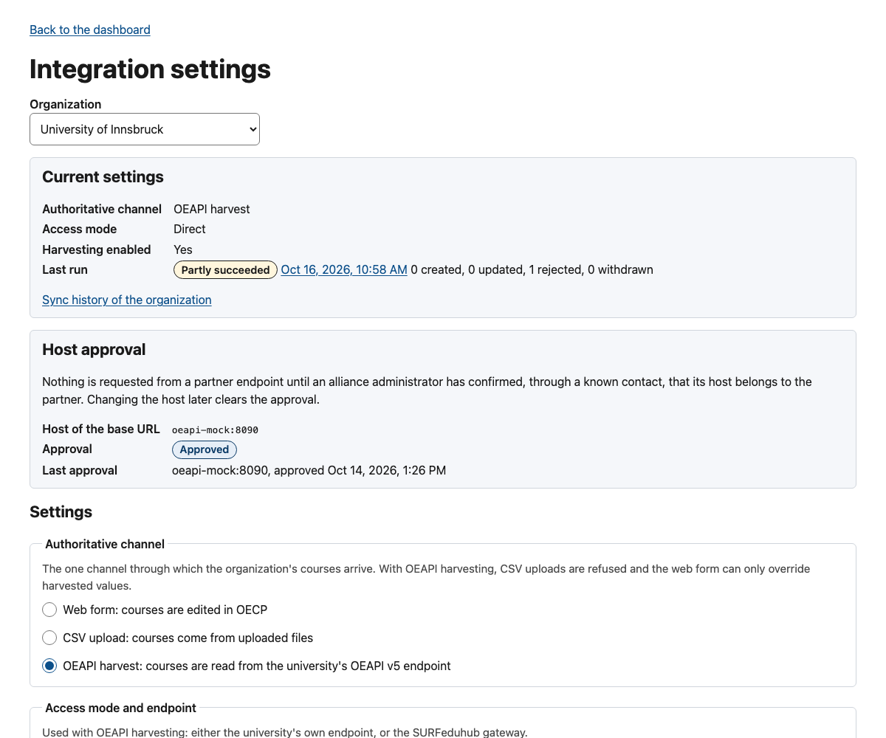
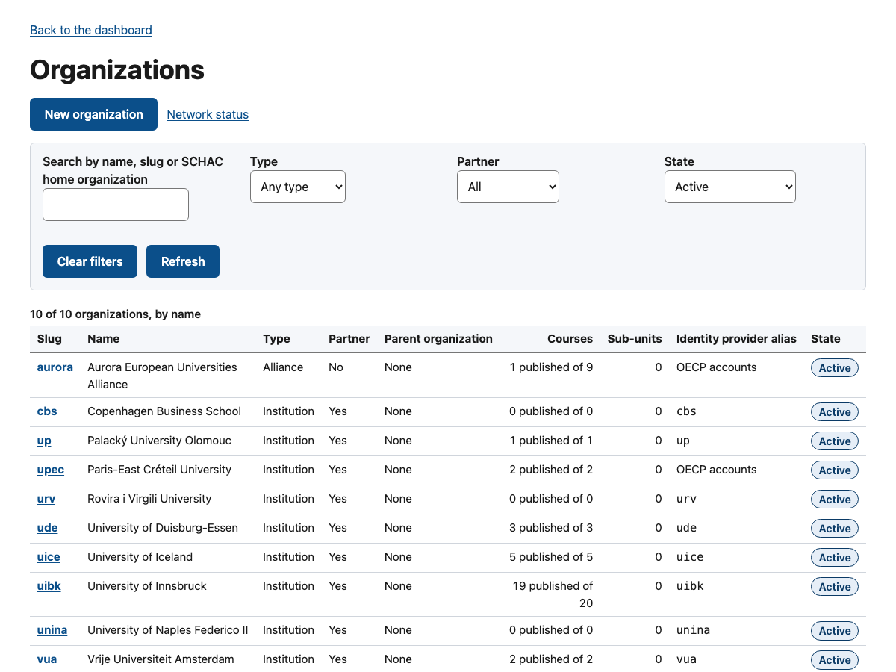
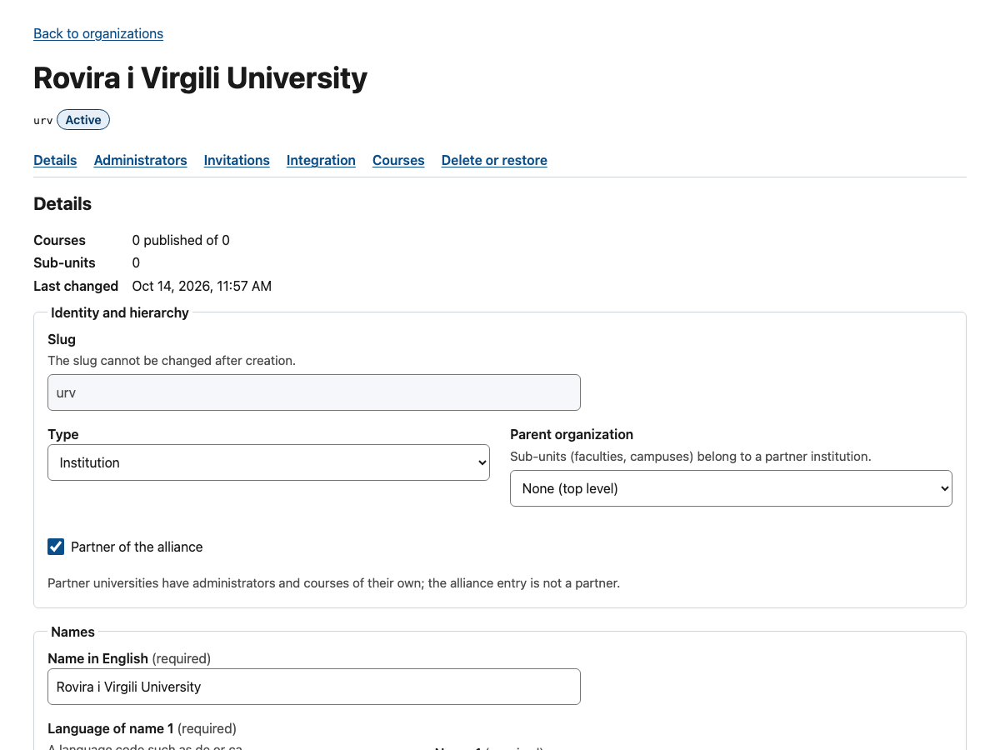
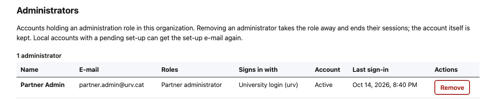
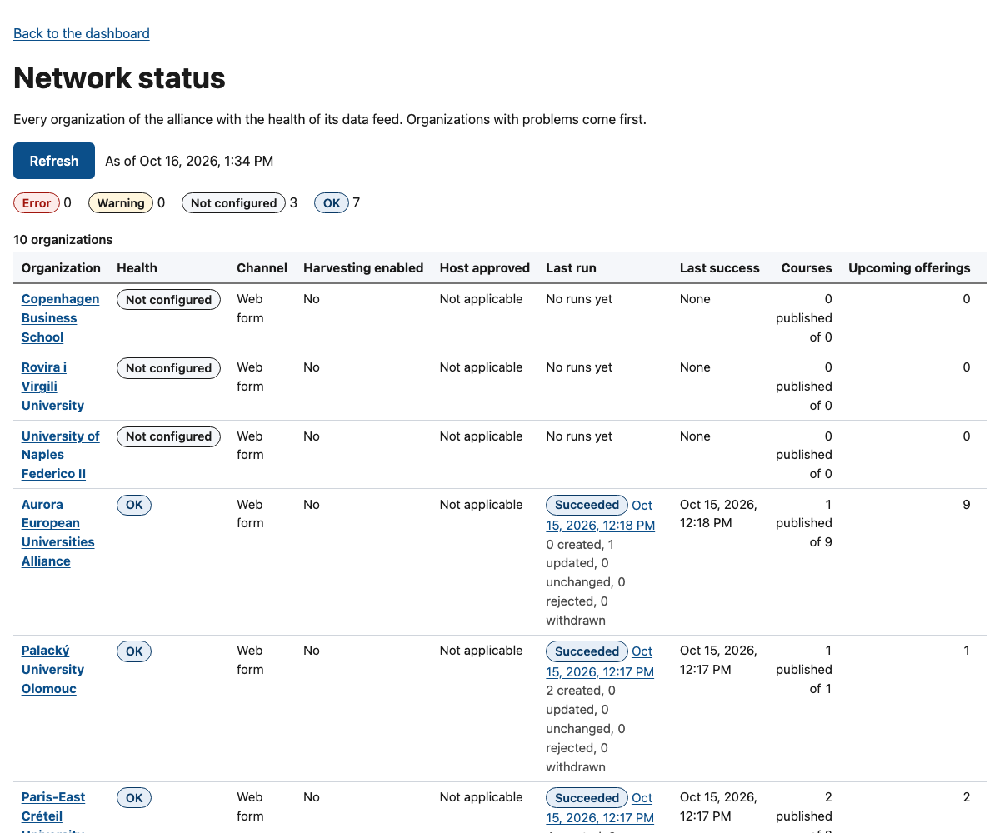
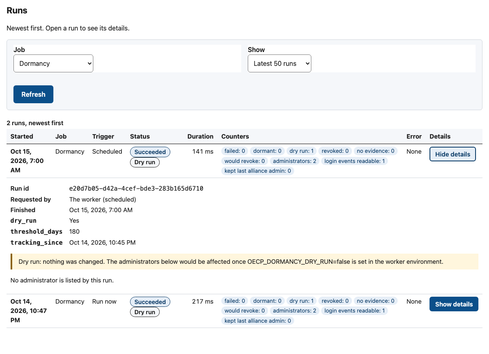

<!-- SPDX-FileCopyrightText: 2026 Lluís Alfons Ariño -->
<!-- SPDX-License-Identifier: EUPL-1.2 -->

# Alliance administrator manual

For you if you are an **alliance administrator** (`alliance_admin`) of an OACC deployment: in Aurora, a person of the alliance office who looks after every university's data, the organizations, the administrators and the routine checks. It walks through the screens of the administration panel as they are in **release 0.11**. Setting up the deployment itself (legal documents, server, identity, seed files) is [Guide A](../onboarding/alliance.md) and the hosting operator's [Guide E](../onboarding/hosting-operator.md); this manual covers the work at the keyboard afterwards.

You can do everything a partner administrator does, for every organization. Those screens are described once, in the [partner administrator manual](partner-admin.md); [Part 1](#part-1-the-organization-modules) below says what differs for you. Part 2 covers the screens only you see.

> **Before you start**
>
> - You hold an alliance administrator account: either the first one, created by the hosting operator ([Guide A, step 6](../onboarding/alliance.md#6-bootstrap-the-first-alliance-admin)), or invited by another alliance administrator.
> - You have an authenticator app for the one-time codes.
> - Your alliance has at least **two** alliance administrators, so it never depends on one person (a go-live requirement).

The screenshots come from the development stack: simulated data for the University of Innsbruck, the real courses of the Aurora Virtual Campus 2026–27, and development test accounts.

## Contents

- [Part 1: the organization modules](#part-1-the-organization-modules)
  - [1. Sign in and choose an organization](#1-sign-in-and-choose-an-organization)
  - [2. Courses, CSV and sync history for a partner](#2-courses-csv-and-sync-history-for-a-partner)
  - [3. Integration settings: approving a partner's host](#3-integration-settings-approving-a-partners-host)
- [Part 2: alliance administration](#part-2-alliance-administration)
  - [4. Organizations: the list and a new organization](#4-organizations-the-list-and-a-new-organization)
  - [5. An organization's page](#5-an-organizations-page)
  - [6. Sign-in mode: OACC accounts or the university's login](#6-sign-in-mode-oacc-accounts-or-the-universitys-login)
  - [7. Administrators: remove, resend set-up e-mail](#7-administrators-remove-resend-set-up-e-mail)
  - [8. Invitations: invite, resend, revoke](#8-invitations-invite-resend-revoke)
  - [9. Network status](#9-network-status)
  - [10. Maintenance: jobs and runs](#10-maintenance-jobs-and-runs)
  - [11. Reviewing the dormancy and account clean-up dry runs](#11-reviewing-the-dormancy-and-account-clean-up-dry-runs)
  - [12. Branding: what the office gives the operator](#12-branding-what-the-office-gives-the-operator)
  - [13. Routine and go-live](#13-routine-and-go-live)

## Part 1: the organization modules

### 1. Sign in and choose an organization

Sign in exactly as a partner administrator does ([partner manual, section 1](partner-admin.md#1-sign-in)): the alliance organization uses OACC accounts, so you choose **Sign in** and enter e-mail, password and the one-time code.

**What you see:** *Your account* (role *Alliance administrator*, *Signed in through* `local`), an **Organization** list, the organization modules (Courses, CSV upload, Sync history, Integration settings, Invitations) and, below, **Alliance administration**: *Network status*, *Organizations*, *Maintenance*.

**What to do:** choose the organization you want to work on. The choice is kept in the address (`?org=…`), so a bookmark or a link from another page opens the same organization; every module page has the same list at the top.

### 2. Courses, CSV and sync history for a partner

Everything in sections 3–10 and 12 of the [partner manual](partner-admin.md) applies, on the organization you chose:

- **Courses**, the wizard, images, offerings, status actions and completeness: [sections 3–8](partner-admin.md#3-your-courses-the-list). The alliance organization can publish courses of its own (for example the alliance-wide programmes).
- **CSV upload** on behalf of a partner: [section 9](partner-admin.md#9-csv-files-the-csv-upload-console). The rate limit (10 uploads per hour) counts per organization, yours included.
- **Sync history**: [section 10](partner-admin.md#10-sync-history-reading-what-happened). OACC sends no notification for data warnings, so look at the runs of each partner regularly, starting from the [network status](#9-network-status).
- **Overrides** on harvested courses: [section 12](partner-admin.md#12-harvested-courses-overrides). Use them for alliance attributes, course types, instructors and instructions; ask the partner to fix the rest at the source.

### 3. Integration settings: approving a partner's host

The page is the same as in the [partner manual, section 11](partner-admin.md#11-oeapi-harvesting-the-integration-settings-page), with one card that only you can act on.

**What you see:** the **Host approval** card with the host of the partner's base URL and *Waiting for approval*, *Approved*, and the last approval.

**What to do**

1. Before approving, confirm with the partner, through a contact you already trust (not the e-mail that asked you), that the host belongs to them.
2. Choose **Approve host …** and confirm. Nothing is requested from a partner endpoint before this.
3. A later change of host clears the approval; changing only the path keeps it.

Then the partner (or you) can use *Test connection* and *Sync now*. Walkthrough: [Guide B, steps 6–8](../onboarding/partner-with-oeapi.md#6-approve-the-host).

## Part 2: alliance administration

### 4. Organizations: the list and a new organization

**What you see:** **New organization**, a link to *Network status*, filters (search by name, slug or SCHAC home organization; type; partner; state *Active*, *Deleted* or both) and a table per organization: slug, name, type, partner, parent organization, courses (*published of total*), sub-units, **identity provider alias** (*OACC accounts* when there is none) and state.

**What to do: add an organization**

1. Choose **New organization**.
2. Fill in the **slug** (2 to 40 lower-case letters, digits or hyphens, for example `uibk`): it is the permanent key and **cannot be changed later**; partner logos are also named after it ([section 12](#12-branding-what-the-office-gives-the-operator)).
3. Choose the type (*Institution* for a university, *Alliance* for the alliance itself; *Faculty*, *Department*, *Campus* or *Other* for a sub-unit with a parent organization) and tick **Partner of the alliance** for member universities.
4. Enter the English name and, with *Add a name in another language*, the university's own names.
5. Under *Identifiers and login*: the **SCHAC home organization** (the university's domain, checked against the federation metadata), the **Identity provider alias** (leave it **empty** unless the university's login is already connected, [section 6](#6-sign-in-mode-oacc-accounts-or-the-universitys-login)), Erasmus code and PIC only with verified values, and the **External id** for OEAPI partners (the `primaryCode` of the endpoint's root organization; the harvester then refuses an endpoint that answers as another university).
6. Under *Settings and contact*: country code, default time zone (used for offering dates), languages, contact e-mail, website.
7. Choose **Create organization**.

For a first bulk load the hosting operator can instead run the seed file ([Guide A, step 4](../onboarding/alliance.md#4-seed-the-organizations)); the fields are the same.

**If something goes wrong:** *Another organization already uses this slug*; *The chosen parent organization is not allowed* (sub-units belong to a partner institution).

### 5. An organization's page

Choose a slug in the list.

**What you see:** the name, slug and state, and links to the page's sections:

| Section | What it holds |
|---|---|
| **Details** | Number of courses and sub-units, last change, and the same form as *New organization* (the slug is read-only); **Save changes** |
| **Administrators** | Who administers the organization ([section 7](#7-administrators-remove-resend-set-up-e-mail)) |
| **Invitations** | The invitation form and list for this organization ([section 8](#8-invitations-invite-resend-revoke)) |
| **Integration** | Links to its *Integration settings* and *Sync history* |
| **Courses** | A link to its course list |
| **Delete or restore** | **Delete organization** hides it (soft delete; it can be restored). The server refuses while the organization still has courses, sub-units, administrators, pending invitations or an enabled harvest, and lists them |

### 6. Sign-in mode: OACC accounts or the university's login

Each organization signs in **one** way, decided by its *Identity provider alias* [DL 22]. There is no mixed mode. Which mode suits a university, and both onboarding paths step by step: [sign-in paths](../onboarding/identity-paths.md).

| Identity provider alias | Mode | Its administrators |
|---|---|---|
| Empty (*OACC accounts* in the list) | Local | Receive a set-up e-mail from the login service, choose a password of at least 12 characters and enrol an authenticator app; sign in with **Sign in** |
| Set (normally the slug) | Federated | Sign in through their university (SAML, eduGAIN), then a one-time code; choose their university under **Sign in through your university** |

**What to do**

- Keep the alias **empty** until the university's identity provider has been connected in the login service and tested by the hosting operator. The *Sign in through your university* list on the sign-in page shows only the universities whose identity provider is enabled.
- **From local to federated:** the operator enables the identity provider in the realm first; then you set the alias here and **Save changes**; then **Remove** each old administrator on the *Administrators* panel ([section 7](#7-administrators-remove-resend-set-up-e-mail)); then ask the hosting operator to delete their old login accounts in the login service (Remove keeps them, with the person's e-mail address); only then invite the administrators again. If you invite before the old account is gone, the person's first sign-in through the university fails with "User with email … already exists"; once the account is deleted they can sign in again from the same invitation link.
- **Federated back to local** (for example while a university's login is broken): clear the alias, save, and invite the administrators again.

**If something goes wrong:** an alias that names an identity provider the login service does not have enabled blocks every invitation of that organization ([section 8](#8-invitations-invite-resend-revoke)). In 0.11 the federated path has been verified against the development test identity provider and, for the SIR2 hub, with one real test sign-in (2026-10-28); no university's own identity provider is connected yet. Procedure for the operator: [Guide A, step 3](../onboarding/alliance.md#3-identity).

### 7. Administrators: remove, resend set-up e-mail

**What you see:** one row per account holding a role in the organization: name, e-mail, role, **Signs in with** (*OACC account*, or *University login (alias)*), **Account** (*Active*, *Disabled*, or *Set-up pending: set a password, set up a one-time code app*), **Last sign-in** and the actions.

**What to do**

- **Remove** an administrator who left or should no longer have access, and confirm. The role is taken away and their sessions end at once (an access token already issued stays valid for up to 5 minutes). The login account is kept, and deleted 12 months later once the account clean-up is enabled ([section 11](#11-reviewing-the-dormancy-and-account-clean-up-dry-runs)).
- **Resend set-up e-mail** appears only for an OACC account whose set-up is still pending (*Set-up pending*). The login service sends a new link to set the password and the second factor.
- Once a year, review every organization's panel with the partner's office and remove those who should not be there: recertification is manual in 0.11 ([administrator lifecycle](../onboarding/administrator-lifecycle.md#the-choices)).

**If something goes wrong**

- *You cannot remove yourself: ask another alliance administrator.*
- *The last alliance administrator cannot be removed: invite another one first.*
- Someone with a finished set-up lost their authenticator app or password: the panel offers no reset. The hosting operator resets the account's credentials in the login service's console (*Users* > the user > *Credentials*), as for the first alliance administrator in [Guide A, step 6](../onboarding/alliance.md#6-bootstrap-the-first-alliance-admin).

### 8. Invitations: invite, resend, revoke

Open **Invitations** from the dashboard (with the organization chosen) or the *Invitations* section of an organization's page; both work the same way.

**What to do: invite an administrator**

1. Choose the organization.
2. Under *Invite an administrator*, enter the **e-mail address** the person signs in with (for a federated organization: the address their university's login sends), choose the **role** (*Partner administrator*; *Alliance administrator* for a colleague of the alliance office, on the alliance organization) and how long the **link is valid** (7 days, 3 days or 1 day).
3. Choose **Send invitation**. OACC e-mails the personal link; for an organization with OACC accounts, the login service also sends the set-up e-mail.

One person administers one organization. Agree with each partner which onboarding guide applies (B, C or D).

**The list** shows each invitation with its status: *Pending*, *Accepted*, *Expired* or *Revoked*.

- **Revoke** stops a pending link at once.
- **Resend** replaces a lost, expired or revoked link with a new one; the old link stops working.
- **Refresh the list** reloads it.

**When the organization's identity provider is not enabled**

**What you see:** above the form, *This organization's identity provider "…" is not enabled in the login service, so its administrators cannot sign in. Invitations will be refused until the identity provider is enabled or the organization's identity provider alias is cleared.*

**What to do:** either ask the hosting operator to enable that identity provider, or follow **Open the organization's settings**, clear the *Identity provider alias* and save, so its administrators get OACC accounts. If you send anyway, OACC refuses: *The invitation was not sent: the organization's identity provider is not enabled in the login service …* (`oecp.invitation.idp_not_enabled`).

**If something goes wrong**

| Message | What to do |
|---|---|
| *The e-mail could not be sent, so nothing was saved.* | Try again later; if it persists, the operator checks the mail relay |
| *The login service did not answer.* | Try again in a few minutes |
| *The login service reported a conflict with an existing account.* | The address already has an account in the login service that OACC cannot reuse; the operator resolves it in the login service's console |
| The invitee reports *This invitation was issued for another account* | They signed in with another address or in the wrong mode: they sign out and sign in with the invited address |

### 9. Network status

**What you see:** counters (*Error*, *Warning*, *Not configured*, *OK*) and one row per organization, **problems first**: health, channel, whether harvesting is enabled, whether the host is approved, the last run with its counters, the last success, courses (*published of total*), upcoming offerings, administrators, pending invitations and a link to the sync history (the last columns are to the right of the screenshot). **Refresh** reloads it; *As of* gives the time.

**What to do:** check it once a week.

- *Error* or *Warning*: open the organization's **Sync history** and the latest run ([partner manual, section 10](partner-admin.md#10-sync-history-reading-what-happened)), and agree a fix with the partner.
- *Not configured*: no channel has delivered anything yet; usually a partner still onboarding.
- **0 administrators** or old pending invitations: follow up with the partner.
- Watch the completeness warnings per partner before the alliance switches the publication rule to *enforce* ([Guide A, step 9](../onboarding/alliance.md#9-operate)).

### 10. Maintenance: jobs and runs

The worker runs six maintenance jobs every day. Open **Maintenance** from the dashboard.

**What you see**

- **Dry run:** whether *Dormancy* and *Account clean-up* still only report, read from their latest run, and the setting the hosting operator changes to enable each.
- **Jobs:** one card per job with what it does, its schedule (UTC), its latest run and **Run now**:

| Job | Schedule (UTC) | What it does |
|---|---|---|
| History partitions | 00:10 and at every worker start | Prepares the storage of harvested payloads and drops expired months |
| IdP metadata refresh | 04:15 and shortly after the worker starts | Refreshes partner identity providers' certificates from the federation |
| CSV upload retention | 04:30 | Deletes uploaded CSV files after 90 days |
| Retention | 04:45 | Deletes expired run errors, runs, audit entries, settled invitations and maintenance runs |
| Dormancy | 05:00 | Revokes administrators inactive for 180 days (dry run by default) |
| Account clean-up | 05:15 | Deletes login accounts of former administrators 12 months after their removal (dry run by default) |

- **Runs:** newest first, filtered by *Job* and *Show* (the latest 50 or 200): start, job, trigger (*Scheduled*, *Worker start*, *Run now*), status (*Succeeded*, *Failed*, *Skipped (already running)*, *Running*; a *Dry run* badge for jobs that only reported), duration, counters, error, and **Show details**.

**What to do**

- Once a week, check that the latest run of every job *Succeeded*.
- **Run now** queues one run, for example after the operator fixed a failing job. It appears in the runs once the worker starts it; if a run of that job is already waiting or running, the page says so and adds none. Every request is audited.
- **Show details** opens a run: who requested it, when it finished, the full error and everything the job recorded.

**If something goes wrong:** a *Failed* run, or a job with no recent run, goes to the hosting operator with the run's details; with alerting enabled the operator is notified too. Background: [Guide A, step 9, Maintenance jobs](../onboarding/alliance.md#9-operate).

### 11. Reviewing the dormancy and account clean-up dry runs

Both jobs remove access, so they run in **dry run** until the alliance decides otherwise; during the Aurora pilot the alliance reviews them quarterly [DL 26]. Choices and defaults: [administrator lifecycle](../onboarding/administrator-lifecycle.md).

**What to do: dormancy**

1. Under *Runs*, set *Job* to **Dormancy**.
2. Choose **Show details** on the latest run.
3. Read the notice (*Dry run: nothing was changed …*) and the table of administrators who would be affected: account (`sub`), roles, organization, last activity, days inactive and the action (*Would be revoked*, or *Kept: last alliance administrator*). The counter *would revoke* gives their number.
4. Match each `sub` on the organization's *Administrators* panel and check with the partner whether the person still needs access. Someone who does only needs to sign in.
5. When the alliance agrees with the result, the hosting operator sets `OECP_DORMANCY_DRY_RUN=false` and recreates the worker. From then on dormant administrators lose their role and sessions, as with **Remove**; the last alliance administrator is always kept.

**What to do: account clean-up.** The same with *Job* set to **Account clean-up**: the table lists the accounts it would delete (*Would be deleted*, with when and how their roles were removed), and the details list the accounts kept with the reason. The switch is `OECP_ACCOUNT_CLEANUP_DRY_RUN=false`. Accounts removed directly in the login service's console leave no trace in OACC and are never acted on.

The first dormant administrators can appear 180 days after the upgrade that introduced the job at the earliest, so early runs list nobody (as in the screenshot).

### 12. Branding: what the office gives the operator

The portal shows the alliance's own pictures, which the alliance (and each partner, for its logo) holds the rights to. They are not uploaded in the panel: the office delivers the files to the hosting operator, who places them in the server's branding directory and sets the variables. Nothing of this goes into the code repository.

| Picture | What the office provides | Variable set by the operator |
|---|---|---|
| Home page header | A photograph or illustration, 3:1 (about 1800 × 600), under 400 KB, and whether it is decorative or needs a description | `OECP_HERO_IMAGE`, `OECP_HERO_IMAGE_ALT` |
| Course list header (optional) | A second image, 12:5 (about 1800 × 750) | `OECP_HERO_IMAGE_COURSES`, `…_ALT` |
| Site logo | SVG, or PNG with a transparent background, about 4:1; its text alternative is the alliance name | `OECP_LOGO_IMAGE` |
| Partner logos | One per university, named `partner-<slug>.svg` (or `.png`, `.webp`) after the organization's slug, about 4:1 to 1:1, under 50 KB | None: a new logo shows within a minute |
| Favicon (optional) | A square SVG (or PNG, ICO) | `OECP_FAVICON_IMAGE` |

Clear the rights first (for Aurora: the alliance's own images and the Aurora logo with the Foundation's permission [DL 25]), use lower-case file names, and give a changed picture a new file name (browsers keep the old one for up to a day). Exact rules: [branding README](../../deploy/compose/branding/README.md). How the result looks: [public home page](../images/public-home.png).

### 13. Routine and go-live

**Weekly**

- [ ] [Network status](#9-network-status): no *Error* or *Warning* left unexplained; open the sync history of every partner with warnings.
- [ ] [Maintenance](#10-maintenance-jobs-and-runs): the latest run of every job *Succeeded*.
- [ ] [Invitations](#8-invitations-invite-resend-revoke): pending invitations followed up, expired ones resent or dropped.

**Quarterly** (Aurora pilot): review the dormancy and account clean-up dry runs ([section 11](#11-reviewing-the-dormancy-and-account-clean-up-dry-runs)).

**Yearly:** review every organization's *Administrators* panel with the partners ([section 7](#7-administrators-remove-resend-set-up-e-mail)).

**Before the portal opens to the public**, work through the [go-live checklist of Guide A](../onboarding/alliance.md#go-live-checklist) with the hosting operator: among other items, at least two alliance administrators, every partner with an accepted administrator and a chosen channel and sign-in mode, the dormancy and clean-up dry runs reviewed and decided, and the publication rule decided.
