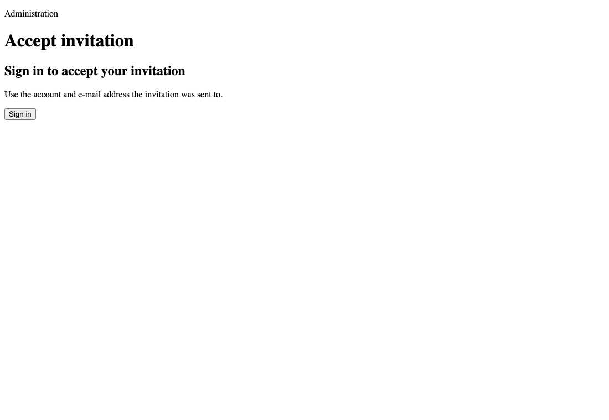
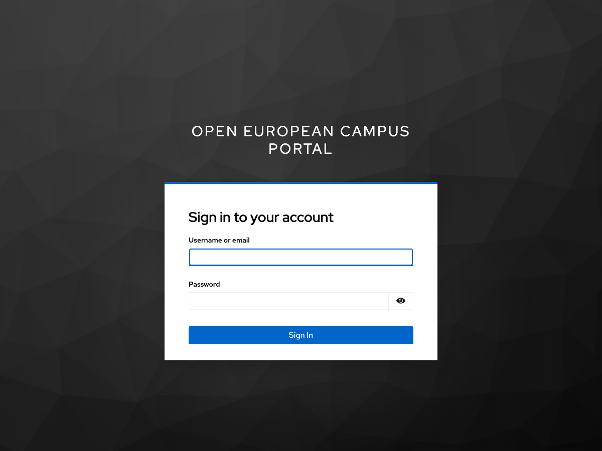
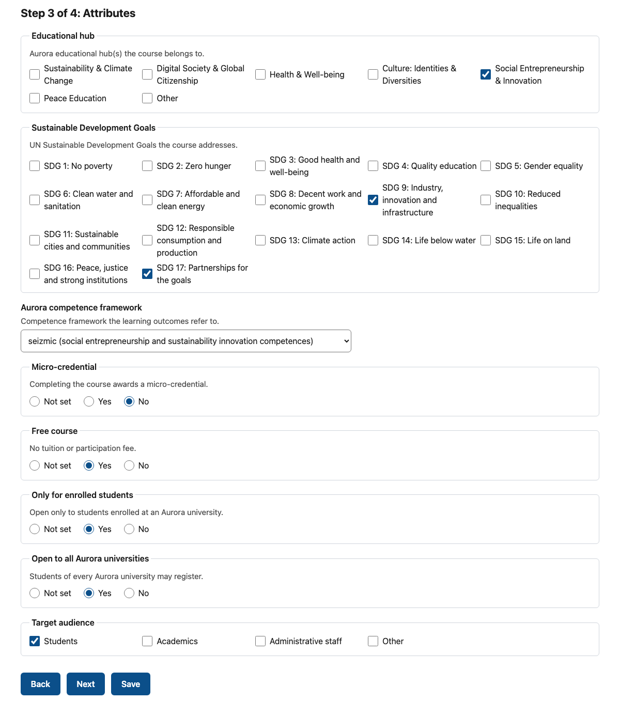
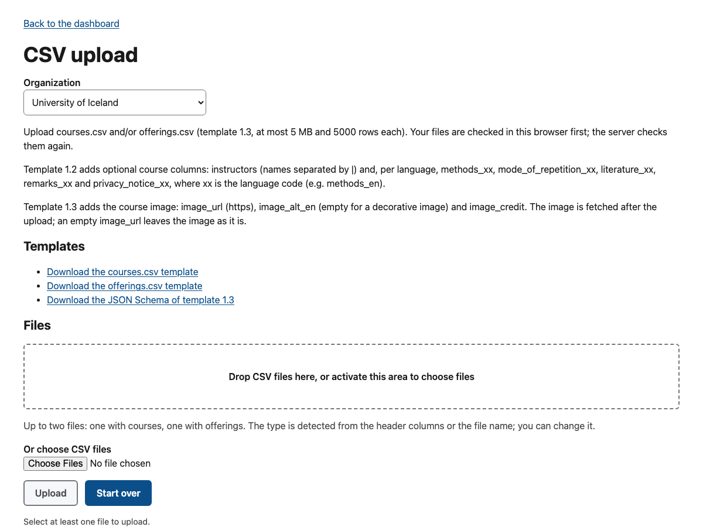
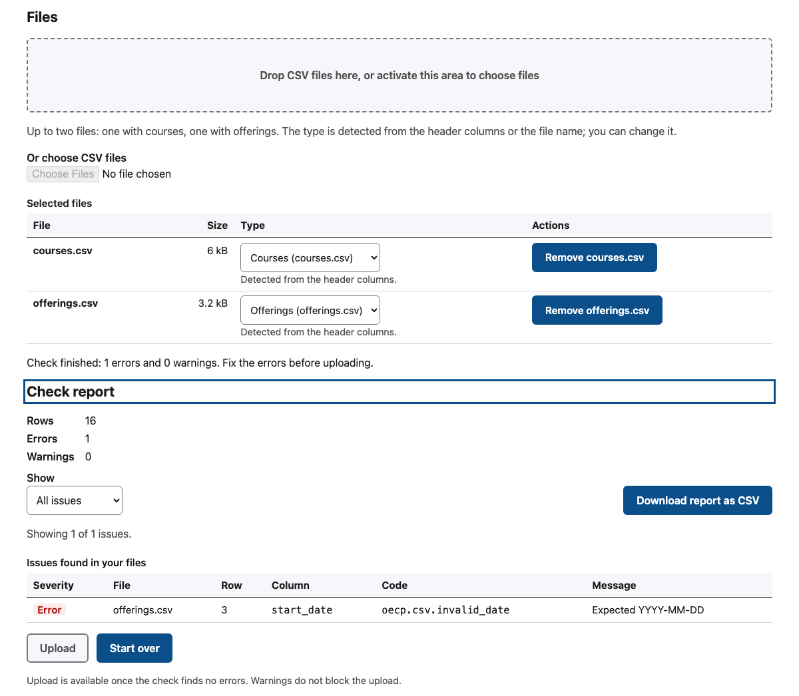
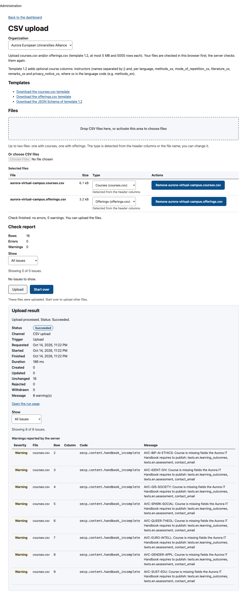
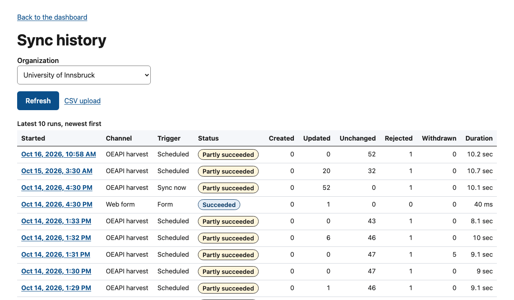
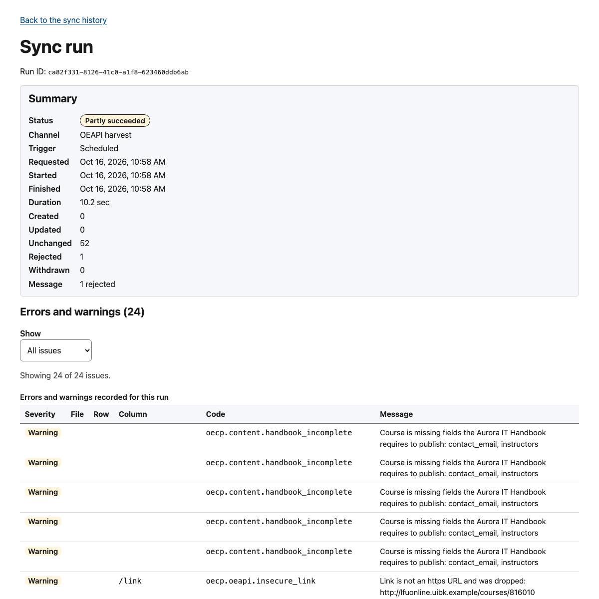
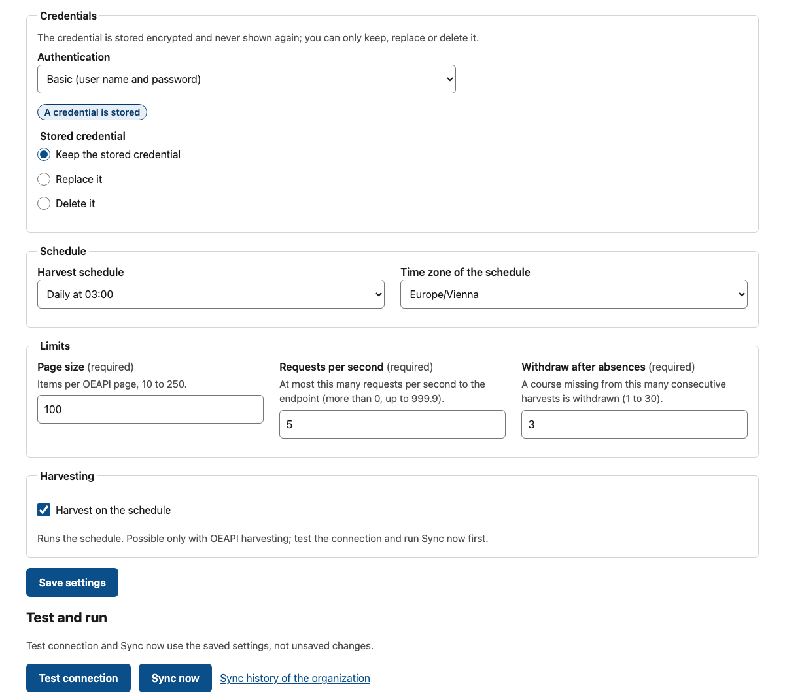

<!-- SPDX-FileCopyrightText: 2026 Lluís Alfons Ariño -->
<!-- SPDX-License-Identifier: EUPL-1.2 -->

# Partner administrator manual

For you if you are a **partner administrator** (`partner_admin`): the person who keeps one university's courses current in the alliance catalogue. It walks through the screens of the administration panel as they are in **release 0.9.0**, in the order you meet them. Why things work this way, and every field rule and error code, are in the onboarding guides and the data-provider guides; this manual links to them instead of repeating them.

Alliance administrators have their own manual, [alliance-admin.md](alliance-admin.md), which builds on this one.

> **Before you start**
>
> - You have received an invitation e-mail from OECP. Without it you cannot get in: nobody signs up on their own.
> - You have an authenticator app (on your phone, for example) for the one-time codes.
> - You know which channel your university uses for its courses: the web form, CSV files, or an OEAPI endpoint harvested by OECP. If you do not, ask your alliance office ([which guide applies](../onboarding/README.md#which-guide-should-i-read)).

The screenshots come from the development stack with simulated data (University of Innsbruck) and the real courses of the Aurora Virtual Campus 2026–27; some were taken signed in as an alliance administrator, so they show an *Organization* list that you see as a fixed name.

## Contents

1. [Sign in](#1-sign-in)
2. [The dashboard](#2-the-dashboard)
3. [Your courses: the list](#3-your-courses-the-list)
4. [Web form: create or edit a course](#4-web-form-create-or-edit-a-course)
5. [Web form: the course image](#5-web-form-the-course-image)
6. [Web form: offerings](#6-web-form-offerings)
7. [Publish, withdraw and delete](#7-publish-withdraw-and-delete)
8. [Completeness: the Aurora publication rule](#8-completeness-the-aurora-publication-rule)
9. [CSV files: the CSV upload console](#9-csv-files-the-csv-upload-console)
10. [Sync history: reading what happened](#10-sync-history-reading-what-happened)
11. [OEAPI harvesting: the Integration settings page](#11-oeapi-harvesting-the-integration-settings-page)
12. [Harvested courses: overrides](#12-harvested-courses-overrides)
13. [Your account: what OECP keeps and when access ends](#13-your-account-what-oecp-keeps-and-when-access-ends)
14. [Who to ask](#14-who-to-ask)

## 1. Sign in

Your organization signs in in **one** of two ways, decided by the alliance [DL 22]:

- **OECP account** (local): an e-mail address, a password of at least 12 characters and a one-time code from your authenticator app. This is the mode of every university whose identity provider is not connected to OECP yet.
- **Through your university**: your usual university login (through eduGAIN), followed by a one-time code from your authenticator app.

### The first time: accept your invitation

1. **OECP account only:** open the e-mail from the login service (it arrives next to the invitation), set a password of at least 12 characters and scan the QR code with your authenticator app. Through your university there is no such e-mail.
2. Open the link in the OECP invitation e-mail. It is personal, works only for the e-mail address it was sent to and expires after 7 days (or the shorter validity the alliance chose).
3. **What you see:** *Accept invitation*, with *Sign in to accept your invitation* (or *Sign in through your university*).

   

4. **What to do:** choose the sign-in button and sign in with the account of the invited e-mail address (password and code, or your university login). Through your university, the first sign-in asks you to set up your authenticator app: scan the QR code and enter the code it shows.
5. The page shows *Invitation accepted*, your role and your organization, and says *Your new role takes effect the next time you sign in*. Choose **Sign out and sign in again**.

   

**If something goes wrong**

| Message | What it means | What to do |
|---|---|---|
| *This invitation has expired.* | The link is older than its validity | Ask the alliance office to resend it; the new link replaces the old one |
| *This invitation is not valid: it does not exist, was revoked or was already accepted.* | Revoked, replaced by a resend, or used | Use the newest e-mail, or ask for a new invitation |
| *This invitation was issued for another account.* | You signed in with another address, or in the wrong mode (OECP account instead of your university, or the reverse) | Sign out, then sign in with the invited address in your organization's mode |
| The login service's set-up link expired | The password and code set-up was not finished in time | Ask the alliance office to use *Resend set-up e-mail* |

### Every other time

1. Open `https://<portal>/en/admin`.

   

2. **OECP account:** choose **Sign in**. The login page asks for your e-mail address and password, then, on a second page, for the one-time code from your app.

   

3. **Through your university:** under *Sign in through your university*, choose your university and **Continue to your university**; sign in there, then enter the one-time code.
4. You land on the dashboard ([section 2](#2-the-dashboard)).

**Staying signed in.** The panel keeps you signed in while you work: a page reload restores your session without asking again as long as your login session is alive (30 minutes without activity, 8 hours at most). After that the page says *Your session has expired. Sign in again.* **Unsaved changes are lost** on a reload or an expired session, so save as you go. Choose **Sign out** on the dashboard when you finish.

**If something goes wrong:** *Your account has no administration role* means your role was removed (by the alliance, or after a long inactivity, [section 13](#13-your-account-what-oecp-keeps-and-when-access-ends)), or you have not signed in again after accepting the invitation. Lost your authenticator app or password? There is no self-service reset: ask the alliance office ([section 14](#14-who-to-ask)).

## 2. The dashboard

**What you see**

- **Your account:** your e-mail address, your role (*Partner administrator*), *Organization* (the internal identifier of your university) and *Signed in through* (`local` for an OECP account, or the alias of your university's login).
- **Modules** for your organization (its name is fixed for you; alliance administrators get a list to choose from):

| Module | What you do there | Section |
|---|---|---|
| **Courses** | Create and edit courses and offerings step by step, or override harvested values | [3](#3-your-courses-the-list)–[8](#8-completeness-the-aurora-publication-rule), [12](#12-harvested-courses-overrides) |
| **CSV upload** | Download the templates, check your files in the browser and upload them | [9](#9-csv-files-the-csv-upload-console) |
| **Sync history** | Every upload, form save and harvest, with counters, errors and warnings | [10](#10-sync-history-reading-what-happened) |
| **Integration settings** | The authoritative channel and the OEAPI harvesting of your university | [11](#11-oeapi-harvesting-the-integration-settings-page) |
| **Invitations** | The invitations sent to your organization's administrators (view only: the alliance office sends, revokes and resends them) | [14](#14-who-to-ask) |

The *Alliance administration* tiles (network status, organizations, maintenance) appear only for alliance administrators.

## 3. Your courses: the list

**What you see:** **New course**, filters (*Search* by code or title, *Status*, *Type of course*, *Source*), and a table of every course of your organization in any status, 25 per page: code, title, type, status, source (*Web form*, *CSV upload* or *OEAPI harvest*), ECTS, levels, number of offerings, last update, whether overrides exist, and **Completeness** (a tick, or a badge such as *2 missing*, [section 8](#8-completeness-the-aurora-publication-rule)).

**What to do**

1. Tick filters and choose **Apply filters**; **Clear filters** shows everything again.
2. Choose a course code to open the course page; **New course** opens the wizard ([section 4](#4-web-form-create-or-edit-a-course)).

*New course* is missing when your university is harvested through OEAPI: then the courses come from your endpoint and you can only override them ([section 12](#12-harvested-courses-overrides)).

## 4. Web form: create or edit a course

The wizard has four steps: **Basics**, **Texts**, **Attributes**, **Review and status**. Field-by-field rules: [web form guide, The course wizard](../guides/web-form.md#the-course-wizard).

**What to do: a new course**

1. Open **Courses** > **New course**.
2. **Step 1, Basics.** Fill in the course code (your own code, for example `MATH-101`; **it cannot be changed later**), the type of course, the levels (the first ticked is the primary one), ECTS (with a dot: `7.5`), teaching hours, one to ten ISCED-F codes with one marked *Primary* (the broad field is shown under the code), the teaching unit, the information page (`https://` only), the instructors (one name per line, as your university already publishes them) and a functional contact e-mail. Choose **Next**: the step is checked before you move on.

   

3. **Step 2, Texts.** English is required: title, abstract (the first 300 characters appear on course cards), description, learning outcomes, prerequisites, assessment and keywords. *More texts (optional)* holds methods, mode of repetition, literature, remarks and a privacy notice. *Add a language* adds a tab for another language, which needs at least its own title. OECP never translates.
4. **Step 3, Attributes.** Your alliance's own tags and filters, for example the educational hub, the Sustainable Development Goals, the competence framework and yes/no flags. Yes/no attributes have three choices: *Not set* (left out), *Yes* or *No*.

   

5. **Step 4, Review and status.** Check the summary, choose **Draft** (not shown in the catalogue) or **Published** (needs the English title), and choose **Create course**. The *Image* card appears only after the course exists ([section 5](#5-web-form-the-course-image)).
6. Add at least one offering ([section 6](#6-web-form-offerings)): a course is listed in the catalogue only once it is published **and** has a published offering that has not ended.

**What to do: an existing course.** Open it from the list. The steps can be opened in any order and **Save** works from any step; a save replaces the whole record with what the form shows.

**If something goes wrong:** errors are listed in a summary at the top of the step and next to each field. *Another record of this organization already uses this code* means the course code exists: choose another one, or open the existing course. A save is never refused for missing catalogue fields; those are reported as completeness warnings ([section 8](#8-completeness-the-aurora-publication-rule)).

## 5. Web form: the course image

One image per course, shown on the course card and above *About this course* on the public course page; without one the portal shows the partner logo line. Details: [web form guide, Course image](../guides/web-form.md#course-image).

**What you see:** in step 4, *Review and status*, the **Image** card shows the current image (if any) with its alternative text, credit, size, source (an uploaded file, or the address a CSV `image_url` was fetched from) and date, and a form below it.

**What to do**

1. Save a new course first: the card only appears once the course exists.
2. Choose an **Image file**: JPEG, PNG or WebP, at most 5 MB; a landscape image at least 1600 pixels wide works best, because cards crop it to 16:9.
3. Write the **Alternative text (English)**: what the image shows, for people who cannot see it (at most 300 characters). Tick **Decorative image** only when the image adds no information.
4. Optionally add a **Credit** (author and licence, for example *Photo: URV / A. Example, CC BY 4.0*).
5. Choose **Upload image** (or **Replace image**). **Save text** changes only the alternative text, the decorative flag and the credit; **Remove image** deletes the image after a confirmation.

These buttons act **at once**: they do not wait for the wizard's **Save**, and they keep what you typed but did not save in the other steps.

**If something goes wrong:** the browser refuses a file of another type or above 5 MB before sending it; the server refuses unreadable images or images above 40 megapixels, and an upload without alternative text unless it is marked decorative. Upload only images your university may publish for this purpose, with no identifiable people: your university declares the rights.

## 6. Web form: offerings

An offering is one edition of a course (for example the 2027 spring semester). Fields and date rules: [web form guide, Offerings](../guides/web-form.md#offerings).

**What to do**

1. On the course page, under *Offerings*, choose **Add offering** (or a code in the list to edit an offering).
2. **Offering:** a code (for example `2027S`; unique within the course and **not changeable later**) and the academic session.
3. **Dates:** start and end date, application period start and application deadline (inclusive), all in the offering's time zone (your organization's by default).
4. **Teaching:** at least one teaching language and one delivery mode; the campus if useful.
5. **Seats:** maximum students (empty means no limit), seats reserved for the alliance, and seats available now; the portal shows the date of that last figure, so an old number looks old.
6. **How to apply:** an application page (`https://`) and/or instructions per language, for example *Nomination by the Aurora office of your home university*.
7. Choose **Draft** or **Published** and **Save offering**.

For next year's edition, add a **new offering** with a new code instead of overwriting last year's.

**If something goes wrong:** date errors name the rule (end on or after start, deadline on or before the end, application start on or before the deadline); seat figures cannot exceed the maximum.

## 7. Publish, withdraw and delete

**What you see:** at the top of every course and offering page, *Summary and status* with the current status and the actions available from it. Each action asks for confirmation.

| Status | Actions offered | In the public catalogue |
|---|---|---|
| Draft | Publish, Cancel | Hidden |
| Published | Withdraw, Cancel, Back to draft | Listed (a course needs a published offering that has not ended) |
| Withdrawn | Publish, Back to draft | Hidden, offerings included |
| Cancelled | Publish, Back to draft | An offering stays visible with a *cancelled* badge until its start date |

**What to do**

- To take a course down, choose **Withdraw**. For an offering that will not take place, choose **Cancel**: students then see it is cancelled.
- **Delete** only records created by mistake. Published records, courses with published offerings and harvested records cannot be deleted; the page says why in place of the button (for example *A published record cannot be deleted. Withdraw or cancel it first.*). A deleted code comes back if you create it again or upload a CSV row with it.
- The course page ends with **History**: the latest changes of the course and its offerings, who made them and what changed.

Full table: [web form guide, Status actions](../guides/web-form.md#status-actions).

## 8. Completeness: the Aurora publication rule

The Aurora IT Handbook shows a course only when every obligatory field is filled: English title, description, learning outcomes, prerequisites and assessment; ECTS; a level; a contact; at least one instructor; and at least one **published** offering with start and end dates, application period start, application deadline, a teaching language and a delivery mode.

**What you see**

- In the course list, the **Completeness** column: a tick, or *N missing*.
- In step 4 of the wizard, the **Completeness** card: *Complete*, or the list of missing fields (screenshot in [section 5](#5-web-form-the-course-image)), based on the last saved version.
- After a CSV upload or a harvest, the warning `oecp.content.handbook_incomplete` with the missing fields, in the result and in the sync history.

**What it does.** The alliance chooses the mode. During the transition (*warn*, the default) an incomplete course is published and only flagged. Once the alliance switches to *enforce*, an incomplete course you publish is kept as a **draft** until it is complete, and emptying an obligatory field takes it back to draft. The card says which applies: *When the publication rule is enforced, incomplete courses are kept as drafts; until then they are only flagged.* A save is never refused because of this rule.

**What to do:** fill in what the card lists. Instructors are the usual gap. Details: [web form guide, Publication rule](../guides/web-form.md#publication-rule-completeness), [CSV guide, Publication rule](../guides/csv-authoring.md#publication-rule-handbook-completeness).

## 9. CSV files: the CSV upload console

CSV files and the web form write the same records, matched by course and offering code, so you can mix them. Every column and code: [CSV authoring guide](../guides/csv-authoring.md); first-time walkthrough: [Guide D, step 3](../onboarding/partner-manual.md#3-upload-csv-files).

**What to do**

1. Open **CSV upload**.
2. Under *Templates*, download the `courses.csv` and `offerings.csv` templates (template **1.3**) and, if your IT team wants it, the JSON Schema of template 1.3. Always download them from your own portal: the courses template has one `attr_<key>` column per alliance attribute.
3. Fill one row per course and per offering in a spreadsheet, keep the header row as it is, and save as **CSV UTF-8** with dates as text (`YYYY-MM-DD`). Several values in one cell are separated with `|`.
4. Drop both files on the drop area (or **Or choose CSV files**). The page detects which file is which from its header; correct the *Type* if needed.
5. Read the **check report**: the files are checked in your browser before anything is sent, course codes and sub-unit codes against your organization's catalogue included.

   

   Each issue shows severity, file, row, column, code and message; *Show* filters errors or warnings and **Download report as CSV** saves the list. Fix every **error** in your spreadsheet and drop the files again (**Start over** clears the page). **Warnings** do not block.
6. Choose **Upload**. It stays disabled until the check finds no errors.

**Reading the result**

- *Upload processed. Status: …* with any server warnings: done. Typical warning: `oecp.content.handbook_incomplete` ([section 8](#8-completeness-the-aurora-publication-rule)).
- *The upload is queued for processing* (more than 500 rows): the page follows its progress until *Processing finished*.
- *The server rejected the upload: N errors and M warnings. Nothing was saved.* An upload is **all or nothing**. The server checks everything again against the catalogue, so it can find what the browser could not (for example when the page said the lists of your organization could not be loaded).
- A course image given as `image_url` is fetched after the upload; a failed fetch is added to the upload's run as a warning `oecp.media.fetch_failed`, visible in the sync history.

**If something goes wrong**

| Problem | Fix |
|---|---|
| `oecp.csv.invalid_date` | The spreadsheet reformatted a date: format the column as text, `YYYY-MM-DD` |
| `oecp.csv.encoding` or broken accents | Save as CSV UTF-8 |
| `oecp.csv.invalid_template_version` | Write `1.3` in `template_version` when you use the 1.3 image columns |
| *This organization is harvested through OEAPI, so CSV uploads are disabled.* | Your channel is OEAPI: change data at the source, or use overrides ([section 12](#12-harvested-courses-overrides)) |
| *The upload limit of 10 uploads per hour …* | Wait; the message says when to try again |
| A file is larger than 5 MB, or above 5,000 rows | Split it |

Remember: **leaving a course out of a file never withdraws it** (upload its row with `status` `withdrawn`), and an **empty cell clears** the field (delete the column to leave a field untouched). More: [Guide D, Common mistakes](../onboarding/partner-manual.md#6-common-mistakes).

## 10. Sync history: reading what happened

Every CSV upload, every form save and every harvest is a **run**.

**What you see:** the latest runs, newest first: start time, channel (*OEAPI harvest*, *CSV upload*, *Web form*), trigger (*Scheduled*, *Sync now*, *Upload*, *Form*), status and counters (created, updated, unchanged, rejected, withdrawn), duration. **Refresh** reloads the list.

| Status | Meaning |
|---|---|
| *Succeeded* | Everything accepted |
| *Partly succeeded* | Harvests only: some courses or offerings were rejected, or the run was incomplete |
| *Failed* | Nothing was written (a CSV upload with any error, or a harvest that could not start) |
| *Queued*, *Running* | Waiting for, or being processed by, the worker |
| *Cancelled* | A queued run that could not start |

**What to do:** choose the start time of a run to open it.

The run page shows the summary and **Errors and warnings**, filterable with *Show*. For CSV runs, *File*, *Row* and *Column* point to the cell; for harvests, *Column* holds a JSON Pointer into your endpoint's data (for example `/teachingLanguage`). Errors reject a record (or the whole upload); warnings only report what OECP adjusted or what the catalogue still misses. Code tables: [CSV codes](../guides/csv-authoring.md#codes), [harvester codes](../guides/api-integration.md#warning-and-rejection-codes).

## 11. OEAPI harvesting: the Integration settings page

For universities with an OEAPI v5 endpoint. The first set-up with your IT team is [Guide B, steps 5–8](../onboarding/partner-with-oeapi.md#5-enter-the-integration-settings); the technical reference is the [API integration guide](../guides/api-integration.md).

**What you see**

- **Current settings:** authoritative channel, access mode, whether harvesting is enabled, and the last run with its counters and a link to the sync history.
- **Host approval:** the host of your base URL and whether an alliance administrator has approved it. Until then the page says *Ask an alliance administrator to approve this host; harvesting and connection tests start after the approval.* Changing the host later clears the approval.
- **Settings:** the authoritative channel (*Web form*, *CSV upload* or *OEAPI harvest*), access mode and endpoint (base URL, consumer profile), credentials, schedule, limits and *Harvest on the schedule*.
- **Test and run:** **Test connection** and **Sync now**.

**What to do**

1. Fill in the settings and choose **Save settings**. The form checks every field first. The credential is stored encrypted and never shown again: the page only says *A credential is stored*, and you choose *Keep the stored credential*, *Replace it* or *Delete it*.
2. Once the host is approved, choose **Test connection**. It uses the **saved** settings, so save first. *The connection works* shows the service contact, the number of courses if your endpoint reports it and the first course code; *The connection failed* shows the error, the HTTP status and a hint; *The connection cannot be tested yet* means a setting is missing or the host is not approved.
3. Choose **Sync now** for a first harvest, then **Follow the run** (or open the sync history). *Sync now* needs *OEAPI harvest* as the saved channel and an approved host, and runs at most once every 15 minutes.
4. When the result is right, tick **Harvest on the schedule** and **Save settings**. The daily harvest then runs (03:00 by default).

**If something goes wrong**

| Message or code | Usual cause |
|---|---|
| `oecp.oeapi.unauthorized` | Wrong credential or authentication method |
| `oecp.oeapi.unreachable`, `oecp.oeapi.timeout` | Your firewall does not allow OECP's address yet, or DNS |
| `oecp.oeapi.address_refused` | The host name resolves to a private address |
| `oecp.oeapi.invalid_payload` | Wrong path prefix or version in the base URL |
| *Sync now needs OEAPI harvesting as the authoritative channel* | Save the settings with *OEAPI harvest* first |

A course missing from three complete harvests in a row is withdrawn automatically and comes back when it reappears; incomplete or failed harvests never withdraw anything ([API guide, Withdrawal by absence](../guides/api-integration.md#withdrawal-by-absence)).

## 12. Harvested courses: overrides

When your university is harvested, the course pages are in **overrides mode**: the record comes from your endpoint, and what you change in OECP is stored as an override next to the harvested value. Overrides survive every harvest until you revert them.

**What you see:** a *Harvested record* banner; under every field, *Source value (partner's OEAPI): …* and an **Override** checkbox.

**What to do**

1. Tick **Override** next to a field, enter your value; the field is marked *Overridden*.
2. To go back to the harvested value, untick the override.
3. In step 4 the review lists the pending changes; **Save overrides** sends them.
4. Status actions (*Withdraw*, *Publish*…) store a status override, which wins over your endpoint. A *Status override* box then shows both values; **Revert status to the partner's value** removes it.

Use overrides for what OEAPI cannot carry: the type of course (BIP, lecture series), alliance attributes, instructors and *How to apply* instructions. Fix everything else at the source. Harvested courses cannot be created or deleted here. Details: [web form guide, Overrides mode](../guides/web-form.md#overrides-mode-harvested-organizations).

## 13. Your account: what OECP keeps and when access ends

- **What the panel shows about you** is on the dashboard ([section 2](#2-the-dashboard)). Alliance administrators also see, on your organization's *Administrators* panel, your name, e-mail address, role, how you sign in, whether your account set-up is finished and your **last sign-in**.
- **Activity.** Every use of the panel records your last activity (at most once an hour, without your IP address). Your changes are audited with your account identifier and appear in each course's *History*.
- **Inactivity (dormancy).** An administrator with no activity for **180 days** counts as dormant. Once the alliance switches this rule on, a dormant administrator loses the role and must be invited again; during the pilot it only reports [DL 26]. Signing in now and then is enough to stay active.
- **When your role is removed** (by the alliance, or by dormancy), your sessions end and the panel says *Your account has no administration role*. Your login account is kept for 12 months in case you are invited again, then deleted once the alliance enables that clean-up.
- **One organization per person.** Changing university means a new invitation.

The rules and their defaults: [administrator lifecycle](../onboarding/administrator-lifecycle.md).

## 14. Who to ask

| You need | Ask |
|---|---|
| An invitation for a colleague (each university should have two administrators), a resent invitation or set-up e-mail, or removal of someone who left | Your alliance office (an alliance administrator) |
| A new authenticator app or a forgotten password (OECP account) | Your alliance office: there is no self-service reset |
| Problems with your university login | Your university's IT service desk |
| Approval of your OEAPI host, or a change of authoritative channel you cannot make | Your alliance office |
| Data at the source of a harvest | Your university's IT team (the [API integration guide](../guides/api-integration.md) is written for them) |

The **Invitations** page shows the invitations sent to your organization and their status (*Pending*, *Accepted*, *Expired*, *Revoked*); only alliance administrators send, revoke or resend them.
