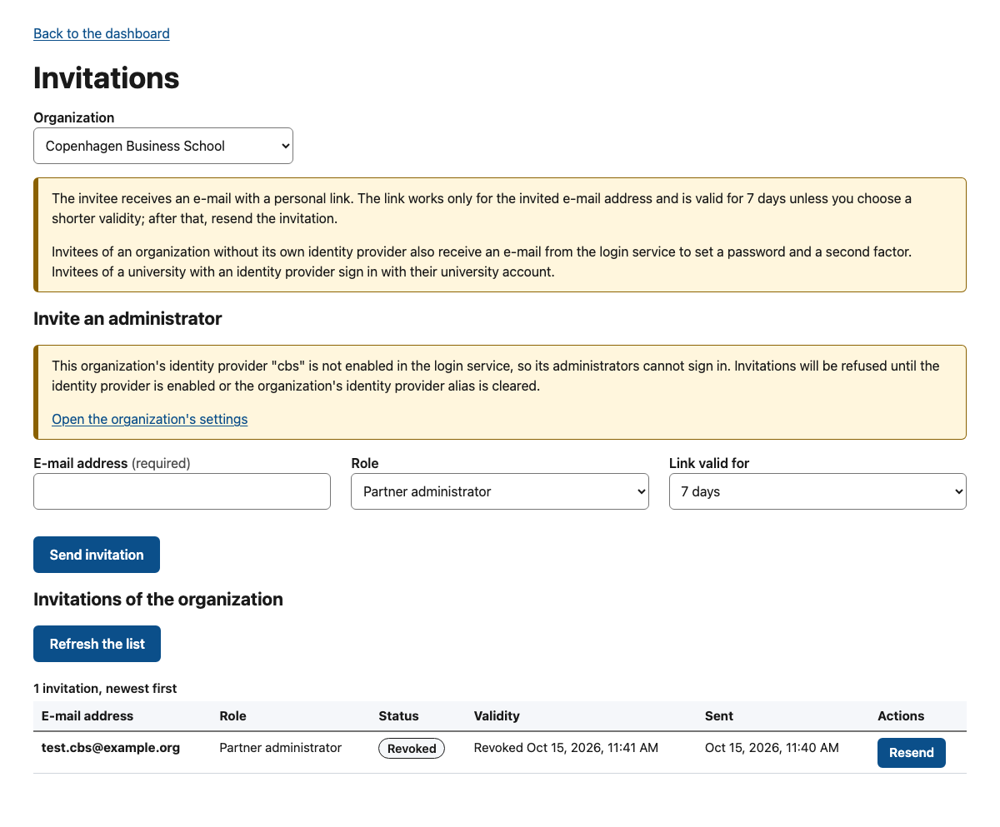
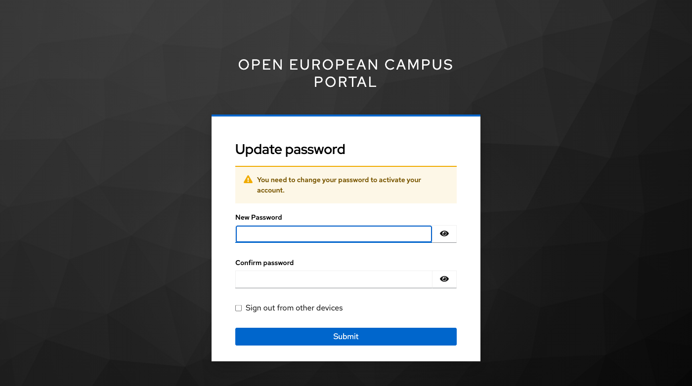
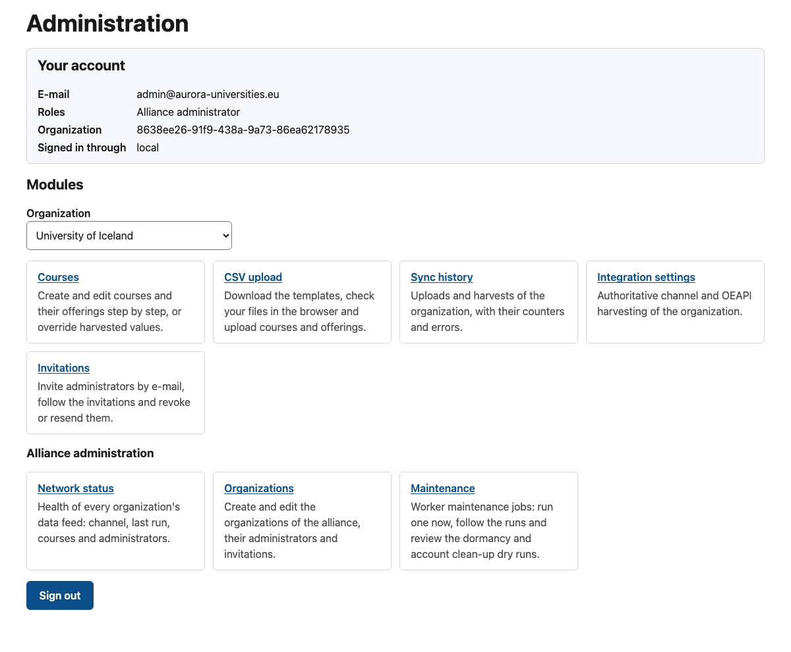
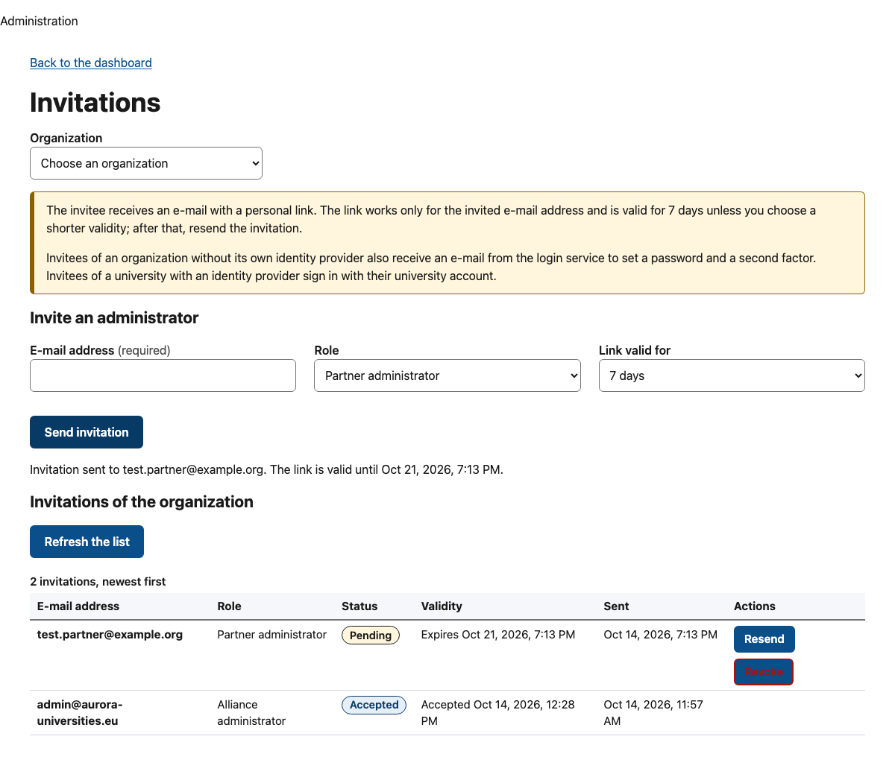
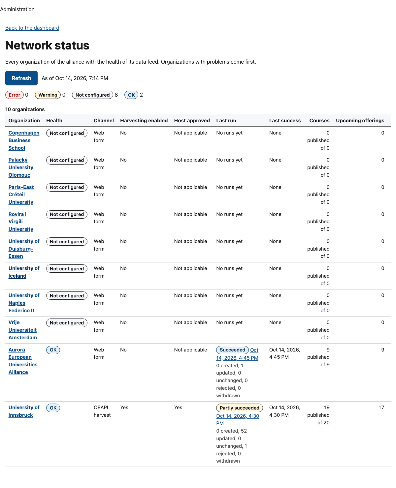
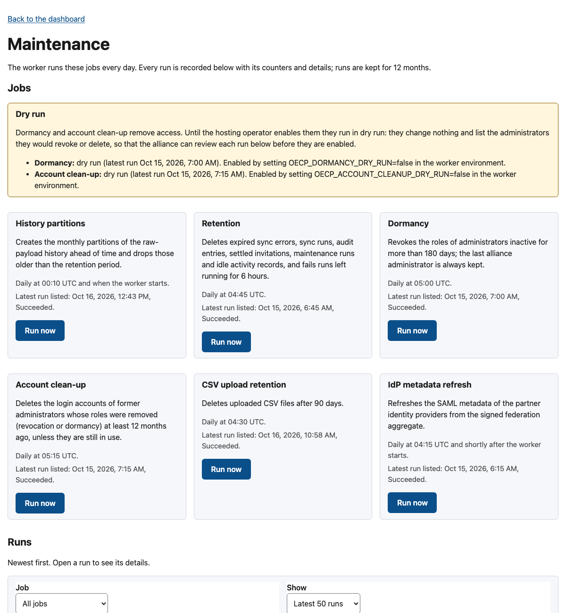

<!-- SPDX-FileCopyrightText: 2026 Lluís Alfons Ariño -->
<!-- SPDX-License-Identifier: EUPL-1.2 -->

# Guide A: setting up OACC for an alliance

For the alliance (its Foundation or secretariat) and the hosting operator. Partners start with [Guide B](partner-with-oeapi.md), [C](partner-with-integration-capacity.md) or [D](partner-manual.md) once this guide is done. Overview: [onboarding README](README.md).

> **Before you start**
>
> - A decision on who is **data controller** (the alliance body that decides what is published and who administers it) and who is **processor** (the hosting institution). In Aurora: the Aurora Foundation and URV [DL 2]; each partner university is an independent controller of the data it supplies [DL 24].
> - A Linux server with Docker Engine 25+ and Compose v2.24+, ports 80 and 443, and two DNS names, for example `courses.alliance.example` (portal) and `auth.courses.alliance.example` (login).
> - An SMTP relay of the hosting institution (plain relay by source address, or SMTP AUTH with a user and password; STARTTLS when the relay offers it).
> - The list of member universities with their official identifiers, and the list of alliance course attributes (hubs, SDGs, flags) you want to show.
> - Elapsed time: one to two weeks of technical work; legal documents and federation registration take longer and run in parallel.

## 1. Legal and governance

**Who:** Foundation, with the hosting institution's data protection officer. **Time:** 1–3 months, in parallel with everything else.

Spec [§10](../spec-v4.1.md#10-non-functional-requirements) lists what is needed. Templates written against the Aurora deployment (RoPA, DPIA outline, art. 28 checklist, accessibility statement, production runbook) are in [docs/production](../production/README.md); every decision in them is marked `[TO COMPLETE]` and is yours to take.

- [ ] Processing contract under art. 28 GDPR between controller and processor (hosting, backups, sub-processors, breach notification).
- [ ] Record of processing activities: administrators' names, e-mail addresses and audit trails, plus contact e-mails published with courses (ask partners for functional mailboxes).
- [ ] DPIA, or a documented screening that concludes one is not required.
- [ ] Privacy notice and accessibility statement (Directive (EU) 2016/2102; OACC targets WCAG 2.1 AA; audited with automated tools and a keyboard review in 0.10.0, the assistive-technology session is still to be run: [accessibility audit](../production/accessibility-audit-2026-10.md)). Publish both on the portal by copying the texts to `branding/privacy.en.md` and `branding/accessibility.en.md` (after 0.10.0 the portal serves them at `/en/privacy` and `/en/accessibility`, with footer links, and answers 404 until the English file exists; a draft privacy notice is in [privacy-notice-draft.md](../production/privacy-notice-draft.md)); 0.10.0 and earlier have no such pages, so publish them on the alliance website instead. The privacy notice URL is also required for the federation registration (step 3).
- [ ] Bilateral access agreement with each partner that will be harvested, including consent to republish data it tags for eduXchange (see [Guide B](partner-with-oeapi.md#2-sign-the-access-agreement)).

## 2. Hosting and deployment

**Who:** hosting operator. **Time:** one day.

The operator's full path, from an empty server to the pilot and day-2 operation, is [Guide E](hosting-operator.md); this step lists the choices the alliance needs to know about.

Follow [deploy/compose/README.md](../../deploy/compose/README.md) ("Quick start" and "Production checklist"), with these choices:

1. Check out tag `v0.10.0` (or later) and copy `.env.example` to `.env`. Set `OECP_PORTAL_HOST`, `OECP_AUTH_HOST`, `ACME_EMAIL`, `OECP_ALLIANCE_NAME`, `OECP_REALM_DISPLAY_NAME`, `KEYCLOAK_ADMIN_ALLOWLIST` (operators' networks only) and `OECP_SMTP_HOST`, `_PORT`, `_FROM` (the institutional relay; `OECP_SMTP_STARTTLS=true`, the default, requires TLS; for SMTP AUTH set `OECP_SMTP_USER`, put the password in the Docker secret `smtp_password`, uncomment it in `compose.yaml` and set `OECP_SMTP_PASSWORD_FILE=/run/secrets/smtp_password`). Keep `OECP_MAIL_LOG_LINKS=false`: in production the api then refuses to start without an SMTP host, so invitation links never end up in a log. Leave the `dev` profile off and `OECP_ALLOW_INSECURE_PARTNER_HTTP=false`. Keep `OECP_PUBLISH_RULE=warn`, `OECP_DORMANCY_DRY_RUN=true` and `OECP_ACCOUNT_CLEANUP_DRY_RUN=true` for now (step 9 explains when to change them); the IdP metadata settings `OECP_IDP_METADATA_*` are set in step 3.
2. Generate the secrets in `deploy/compose/secrets/` as the README shows. Keep an **offline copy of `oecp_master_key`**: without it the stored partner credentials cannot be decrypted.
3. TLS: in the `traefik` service uncomment the *PRODUCTION* block (ACME, TLS-ALPN challenge) and remove `--api.insecure` and the dashboard port.
4. Start and migrate:

   ```sh
   docker compose up -d --build --wait
   docker compose ps -a keycloak-config --format '{{.Status}}'   # realm applied: Exited (0)
   docker compose logs keycloak-config | grep -i import          # realm file imported, no error
   docker compose run --rm api pnpm db:migrate
   ```

5. Replace the temporary Keycloak bootstrap admin of the `master` realm by a permanent one with MFA.

   

6. Note the server's **public outbound IP address**. Partners with an OEAPI endpoint will put it on their allowlist.
7. Keep the login host on the **same site** as the portal (for example `courses.alliance.example` and `auth.courses.alliance.example`, as above) and keep the portal's `X-Frame-Options: SAMEORIGIN` from `deploy/compose/traefik/dynamic/middlewares.yaml` (never `DENY`). Both are needed for the admin session to survive a page reload (spec [§4](../spec-v4.1.md#4-identity)); with a login host on another domain administrators must sign in again after every reload.
8. **Log retention.** Spec §10 keeps application logs 90 days and access logs 30 days. With the `observability` profile (item 10; since 0.7.0) Grafana Alloy ships every container's log to Loki through a read-only Docker socket proxy, and Loki deletes the Traefik access log after 30 days and everything else after 90 days; the logs are searched in Grafana (dashboard *OECP logs*). Compose also rotates every container's log by size (`OECP_LOG_MAX_SIZE` × `OECP_LOG_MAX_FILE`, default 10m × 5; Traefik `OECP_TRAEFIK_LOG_MAX_SIZE` × `_MAX_FILE`, 20m × 10), the local copy and the only bound without the profile: then, after a week of real traffic, size them for 90 days of each container's volume, as the Compose README's [Log retention](../../deploy/compose/README.md#log-retention) section shows. Traefik's access log is off by default; enable it (`OECP_TRAEFIK_ACCESS_LOG=true`) only with a 30-day bound, since it records client addresses. The api's request logs carry no client address or User-Agent (`OECP_LOG_CLIENT_ADDRESSES=false`).

   

9. Size the server for the **worker**: with the IdP metadata refresh on the eduGAIN aggregate (step 3) the worker needs at least **2 GB** of memory of its own (about 750 MB measured for a 75 MB aggregate; eduGAIN is about 94 MB). Compose sets no memory limit; if you add one, keep it at 2 GB or more.
10. **Backups and alerting.** Add `COMPOSE_PROFILES=backup,observability` to `.env` (or pass `--profile backup --profile observability` to every `docker compose` command) and set `OECP_ALERT_EMAIL_TO` (and/or `OECP_ALERT_WEBHOOK_URL`) before you start, so the `backup` service and the monitoring stack run with the rest. What they do and what to check: step 9, *Backups* and *Alerts*.
11. **Branding: header image and logo** (optional). Put the alliance's own header image and logo (the alliance holds their rights; they never go into the repository; for Aurora: own generated images and the Aurora logo with the Foundation's permission [DL 25]) in `deploy/compose/branding/` (or the directory named by `OECP_BRANDING_DIR`) and set `OECP_HERO_IMAGE` (e.g. `/branding/hero.jpg`; `OECP_HERO_IMAGE_ALT` empty = decorative; shown on the home page and the course list), optionally `OECP_HERO_IMAGE_COURSES` and `OECP_HERO_IMAGE_COURSES_ALT` (a different image for the course list), and `OECP_LOGO_IMAGE` (e.g. `/branding/logo.svg`; its text alternative is `OECP_ALLIANCE_NAME`) in `.env`. Partner logos need no variable: add `partner-<slug>.svg` (or `.png`, `.webp`) per university, and optionally a square favicon with `OECP_FAVICON_IMAGE=/branding/favicon.svg`. File names, sizes and permissions: [branding/README.md](../../deploy/compose/branding/README.md); see also the Compose README's [Branding](../../deploy/compose/README.md#branding) section.

   

Check: `https://<portal host>/en` shows the empty catalogue; `https://<auth host>/realms/oecp/.well-known/openid-configuration` answers; `docker compose ps` shows `api` and `worker` as *healthy* (the worker's healthcheck calls its internal `/ready`, which checks PostgreSQL and Valkey).

## 3. Identity

**Who:** hosting operator, Foundation. **Time:** half a day, plus the federation's lead time.

- **Realm as code.** `identity/keycloak/realm-oecp.yaml` is applied on every `docker compose up`; edit the file, never the console. See [identity/keycloak/README.md](../../identity/keycloak/README.md).
- **One sign-in mode per organization** [DL 22]. The organization's *Identity provider alias* (`keycloak_idp_alias`) decides how all of its administrators sign in:
  - **Local accounts** (no alias, seed `null`): Keycloak accounts with a password of at least 12 characters plus a TOTP app, set up from the e-mail Keycloak sends at invitation time. Nobody can self-register and there is no open password reset: if the set-up is lost or expires, an alliance admin uses *Resend set-up e-mail* on the organization's *Administrators* panel (the button appears only while a local account's set-up is pending). This is the permanent mode of the alliance organization and of every university that is not in eduGAIN, and the interim mode of a university in eduGAIN whose identity provider is not connected and tested yet ([which mode for a university](identity-paths.md#which-mode-for-a-university)).

    

  - **Federated** (alias set): administrators sign in through their university's identity provider (SAML, through eduGAIN), brokered by Keycloak; OACC enrols a TOTP app after the first sign-in and asks for the code at every sign-in.

    

  - **From local to federated.** An organization can move later: enable its IdP in the realm, set the alias, re-invite its administrators (procedure under *Partner identity providers* below). An invitation accepted in the wrong mode is refused with `oecp.invitation.mismatch`.
  - **Alias without an enabled IdP.** OACC refuses to invite administrators of an organization whose alias is missing or disabled in the realm (`oecp.invitation.idp_not_enabled`, step 8), since they could not sign in.

    

  - **No mixed mode.** Some administrators local and others federated within one organization is not supported and not planned [DL 22].
- **Federation registration.** OACC registers one SAML service provider, entityID `https://<auth host>/realms/oecp`, in the hosting institution's national federation with export to eduGAIN (Aurora: SIR/RedIRIS [DL 15]), requesting the entity categories **REFEDS Personalized Access** and **REFEDS Data Protection Code of Conduct (CoCo) v2** and the **Sirtfi** assurance (no Research and Scholarship). Prepare contacts, names, logo and privacy notice URL now. The combined multi-ACS metadata is produced by `tools/scripts/sp-metadata.mjs` from the SAML key pairs and a small config ([identity/keycloak/scripts/sp-metadata.md](../../identity/keycloak/scripts/sp-metadata.md)), so it can go to the federation before the production server exists; the operator ([Guide E](hosting-operator.md#213-connect-an-identity-provider), step 2.13) runs it and sends you the file. Supply the contacts (technical, support, security for Sirtfi), the display names, logo and privacy notice URL it asks for. Available since 0.10.0; earlier releases do not have it.
- **Through a national hub** (in progress, [decision 29](../decisions-log.md)). Instead of one IdP per university, the deployment can connect the hub of the hosting federation (for Aurora: SIR2, realm IdP `sir2`, proof of concept in 0.11.0). It needs agreements the alliance takes first: the attribute set (`pairwise-id`, `schacHomeOrganization` and `mail` required, `displayName` requested), the attributes each university releases to the hub (for SIR2: `uid` and `schacHomeOrganization`, from which the hub builds the identifier), each university's `schacHomeOrganization` value as it arrives, who registers the service and its contacts, and a test sign-in per university before it becomes federated; each national federation must also exchange metadata with eduGAIN in both directions and pass the attributes on. The full list, by party: [Federating through a national hub](identity-paths.md#federating-through-a-national-hub-what-must-be-agreed).
- **IdP metadata refresh.** Partner IdPs carry a copy of their signing certificates and sign-in endpoints, which universities change. The worker job `idp-metadata-refresh` updates them every day at 04:15 UTC from the federation's signed metadata aggregate (spec [§4](../spec-v4.1.md#4-identity), [identity/keycloak/README.md](../../identity/keycloak/README.md#metadata-refresh-owned-by-the-api)). It is off until you configure it, and it is only needed once a partner IdP is connected:
  1. Choose the aggregate: eduGAIN (`https://mds.edugain.org/edugain-v2.xml`) or the feed of the federation that registers the partner IdPs.
  2. Obtain the aggregate's **signing certificate** from the federation's website and check its SHA-256 fingerprint against a second, independent source (another page of the federation, or its operators). This certificate is the only trust anchor: OACC refuses any aggregate not signed by it. Save it as a PEM file with that one certificate.
  3. Mount the file read-only into the `worker` (for example in a `compose.override.yaml`: `services: worker: volumes: ["./secrets/federation-signer.pem:/run/secrets/federation-signer.pem:ro"]`) and set in `.env` `OECP_IDP_METADATA_URL`, `OECP_IDP_METADATA_SIGNING_CERT_FILE=/run/secrets/federation-signer.pem` and keep `OECP_IDP_METADATA_MAX_BYTES=157286400` (the 50 MiB built-in limit is too small for eduGAIN). The last good aggregate is kept on the volume `idp-metadata` and used for up to 7 days if the federation is unreachable.
  4. Check the memory of step 2, item 9, then try a dry run: `docker compose run --rm worker node dist/cli.js idp-metadata-refresh --dry-run` lists every partner IdP as *updated* (would change), *unchanged*, *skipped* (disabled, or no entity ID) or *failed*, with the keys that would change. Then restart the worker: about a minute after every start it runs once, and daily afterwards. Every run, scheduled, at start-up or on demand, appears on the *Maintenance* page (job *IdP metadata refresh*) with one line per IdP in its details (step 9).
  5. When certificates are rolled, the run writes them and adds an audit entry `idp.metadata_refresh`; a certificate expiring within 30 days and a failing IdP are reported in the worker log and in the run's details on the *Maintenance* page, where a failed IdP makes the run *Failed*; with the `observability` profile a failed run raises the alert `OecpIdpMetadataRefreshFailed`, and no success for 26 hours `OecpIdpMetadataRefreshStale`. Separately, the worker reads the signing certificates of every IdP in the realm hourly and the alert `OecpIdpCertificateExpiring` fires 30 days (warning) and 7 days (critical) before the last one of an enabled IdP expires (since 0.7.0). `docker compose up` re-applies `realm-oecp.yaml` and resets the refreshed values until the start-up run a minute later, so keep the values committed in the realm file reasonably current. When the federation renews its signing key, replace the PEM file before the old key stops being used.
- **Partner identity providers.** The procedure is in the Keycloak README ("Adding a partner IdP": alias = organization slug, `subject-id` or `pairwise-id`). Partner IdPs are hidden on the Keycloak login page; administrators reach theirs through OACC: the invitation link of an organization with an IdP alias carries that alias, and every admin sign-in prompt offers **Sign in through your university**, listing the partners whose IdP is enabled in the realm. The brokered path is verified end to end only against the development test SAML IdP (`tools/e2e-identity`): **no real partner IdP has been connected in 0.10.0**. Until a partner's IdP is connected and tested, leave its *Identity provider alias* empty (seed `"keycloak_idp_alias": null`, step 4), so its administrators get local accounts. To switch a partner later: enable its IdP in the realm first, then set the alias on the organization page, then re-invite its administrators (accounts of the old login method are refused with `oecp.auth.idp_mismatch`; remove them on the *Administrators* panel).

## 4. Seed the organizations

**Who:** hosting operator, with data checked by the Foundation. **Time:** 1–2 hours.

Organizations can be created in two ways: from a JSON seed file run by the operator, which suits the first bulk load and can be reviewed before it is written, or on the *Organizations* page of the admin dashboard (*Organizations* > *New organization*), which needs an alliance admin (step 6). The seed must contain at least the alliance organization, because the first alliance admin belongs to it. For the seed, copy `apps/api/db/seed/organizations.aurora.json` to a file of your own and edit one entry per university plus one for the alliance. The fields are the same on the page:

| Field | Example (Universität Innsbruck) | Notes |
|---|---|---|
| `slug` | `uibk` | `[a-z0-9-]{2,40}`; the permanent key, do not rename |
| `org_type`, `is_partner` | `institution`, `true` | The alliance entry: `alliance`, `false` |
| `name` | `{"en": "University of Innsbruck", "de": "Universität Innsbruck"}` | English required |
| `schac_home_organization` | `uibk.ac.at` | Verify against the federation metadata |
| `erasmus_code`, `pic` | `null` | Fill only with verified values |
| `country_code` | `AT` | |
| `default_timezone` | `Europe/Vienna` | Used for offering dates |
| `ui_languages` | `["en", "de"]` | Stored for later; the portal is English-only in 0.10.0 |
| `keycloak_idp_alias` | `null` for now | See step 3 |
| `ext_id` (optional) | `uibk.ac.at` | For OEAPI partners: the root organization's `primaryCode.code`; the harvester then refuses an endpoint that answers as another university |

Validate, then write (the command upserts by `slug`, in one transaction, and never deletes):

```sh
docker compose run --rm -T -v "$PWD/organizations.alliance.json:/seed/orgs.json:ro" \
  api node dist/cli.js seed-organizations --file /seed/orgs.json --dry-run
docker compose run --rm -T -v "$PWD/organizations.alliance.json:/seed/orgs.json:ro" \
  api node dist/cli.js seed-organizations --file /seed/orgs.json
```

Later changes are made on the organization page (*Organizations* > the organization > *Details*); the slug cannot be changed. *Delete or restore* hides an organization (soft delete, restorable); it is refused while the organization still has courses, sub-units, administrators, pending invitations or an enabled harvest. The seed command never deletes.

## 5. Define the course attributes

**Who:** Foundation decides, operator runs. **Time:** one hour once the list is agreed.

Alliance attributes are your alliance's own tags and filters (types `boolean`, `enum`, `multi_enum`, `text`). Each becomes an `attr_<key>` CSV column, a field in the course wizard and, if `filterable`, a catalogue filter.

The default file (`attribute-definitions.json`) **is the Aurora list**, aligned with the filters of the Aurora Virtual Campus website (confirmed by the owner on 2026-10-15; the first real load uses the alliance's own CSV files; the fictional [example dataset](../data/example-alliance-2026-27/README.md) shows the files and the attributes in use). A deployment that loaded an earlier version runs the seed again and replaces the old `target_audience` values (`phd_candidates`, `staff`) on existing courses. **Every other alliance must write its own file** and pass it with `--file`, using `attribute-definitions.aurora.json` as a model. Definitions missing from the file are kept, never deleted, so do not run the default first: removing a definition afterwards needs SQL.

```sh
docker compose run --rm -T -v "$PWD/attributes.alliance.json:/seed/attrs.json:ro" \
  api node dist/cli.js seed-attribute-definitions --file /seed/attrs.json --dry-run
```

Run it again without `--dry-run`. Option `value`s are stable identifiers used in CSV cells and URLs; labels can change.

## 6. Bootstrap the first alliance admin

**Who:** operator runs the command; a named Foundation person completes it. **Time:** 30 minutes.

```sh
docker compose run --rm -T api node dist/cli.js bootstrap-alliance-admin \
  --email platform@alliance.example --org aurora --ttl-hours 48
```

The command prints the invitation link (valid 24 hours by default, at most 168) and is refused once an alliance admin exists or is invited. It does **not** e-mail that link: send it to the person over a trusted channel. Keycloak separately e-mails a set-up link; if that mail fails, the command says so; re-send it from the Keycloak console (Users > the user > Credentials > Credential reset), since no alliance admin exists yet to use *Resend set-up e-mail* in OACC.

The new admin then:

1. Opens the Keycloak e-mail and follows its link. Keycloak first asks to set up the authenticator app (scan the QR code, enter a one-time code) and then to set a password of at least 12 characters.

   

   

2. Opens the invitation link and signs in with password and code; the page shows "Invitation accepted".

   

3. Signs out and in again: the new session carries the `alliance_admin` role.

   

Tokens are kept in memory only. A page reload restores the session without asking again while the login session is alive (30 minutes idle, 8 hours at most) and the requirements of step 2, item 7, are met; otherwise the page asks you to sign in again.

## 7. The administration screens

**Who:** alliance admin. **Time:** a quick tour.

Sign in at `https://<portal host>/en/admin`. Besides the organization modules (courses, CSV upload, sync history, integration settings), an alliance admin sees **Alliance administration**:

| Screen | What it does |
|---|---|
| *Network status* (`/en/admin/network`) | Health of every organization's data feed (OK, warning, error, not configured), with channel, harvesting, host approval, last run, courses, upcoming offerings, administrators and pending invitations; problems first |
| *Organizations* (`/en/admin/organizations`) | List, create, edit, delete and restore organizations; per organization: *Administrators* (remove, resend set-up e-mail), *Invitations*, *Integration* and *Courses* |
| *Invitations* (`/en/admin/invitations`) | Invite administrators of the selected organization; list, revoke and resend invitations |
| *Maintenance* (`/en/admin/maintenance`) | The worker's maintenance jobs with *Run now*, their recorded runs with counters and details, and the review of the dormancy and account clean-up dry runs (step 9) |

The organization picker at the top of each page (kept in `?org=`) selects the organization the page works on.

Screen-by-screen walkthrough with screenshots: [alliance administrator manual](../manuals/alliance-admin.md).

**Scripting with the API.** Every screen calls the admin API ([spec §8.2](../spec-v4.1.md#82-admin-api-apiadminv1-implemented)), which can also be scripted for bulk work. There are no API keys or service accounts: a script needs an access token from an interactive sign-in with MFA (for example copied from the `Authorization: Bearer …` header of an `/api/admin/v1` request in the browser's developer tools), which expires after 5 minutes. Treat it as a password and never share it.

## 8. Invite partner admins

**Who:** alliance admin. **Time:** 15 minutes per partner, plus their response time.

1. Open *Invitations* (or *Organizations* > the organization > *Invitations*) and pick the partner organization.
2. Under *Invite an administrator* enter the e-mail address, choose the role (`partner_admin`) and the validity (7 days by default, or 3 or 1), and choose *Send invitation*.

   

OACC e-mails the invitation link; for local-account organizations Keycloak also sends the password and TOTP set-up mail. For an organization with an identity provider alias, the link carries the alias and the person signs in through their university. That identity provider must be enabled in the realm (section 3): otherwise OACC refuses the invitation (`oecp.invitation.idp_not_enabled`) and the *Invitations* panel shows a warning with a link to the organization, where you can clear the alias to use a local account instead. The address must be the one the person signs in with, and one person can administer only one organization.

The list shows each invitation as *Pending*, *Accepted*, *Expired* or *Revoked*. *Revoke* stops a pending link at once; *Resend* replaces a lost or expired link with a new one (the old link stops working). If a local account never finished its password and TOTP set-up, use *Resend set-up e-mail* on the organization's *Administrators* panel. Agree with each partner which guide applies (B, C or D).

## 9. Operate

- **Network status and sync monitor.** *Network status* shows every organization's health at a glance; check it weekly, and open an organization's *Sync history* for the runs of every channel with counters, errors and warnings. The alerts (below) report harvests that fail twice in a row, but OACC sends no notification for data warnings, for example when the mass-absence guard (`oecp.oeapi.mass_absence`) stops withdrawals: look at these screens regularly.

  

- **Approve partner hosts.** Before a partner can be harvested, check with the partner, through a channel you already trust, that the `base_url` host is theirs, then open the partner's *Integration settings* and choose *Approve host …* in the *Host approval* card. Any later change of host clears the approval ([Guide B, step 6](partner-with-oeapi.md#6-approve-the-host)).

  

- **Remove an administrator.** *Organizations* > the organization > *Administrators* > *Remove*: the role is taken away and the person's sessions end. You cannot remove yourself or the last alliance admin. An access token already issued stays valid for up to 5 minutes. The Keycloak account is kept; the `account-cleanup` job deletes it 12 months later, once that job is enabled (below).
- **Maintenance jobs.** The worker runs, every day (UTC): `history-partitions` at 00:10 (and at every start: monthly partitions of the raw payload history), `idp-metadata-refresh` at 04:15 (and about a minute after every start; step 3), `csv-retention` at 04:30 (uploaded files after 90 days), `retention` at 04:45 (old run errors, runs, audit entries, invitations, maintenance runs and deleted records, below), `dormancy` at 05:00 and `account-cleanup` at 05:15. Every run is recorded. Open **Maintenance** (`/en/admin/maintenance`, alliance admins only):
  - *Jobs*: one card per job with what it does, its schedule, its latest run and **Run now**. A run requested this way is queued for the worker and appears in the runs table once it starts; if a run of that job is already waiting or running, the page says so and adds none. Requests are audited (`maintenance.run_requested`).
  - *Dry run*: whether `dormancy` and `account-cleanup` still run in dry run, read from their latest run, and the variable that enables each.
  - *Runs*: newest first, filtered by job, the latest 50 or 200, with start, job, trigger (*Scheduled*, *Worker start*, *Run now*), status (*Succeeded*, *Failed*, *Skipped (already running)*, *Running*), duration, counters and the start of any error. *Show details* opens the run: who requested it, when it finished, the full error and every detail the job recorded.

  

  Check once a week that the latest run of every job *Succeeded*. The same data is available to scripts through `GET /api/admin/v1/maintenance/runs?limit=&job=` and `POST /api/admin/v1/maintenance/jobs/{name}/run` (step 7, "Scripting with the API").
- **The administrator lifecycle on one page**, with the choices and the defaults, is in [administrator-lifecycle.md](administrator-lifecycle.md) [DL 26].
- **Inactive administrators (dormancy).** The *Administrators* panel shows each person's last sign-in. The `dormancy` job finds administrators (partner and alliance) with no activity for `OECP_DORMANCY_DAYS` (180) days: last use of the admin API, last Keycloak sign-in, account creation and the date of the upgrade that introduced the job, whichever is latest, so nobody becomes dormant earlier than 180 days after that upgrade. It **only reports** while `OECP_DORMANCY_DRY_RUN=true` (the default). Review the dry run on the *Maintenance* page: filter on *Dormancy*, open the latest run with *Show details*; the table lists every administrator it would revoke (account `sub`, roles, organization, last activity, days inactive, *Would be revoked* or *Kept: last alliance administrator*) and `would_revoke` among the counters gives their number. Match the `sub` on the organization's *Administrators* panel. When the Foundation agrees with the result, set `OECP_DORMANCY_DRY_RUN=false` in `.env` and recreate the worker (`docker compose up -d worker`). From then on dormant administrators lose their role and sessions, exactly as with *Remove*, with the audit entry `admin.dormant_revoke`; the last alliance admin is never removed. Annual recertification is not implemented: review the *Administrators* panels at least once a year.
- **Former administrators' accounts (account clean-up).** The `account-cleanup` job deletes the Keycloak account of a person whose OACC roles were removed (by *Remove* or by dormancy) more than `OECP_ACCOUNT_DELETE_MONTHS` (12) months ago, unless the account has a role again, is a service account, still carries an organization, accepted an invitation since, is younger than the period, was used or signed in within the period, or has a pending invitation. Each deletion is audited (`admin.account_deleted`, no e-mail address). It **only reports** while `OECP_ACCOUNT_CLEANUP_DRY_RUN=true` (the default). Review its dry runs on the *Maintenance* page like the dormancy ones: the table lists the accounts it would delete (*Would be deleted*, with when and how the roles were removed), and the details list the kept accounts with their reason (`kept`, `kept_by_reason`). Removals made directly in the Keycloak console leave no audit entry and are never acted on. When the Foundation agrees, set `OECP_ACCOUNT_CLEANUP_DRY_RUN=false` and recreate the worker.
- **Worker health.** `docker compose ps` shows the worker's health. Its internal endpoints are not published; to look at them: `docker compose exec worker node -e "fetch('http://127.0.0.1:3001/health').then(r=>r.text()).then(console.log)"` lists the scheduled jobs with their next run time; `/ready` says whether PostgreSQL and Valkey answer.
- **Publication rule.** `OECP_PUBLISH_RULE=warn` publishes courses that miss fields the Aurora IT Handbook requires and only flags them (warning `oecp.content.handbook_incomplete`, *Completeness* column of the course list, sync history). Watch those counts per partner; when they are acceptable, set `OECP_PUBLISH_RULE=enforce` for **both** `api` and `worker` (the shared `.env` does that) and recreate both: incomplete courses are then stored as drafts at their next write (ADR-0016). Harvested courses usually lack instructors, so agree with OEAPI partners how they send them first ([API integration guide](../guides/api-integration.md#handbook-completeness)).
- **Backups.** The `backup` profile (step 2, item 10) runs pgBackRest for the whole PostgreSQL cluster (databases `oecp` and `keycloak`): continuous WAL archiving, a full backup every Sunday and a differential the other days at 02:00 UTC, a 35-day recovery window, and a daily archive of the `uploads` volume, all on the local volume `pgbackrest-repo`. After the first backup set `OECP_WAL_ARCHIVE=on` and recreate `postgres`. Until the second site (encrypted repo2, S3/MinIO or SFTP) is configured, every backup lives on the production host only. The secrets are not in the backups: keep their offline copy current. Run the restore drill `deploy/compose/scripts/restore-drill.sh` before go-live and quarterly: it restores into a scratch container, checks both databases and prints PASS or FAIL. Details: Compose README [Backups](../../deploy/compose/README.md#backups-profile-backup) and [Restore drill and restore](../../deploy/compose/README.md#restore-drill-and-restore); runbook sections [3](../production/runbook.md#3-backups-and-point-in-time-recovery) and [4](../production/runbook.md#4-restore-drill).
- **Alerts.** The `observability` profile runs Prometheus with the OACC alert rules (two consecutive failed harvests, newest backup older than 26 hours, WAL archiving failing, disk above 80 %, IdP metadata refresh, 5xx above 1 %, api or worker down, failed or stale maintenance jobs, partner IdP signing certificates and the TLS certificate close to expiry), Alertmanager, which sends them to `OECP_ALERT_EMAIL_TO` and/or `OECP_ALERT_WEBHOOK_URL`, and Grafana with the dashboards *OECP overview* and *OECP logs*. Send a test alert after set-up and after every change. In production make the ACME certificate Traefik's default, or the TLS probe watches Traefik's self-generated one. The in-host monitoring cannot report the host itself down: check that from outside. Details: Compose README [Alerting](../../deploy/compose/README.md#alerting); runbook section [7](../production/runbook.md#7-monitoring-and-alerts).
- **Retention.** Automatic: uploaded files after 90 days; raw harvested payloads after 12 months (`OECP_RETENTION_HISTORY_MONTHS`; person data such as `coordinators` is removed before a payload is stored); run errors 12 months, sync runs 24 months, audit entries 36 months (`OECP_RETENTION_SYNC_ERRORS_MONTHS`, `_SYNC_RUNS_MONTHS`, `_AUDIT_MONTHS`); settled invitations, maintenance runs and idle activity records 12 months; courses, offerings and organizations deleted more than 12 months ago (`OECP_RETENTION_SOFT_DELETED_MONTHS`; an organization only once nothing refers to it any more); Keycloak events 90 days; Keycloak accounts of former administrators 12 months after their roles were removed (`account-cleanup`, above, once enabled). Compose passes these variables with their defaults; set them in `.env` to change a period. Application and access logs: kept 90 and 30 days by Loki with the `observability` profile, otherwise rotated by size and sized by the operator for 90 and 30 days (step 2, item 8). Record the periods in your record of processing activities (step 1; template [docs/production/ropa.md](../production/ropa.md)).

## Go-live checklist

- [ ] Art. 28 contract signed; record of processing, DPIA or screening, privacy notice and accessibility statement published (on the portal through the branding files, or on the alliance website)
- [ ] Access agreements signed with every harvested partner
- [ ] Production TLS, allowlists, SMTP relay (with SMTP AUTH and STARTTLS if the relay offers them), `OECP_MAIL_LOG_LINKS=false`; no `dev` profile; insecure partner HTTP off
- [ ] Logs shipped to Loki (profile `observability`: 90 days, Traefik access log 30 days) and *OECP logs* showing every service; or, without it, log rotation sized for 90 days (application) and, if the Traefik access log is on, 30 days
- [ ] Permanent Keycloak master admin with MFA; secrets and master key copied offline
- [ ] Organizations seeded and identifiers verified; attribute definitions agreed and seeded
- [ ] At least two alliance admins (invite a second one, so the alliance never depends on one person)
- [ ] Every partner has an accepted partner admin and a chosen channel; each organization's sign-in mode decided (identity provider alias only when its IdP is enabled in the realm, otherwise local accounts)
- [ ] Backups running (profile `backup`, `OECP_WAL_ARCHIVE=on`, second site configured) and one restore drill passed
- [ ] Alerting running (profile `observability`), receivers set and a test alert received; the ACME certificate is Traefik's default, so the TLS expiry probe watches it
- [ ] Branding images, if any, in the branding directory with their rights cleared, and the `OECP_HERO_IMAGE*` / `OECP_LOGO_IMAGE` variables set
- [ ] Worker *healthy*; on the *Maintenance* page the latest run of every job *Succeeded*
- [ ] A dormancy dry run reviewed by the Foundation, and `OECP_DORMANCY_DRY_RUN` decided ([administrator-lifecycle.md](administrator-lifecycle.md), [DL 26])
- [ ] An account clean-up dry run reviewed, and `OECP_ACCOUNT_CLEANUP_DRY_RUN` decided
- [ ] `OECP_PUBLISH_RULE` decided (`warn` during the transition, `enforce` when the catalogue is complete enough)
- [ ] If partner IdPs are connected: IdP metadata refresh configured (aggregate URL, verified signing certificate, worker memory ≥ 2 GB) and a dry run clean
- [ ] Federation registration submitted, if partner IdP login is wanted later
- [ ] Acceptance test plan executed and signed ([acceptance-test-plan.md](../production/acceptance-test-plan.md))
