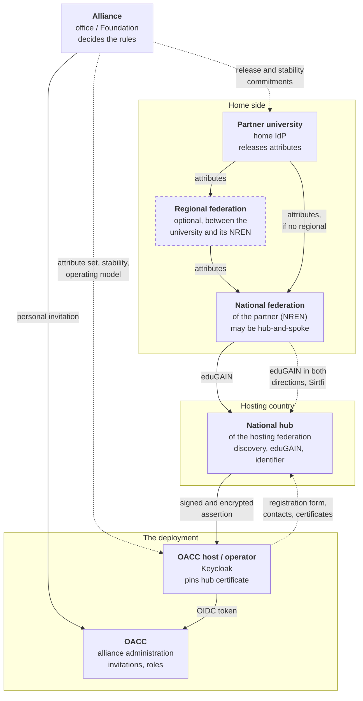
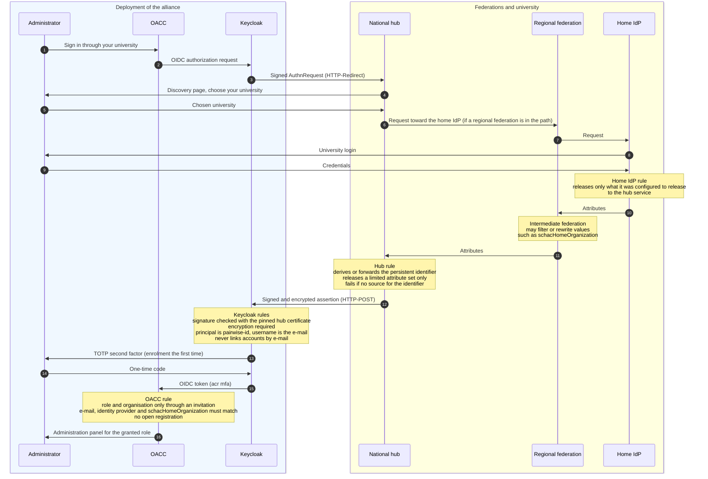
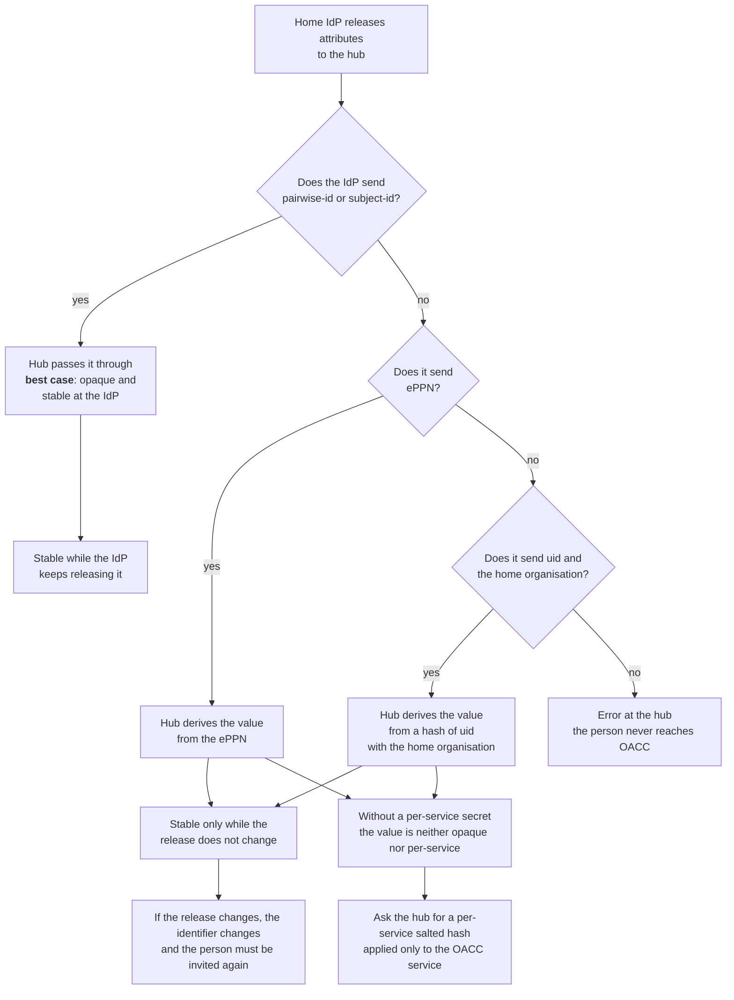

<!-- SPDX-FileCopyrightText: 2026 Lluís Alfons Ariño -->
<!-- SPDX-License-Identifier: EUPL-1.2 -->

# Federating through a national hub: parties, flow and rules

*In progress: the hub model is a proof of concept ([decision 29](../decisions-log.md), not confirmed). This page is the visual view of the model and of who is responsible for what; it changes with the ADR that amends ADR 0004.*

An alliance can let its administrators sign in to OACC through their own university without connecting every university's identity provider (IdP) one by one: the deployment connects **one** SAML identity provider, the **hub** of the hosting country's national federation (Spain's SIR2 is an example of a national federation that offers a hub). The hub publishes OACC to eduGAIN, shows a discovery page where the administrator picks their university, and passes the result back. This page shows, with diagrams, **who must define, implement or use what**, so that alliance offices, university identity teams, federation operators and the hosting operator share the same picture.

It does not repeat the detailed lists. Those are in [Sign-in paths](identity-paths.md#federating-through-a-national-hub-what-must-be-agreed) (the agreements, party by party), [Guide A §3](alliance.md#3-identity) (the alliance's decisions) and the [Keycloak README](../../identity/keycloak/README.md#sir2-hub-sir2) (the configuration). Terms as in the [onboarding README](README.md).

## Who this page is for

| You are | Read first |
|---|---|
| An alliance office | [The parties](#the-parties-and-how-they-relate), [Before production](#before-production-checklist) |
| A university identity team | [The sign-in flow](#the-sign-in-flow), [Which identifier reaches OACC](#which-identifier-reaches-oacc) |
| A federation operator (national, regional or hub) | [The parties](#the-parties-and-how-they-relate), [Who does what](#who-does-what) |
| A hosting operator | All of it; then the [Keycloak README](../../identity/keycloak/README.md#sir2-hub-sir2) and the [runbook](../production/runbook.md#6-identity-operations) |

## When the hub model applies

An organization signs in one way, decided by its identity provider alias [DL 22] ([Sign-in paths](identity-paths.md#which-mode-for-a-university) has the full table):

| The university | Mode | Why |
|---|---|---|
| Is in eduGAIN and the alliance connects through the hosting federation's hub | **Hub** (alias `sir2` in the Aurora seed) | One connection reaches every university of the alliance that is in eduGAIN, once the agreements below are met |
| Is in eduGAIN and the alliance connects its IdP directly | **Per-university IdP** (alias = slug) | The hosting operator and the university exchange metadata; no intermediate hub |
| Is not in eduGAIN, or its IdP cannot release the agreed attributes | **Local accounts** (no alias) | A full, permanent mode: password plus TOTP, set up from Keycloak's e-mail |

Both federated modes end in the same checks inside OACC (see [the flow](#the-sign-in-flow)). The hub changes who the deployment talks to, not what OACC requires of a person.

## The parties and how they relate

Solid arrows are the flow of the sign-in and of attributes. Dotted lines are agreements: something a party defines, signs or promises to another. The "Home side" box groups the university and the federations it belongs to (membership is implied); the dashed border marks the optional party.

The alliance has no agreement with the federations themselves. It has agreements with its universities and with the operator; the operator registers the service with the hub; each university deals with its own federation. That chain is why the commitments below must be written down by the alliance and passed along.

## The sign-in flow

The administrator starts from OACC. Notes mark the points where a party applies a rule.

What follows from the notes:

- **The hub is the only party that sees the home IdP, and the home IdP only ever sees the hub.** A university releases attributes to the hub's service as registered in eduGAIN, not to OACC's entity ID.
- **No attribute alone opens a door.** A person with a valid university login but no invitation reaches OACC with no role and cannot do anything.
- **Every successful sign-in leaves a Keycloak account**, even without an invitation (see [Known limits](#known-limits-and-planned-items)).

If an administrator sees "Sign-in could not be started" before reaching the hub, a browser has not accepted the auth host's certificate: see the [runbook, identity operations](../production/runbook.md#6-identity-operations).

## Which identifier reaches OACC

OACC recognises a returning administrator by a persistent identifier, the `pairwise-id` attribute, used as the principal of the identity provider. A hub does not always receive one from the home IdP, so it may **derive** one. What it derives from decides how stable and how private the identifier is.

Hubs differ in the order and the sources they use, so the tree is a model, not a statement about any particular hub. The alliance asks its hub which of these paths applies and writes the answer down. Three consequences:

1. **The identifier depends on what the home IdP releases.** If a university starts to send its own `pairwise-id`, or stops sending the attribute the hub was using (for example ePPN), its users get a different identifier and must be invited again. **Stability of the release is part of the alliance agreement, and a change is announced beforehand** to the operator and the alliance office.
2. **A value derived without a per-service secret** (a raw ePPN, an unsalted hash) is neither opaque nor different for each service. The recommendation is to ask the hub for a **per-service salted hash** (for example SimpleSAMLphp's `saml:PairwiseID`, salted with the service's entity ID), applied **only** to the OACC service. Until then, OACC mitigates the exposure of the raw value inside Keycloak by setting the username from the e-mail ([Keycloak README](../../identity/keycloak/README.md#sir2-hub-sir2)), but the federated identity link in Keycloak still holds the hub's value.
3. **Data minimisation.** The hub should release only what OACC uses: `pairwise-id`, `mail`, `displayName` and `schacHomeOrganization`. Not `uid`, even if the hub needs it internally to derive the identifier.

## Who does what

| Party | What to define, implement or use | Typical owner | Notes |
|---|---|---|---|
| **Alliance** | Define: the attribute set and what happens when one is missing; the identifier policy (stable, never reassigned, changes announced); each university's `schacHomeOrganization` as it arrives; who registers the service and the role contacts; data protection (privacy notice, entity categories); rollout order. Use: personal invitations to grant roles. | Alliance office or Foundation, with the universities' identity teams | Written down and kept with the deployment's records. The alliance has no agreement with the federations, so its commitments go to universities and operator. See [what the alliance must agree](identity-paths.md#what-the-alliance-must-agree). |
| **Partner university** (home IdP) | Implement: stay in its national federation; release the agreed attributes to the hub's service; keep the identifier source stable. Use: its own login. Name a contact for the test sign-in and for incidents. | University identity team | MFA at the IdP is not required: OACC asks for its own TOTP at every sign-in. Announce a change of release before making it. |
| **National federation of the partner** (NREN, possibly hub-and-spoke) | Implement: export its IdPs to eduGAIN and import eduGAIN service metadata, so its IdPs see the hub's service; pass attribute values unchanged, or say how they change; a security contact (Sirtfi). | Federation operator, reached through the partner's identity team | Hub-and-spoke federations may require the institution to enable the service explicitly. See [what each national federation must support](identity-paths.md#what-each-national-federation-must-support). |
| **Regional or intermediate federation** (optional) | Implement: forward the request and attributes; say whether it filters or rewrites values, notably `schacHomeOrganization`. Use: its own membership rules for the university. | Regional federation operator | Present only when a university's IdP is registered there rather than directly in the national federation. OACC does not talk to it and does not trust its values on their own. |
| **National hub** of the hosting country | Implement: register OACC (test, then production) and publish it to eduGAIN; discovery page; derive or forward the persistent identifier and release a limited attribute set; encrypt assertions; publish its metadata and announce certificate changes to the registered contacts. Define: the registration form and its contacts. | Operator of the hosting federation's hub | Metadata may be unsigned, so the operator pins the certificate. Scope of scoped values is usually checked only for the hub's own federation. See [what the hub operator provides](identity-paths.md#what-the-hub-operator-provides-for-aurora-rediris-sir2). |
| **OACC host / operator** | Implement: the hub as a realm identity provider (pinned certificate, assertion encryption on by default, principal `pairwise-id`, username from the e-mail, TOTP at every sign-in, no account linking by e-mail); the registration with the hub; real TLS certificates on the auth host. Use: the hub's metadata and role contacts. Run: removal of accounts without a role until the automatic clean-up exists. | Hosting institution's IT team | Configuration: [Keycloak README](../../identity/keycloak/README.md#sir2-hub-sir2) (`OECP_SIR2_IDP_*`). Day-2 procedures: [runbook](../production/runbook.md#6-identity-operations). |

## Before production checklist

Each item names who closes it.

- [ ] **Alliance decisions taken and recorded** (alliance): attribute set with the missing-attribute behaviour, identifier policy, who registers the service, role contacts, rollout order.
- [ ] **Hub registration form filled and signed** (the registering party, decided by the alliance). It typically asks for: the service name, the entity ID, contacts (technical, support, security with Sirtfi, administrative), entity categories (for example REFEDS CoCo v2; R&S is not needed), the requested attributes, and a liaison person at the registering institution. Use **role addresses** for contacts, so they outlive one person.
- [ ] **Privacy notice published** at the URL given in the registration ([draft](../production/privacy-notice-draft.md)) (alliance, operator).
- [ ] **Attribute agreement signed off by each university**, including **stability of the release and advance notice of changes**, and the `schacHomeOrganization` value as read from a test sign-in (universities, alliance).
- [ ] **Data minimisation requested from the hub**: only `pairwise-id`, `mail`, `displayName`, `schacHomeOrganization`; and, if the hub derives the identifier, a **per-service salted hash** for this service (operator asks the hub).
- [ ] **Hub certificate pinned and checked out of band** (fingerprint), with the assertion encryption requirement left on, and the contacts that will announce a change recorded (operator).
- [ ] **Real TLS certificates on the auth host** (operator). With a self-signed development certificate each browser has to accept the host first or sign-in does not start.
- [ ] **One test sign-in per university** before it becomes federated: an administrator signs in through the hub, enrols TOTP and accepts an invitation (university, alliance, operator).
- [ ] **Orphan-account handling agreed** (operator): who removes Keycloak accounts without a role, and how often, until the automatic clean-up exists.

## Known limits and planned items

Consistent with [Known limits in 0.11.0](identity-paths.md#known-limits-in-0110) and decision 29, which is IN PROGRESS:

- **The hub is a proof of concept.** One real sign-in through a hub's test gateway worked end to end. The production registration is still to come, and only **one** organization can use the hub alias until decision 29 is confirmed.
- **Accounts without a role.** Every successful federated sign-in creates a Keycloak account, even without an invitation; it has no role or organisation and cannot do anything. An automatic clean-up ([decision 31](../decisions-log.md)) of accounts without role, organisation or pending invitation after a short period is **planned** (owner decision of 2026-10-29, not yet implemented). Until then the operator removes them by hand. Such an orphan account can also block a later **local** invitation for the same e-mail.
- **The identifier policy is not settled.** Whether the hub in use passes through, derives or fails, and whether it can use a per-service salted hash, are open requests to the hub operator (decision 29, open points).
- **No custom Keycloak error for missing attributes.** Keycloak creates the user without them and the API then refuses the acceptance ([Sign-in paths](identity-paths.md#known-limits-in-0110)).
- **No real partner IdP is connected yet.** Only the development test IdP and one hub test gateway have been exercised.
