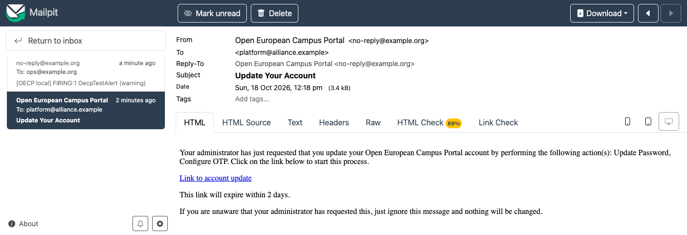
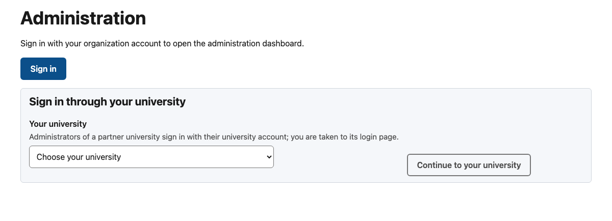
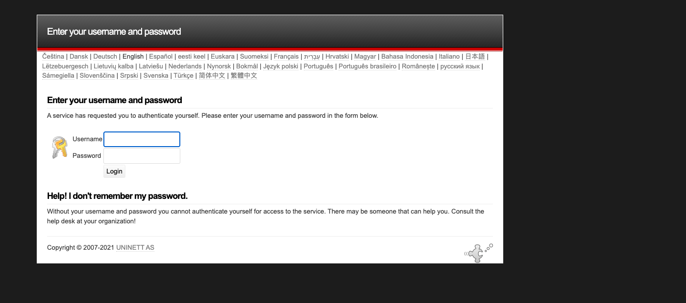
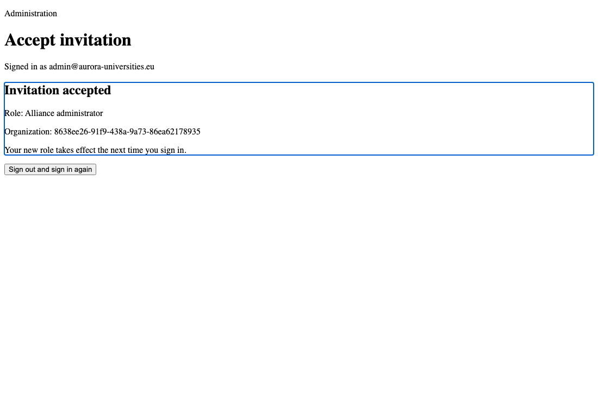

<!-- SPDX-FileCopyrightText: 2026 Lluís Alfons Ariño -->
<!-- SPDX-License-Identifier: EUPL-1.2 -->

# Guide E: hosting operator, from an empty server to the pilot

## 0. Who this is for

For the **hosting operator**: the IT team of the institution that installs and runs OECP for an alliance. In the first deployment this is URV for the Aurora alliance [DL 2], with the pilot on `lspurv.urv.cat` (portal) and `auth.lspurv.urv.cat` (Keycloak).

At the end you have the reference Docker Compose deployment of release 0.9.0 running on one host, with production TLS, an SMTP relay, backups with a passed restore drill, alerting and logs, the organizations seeded and a first alliance admin invited, and a list of what you run every week, month, quarter and year.

This guide is the **ordered path**. The detail lives in three documents, and each step below links to the section that has it:

- [deploy/compose/README.md](../../deploy/compose/README.md) (the Compose README): services, configuration, backups, alerting, logs, production checklist. Its "Quick start" is the local-development one: do not follow it on a production host.
- [docs/production/runbook.md](../production/runbook.md) (the runbook): day-2 operation, in 12 sections.
- [deploy/compose/secrets/README.md](../../deploy/compose/secrets/README.md): the Docker secrets.

The alliance's side of the same work (legal, identity choices, organizations, attributes, administrators) is [Guide A](alliance.md). Where a step needs the alliance, this guide says **Hand over**. Values the URV pilot has not settled yet are collected in [section 5](#5-the-pilot-at-urv-worked-example).

## 1. Day 0: before touching the server

### 1.1 What to ask for and decide

Settle these with the institution's network, mail, identity and security teams and with the alliance before installing. Each answer goes into `.env`, a secret or the runbook.

| Item | What you need | Where it is used |
|---|---|---|
| **Hostnames** | Two DNS names: the portal and the auth host. The auth host must be on the **same registrable domain** as the portal (`portal.example.eu` and `auth.example.eu`, or `auth.lspurv.urv.cat` under `lspurv.urv.cat`), or the admin session cannot survive a page reload ([spec §4](../spec-v4.1.md#4-identity), "Session restore after a reload"). | `OECP_PORTAL_HOST`, `OECP_AUTH_HOST` |
| **DNS records** | Both names pointing at the server. | Compose README, [Production checklist](../../deploy/compose/README.md#production-checklist) item 1 |
| **TLS** | Either ACME (Let's Encrypt) with the TLS-ALPN challenge on port 443, which is what `compose.yaml` prepares (commented *PRODUCTION* block of `traefik`), or certificates issued by the institution (URV issues its own: PEM certificate, PEM intermediate chain and private key; one certificate with both hosts as SAN, or one per host). ACME needs port 443 reachable from Let's Encrypt. | `ACME_EMAIL` and [step 2.4](#24-switch-traefik-to-production-tls), or the files of [step 2.4b](#24b-tls-with-certificates-issued-by-the-institution) |
| **Inbound ports** | 443 for both hosts (users, partners' browsers, the ACME challenge). Port 80 is published by Traefik only to redirect to HTTPS; the TLS-ALPN challenge does not use it. The Compose README asks for both ports free on the host. | `OECP_HTTPS_PORT`, `OECP_HTTP_PORT` (change only behind another proxy: the public URLs assume 443) |
| **Outbound traffic** | From the worker (network `egress`): every partner OEAPI endpoint (`https` on port 443 only, spec §6.2.6) and, once a partner IdP is connected, the federation aggregate (`https://mds.edugain.org/edugain-v2.xml` or the federation's feed). From `api`, `keycloak` and `alertmanager` (network `edge`): the SMTP relay; from Alertmanager also the webhook target, if any. From Traefik: Let's Encrypt (ACME). From `postgres` and `backup`, once repo2 is configured (network `egress`): the second backup site. For building the images on the server: the container registries of the base images (Docker Hub, quay.io), the npm registry (`pnpm install`) and the Debian/PGDG apt repositories (`postgres.Dockerfile`). | [Compose README, network diagram](../../deploy/compose/README.md) |
| **Public outbound IP** | The address the worker's requests leave from. Partners with an OEAPI endpoint put it on their allowlist. | Runbook [§1](../production/runbook.md#1-topology-and-environments); Guide A step 2 item 6 |
| **SMTP relay** | Host, port, STARTTLS or not, and how it authorises the server. Keycloak's realm SMTP has **no authentication** and no implicit TLS (`auth: "false"`, `ssl: "false"` in `realm-oecp.yaml`), so the relay must accept mail from the server by **source address**, on a port with STARTTLS or plain SMTP. The api can also use SMTP AUTH (`OECP_SMTP_USER` + secret `smtp_password`), but Keycloak cannot. | `OECP_SMTP_*`; runbook [§7](../production/runbook.md#7-monitoring-and-alerts) "Mail" |
| **Alert recipient** | A mailbox (or on-call address) and/or a webhook. | `OECP_ALERT_EMAIL_TO`, `OECP_ALERT_WEBHOOK_URL` |
| **Keycloak admin networks** | The CIDRs of the operators' networks (for example the institution's VPN range), never the Docker bridge ranges. | `KEYCLOAK_ADMIN_ALLOWLIST` |
| **Second backup site** | An S3/MinIO bucket or an SFTP server away from the host, with an owner. Until it exists every backup lives on the production host. | `.env.pgbackrest`; runbook [§3](../production/runbook.md#3-backups-and-point-in-time-recovery) |
| **Off-host availability probe** | An HTTPS check of the portal and the auth host from outside the host (the institution's monitoring or an external service). Not built into OECP (backlog "Off-host availability probe"). | Runbook §7 "Still manual" |
| **Identity provider** | For each university that will sign in through its own IdP: an exchange of SAML metadata. The alliance side sends the SP entity ID `https://<auth host>/realms/oecp`, the per-IdP descriptor `https://<auth host>/realms/oecp/broker/<alias>/endpoint/descriptor` and the requested attributes (`subject-id` or `pairwise-id`, `mail`, `schacHomeOrganization`, `displayName`, `givenName`, `sn`); it receives the IdP's entity ID, SSO URL and signing certificates. | [step 2.13](#213-connect-an-identity-provider); [identity/keycloak/README.md](../../identity/keycloak/README.md#adding-a-partner-idp) |
| **Offline secrets store** | An access-controlled place for the offline copy of every secret. | Runbook [§2](../production/runbook.md#2-secrets-inventory-and-rotation) |

**Hand over:** the public outbound IP to the alliance (Guide A step 2 item 6), which passes it to the partners.

### 1.2 The host

**Sizing.** The sources do not size the host as a whole: the runbook's [§1](../production/runbook.md#1-topology-and-environments) template asks for "RAM ≥ 4 GB with 2 GB for the worker", and the worker alone needs at least 2 GB once the IdP metadata refresh uses the eduGAIN aggregate (runbook [§9](../production/runbook.md#9-capacity)). Measured on the full development stack at rest on 2026-10-16 (every profile, 31 courses): the containers use **1.7 GiB of memory** in total (Keycloak 750 MiB, Grafana 300 MiB, every other service under 90 MiB) and under 3 % CPU each; the images take about **8 GB** of disk (Grafana 1.9 GB, Alloy 0.9 GB, the four OECP images 2.1 GB) and the data volumes 230 MB, growing with the 35-day backup window (5.5 MB per full backup of a 47 MB cluster). The image build of step 2.5 is the heaviest moment. A host with **4 vCPU, 8 GB of RAM and 60 GB of disk** is ample for the pilot; record the real sizes in runbook [§9](../production/runbook.md#9-capacity) after the first months.

**Operating system.** One Linux host with:

- Docker Engine 25+ and Compose v2.24+ ([Compose README, Requirements](../../deploy/compose/README.md#requirements)), `openssl` (secrets) and `git`.
- A dedicated operator account that runs the `docker compose` commands. The sources do not specify this account; keep in mind that access to the Docker daemon is equivalent to root on the host.
- Disk: every named volume (`postgres_data`, `pgbackrest-repo`, `uploads`, `idp-metadata`, `traefik_acme`, `valkey_data`, and with the profiles `prometheus_data`, `loki_data`, `alloy_data`, `grafana_data`, `alertmanager_data`) lives under Docker's data directory. Runbook §9 recommends keeping `pgbackrest-repo` on a different disk from `postgres_data` if possible; the sources do not describe how.
- A synchronised clock. The sources do not mention it, but every schedule is in UTC (backups 02:00, maintenance jobs 00:10 to 05:15), and TOTP codes and SAML assertions depend on the time.
- Two file ownership rules from the sources: the branding directory and its files must be readable by **uid 1000** (the `web` container, [branding/README.md](../../deploy/compose/branding/README.md)); an SFTP private key for the second backup site must be mode 0600 and readable by **uid 999** (`postgres` and `backup`, [pgbackrest-repo2.env.example](../../deploy/compose/postgres/pgbackrest-repo2.env.example)).

Check: `docker version` and `docker compose version` report at least 25 and v2.24.

## 2. Day 1: installation

> **Verified** on 2026-10-16: steps 2.1 to 2.3 and 2.5 to 2.10 were run in this order on a fresh clone of 0.7.0 on a clean Docker host (local hostnames, Traefik's self-signed certificate instead of ACME, images already built), each check as written. Only step 2.4 (ACME) and the second backup site could not be exercised locally. Step 2.4b was exercised on 2026-10-21 with Traefik 3.7.14 and a self-signed test chain (served certificate with and without SNI, chain verifying, read-only mount, renewal with `touch`, mismatched key); the institution's own certificates have not been loaded yet.

Run every command in `deploy/compose` of the checkout, as the operator account. Each step ends with **Check:** lines. Do not go on while one fails.

### 2.1 Check out the release

```sh
git clone https://github.com/LAArino/OECP.git && cd OECP
git checkout v0.9.0          # or the latest release: only the latest minor is supported
cd deploy/compose
```

Clone the whole repository: `compose.yaml` builds from the repository root and mounts `identity/keycloak`. Images are not published yet: you build them on the server from the tag ([RELEASING.md](../RELEASING.md#support-policy)).

Check: `git describe --tags` prints `v0.9.0`.

### 2.2 Write `.env`

```sh
cp .env.example .env
```

Every variable is documented in `.env.example`. Set these, and leave every other line as it is:

| Group | Variables |
|---|---|
| Hosts | `OECP_PORTAL_HOST`, `OECP_AUTH_HOST` (the ports stay 80 and 443); `OECP_ENVIRONMENT=production` (shown in telemetry and alerts) |
| TLS | `ACME_EMAIL` (the ACME account contact) |
| Images | `OECP_IMAGE_TAG=0.9.0` (the release you checked out; default `dev`); `OECP_GIT_COMMIT` (e.g. `git rev-parse --short HEAD`) |
| Keycloak | `KEYCLOAK_ADMIN_ALLOWLIST` (operators' networks only); `OECP_REALM_DISPLAY_NAME` (login page) |
| Portal | `OECP_ALLIANCE_NAME`; the branding variables come in [step 2.11](#211-branding) |
| Mail | `OECP_SMTP_HOST`, `OECP_SMTP_PORT`, `OECP_SMTP_FROM`, `OECP_SMTP_STARTTLS` (`true`, the default, requires the relay to offer STARTTLS; `false` for a relay without TLS); for SMTP AUTH of the api: `OECP_SMTP_USER`, `OECP_SMTP_PASSWORD_FILE=/run/secrets/smtp_password` and the secret `smtp_password` uncommented in `compose.yaml` (both the `x-oecp-backend-secrets` list and the top-level `secrets:`); the api refuses one without the other. `OECP_MAIL_LOG_LINKS=false` |
| Profiles | `COMPOSE_PROFILES=backup,observability` (add the line: plain `docker compose` commands then include both profiles) |
| Alerting | `OECP_ALERT_EMAIL_TO` and/or `OECP_ALERT_WEBHOOK_URL`; `OECP_ALERT_SMTP_*` only if alert mail uses another relay than the application's; `OECP_ALERT_SMTP_USER` with `OECP_ALERT_SMTP_PASSWORD_FILE=/run/secrets/alert_smtp_password` and the secret `alert_smtp_password` uncommented, for SMTP AUTH |
| Backups | `OECP_WAL_ARCHIVE=auto` for now (`on` in [step 2.9](#29-backups)); `OECP_BACKUP_TIME`, `OECP_BACKUP_FULL_DAY`, `OECP_BACKUP_UPLOADS_RETENTION_DAYS`, `OECP_BACKUP_CATCHUP_HOURS` keep their defaults unless decided otherwise |
| Logs | `OECP_LOG_MAX_SIZE`, `OECP_LOG_MAX_FILE`, `OECP_TRAEFIK_LOG_MAX_SIZE`, `OECP_TRAEFIK_LOG_MAX_FILE`: the defaults are fine with Loki ([step 2.10](#210-alerting-and-logs)); `OECP_TRAEFIK_ACCESS_LOG=false` unless the alliance decides otherwise (30 days at most); `OECP_LOG_CLIENT_ADDRESSES=false` |

Keep these at their defaults, which are the production values: `OECP_ALLOW_INSECURE_PARTNER_HTTP=false`, `OECP_PUBLISH_RULE=warn`, `OECP_DORMANCY_DRY_RUN=true`, `OECP_ACCOUNT_CLEANUP_DRY_RUN=true` (the alliance decides when to change the last three: Guide A [step 9](alliance.md#9-operate), [DL 26]), `NUXT_CSP_MODE=enforce`. Leave `OECP_IDP_METADATA_*` empty until a partner IdP is connected (Guide A [step 3](alliance.md#3-identity)), and the `EXAMPLE_PARTNER_IDP_*` placeholders as they are (a disabled template).

**Never in production:** the `dev` profile (the four commented lines `COMPOSE_PROFILES=dev`, `OECP_SMTP_HOST=mailpit`, `OECP_SMTP_PORT=1025`, `OECP_SMTP_STARTTLS=false` stay commented; they come after the real `OECP_SMTP_*` lines, and the last definition wins), `OECP_DEV_IDP_ENABLED=true`, `OECP_MAIL_LOG_LINKS=true`, `OECP_ALLOW_INSECURE_PARTNER_HTTP=true`. The remaining development variables (`MAILPIT_PORT`, `OECP_DEV_IDP_PORT`, `OEAPI_MOCK_*`) are read only by `dev` services.

Check:

- `docker compose config --quiet` prints nothing and exits 0 (it fails on a missing `OECP_PORTAL_HOST` or `OECP_AUTH_HOST`).
- `docker compose config --services` lists `backup`, `alertmanager`, `grafana`, `loki`, `alloy` and **not** `mailpit`, `oeapi-mock` or `test-saml-idp`.
- `grep -nE '^(COMPOSE_PROFILES|OECP_SMTP_HOST|OECP_MAIL_LOG_LINKS|OECP_ALLOW_INSECURE_PARTNER_HTTP|OECP_DEV_IDP_ENABLED)=' .env` shows one line each with the production value (no `OECP_DEV_IDP_ENABLED` line at all).

### 2.3 Create the secrets

Generate them on the server with the commands of [secrets/README.md, "Create them"](../../deploy/compose/secrets/README.md#create-them): six random passwords (`openssl rand -hex 32`), the master key `oecp_master_key` (`openssl rand -base64 32`) and the four SAML key-pair files `keycloak_saml_sig_key`, `keycloak_saml_sig_cert`, `keycloak_saml_enc_key` and `keycloak_saml_enc_cert` (`bash ../../tools/scripts/gen-saml-keys.sh --dir secrets`: RSA 3072, certificates valid 10 years, one line of base64 each; they become the realm's SAML signing and encryption keys, so the SP certificates registered at the federation do not depend on the server and survive a reinstall; if the SP metadata was already prepared with the same script before the server existed, copy those four files here instead of generating new ones), with **no trailing newline**, directory mode 700, files mode 644 (or, on a shared host, owned by the container uids 999 and 1000 or a dedicated group). Add the optional ones you need, in the same way: `smtp_password`, `alert_smtp_password`; the repo2 secrets come in step 2.9.

Check:

- `ls -l secrets/` shows the eleven files `postgres_superuser_password`, `oecp_db_password`, `keycloak_db_password`, `keycloak_admin_password`, `oecp_backend_client_secret`, `oecp_master_key`, `grafana_admin_password` and `keycloak_saml_sig_key`, `keycloak_saml_sig_cert`, `keycloak_saml_enc_key`, `keycloak_saml_enc_cert`.
- `git status --short --ignored .` lists `.env` and the secrets as ignored (`!!`).
- An offline, access-controlled copy of **every** secret exists (runbook [§2](../production/runbook.md#2-secrets-inventory-and-rotation)). Without `oecp_master_key` the stored partner credentials cannot be decrypted; without the four `keycloak_saml_*` files a reinstall changes the SAML certificates registered at the federation.

### 2.4 Switch Traefik to production TLS

This step is the ACME (Let's Encrypt) path. With certificates issued by the institution, do items 2 and the load-balancer paragraph here, and [step 2.4b](#24b-tls-with-certificates-issued-by-the-institution) in place of items 1 and 3.

Edit the `traefik` service in `compose.yaml` as its *PRODUCTION* comment says ([Production checklist](../../deploy/compose/README.md#production-checklist) item 1):

1. Uncomment the four flags `--certificatesresolvers.le.acme.email`, `…acme.storage`, `…acme.tlschallenge` and `--entrypoints.websecure.http.tls.certresolver=le` (ACME account, storage on the volume `traefik_acme`, TLS-ALPN challenge, a certificate for every router).
2. Remove `--api.insecure=true` and the dashboard port `127.0.0.1:${TRAEFIK_DASHBOARD_PORT:-8080}:8080`.
3. Make the portal's ACME certificate Traefik's **default** one, so that the in-host TLS probe (no SNI) watches it. Traefik takes these as labels on its own service:

   ```yaml
   labels:
     traefik.tls.stores.default.defaultgeneratedcert.resolver: le
     traefik.tls.stores.default.defaultgeneratedcert.domain.main: ${OECP_PORTAL_HOST}
   ```

   The sources give the two labels but no complete example: they do not say whether Traefik, which runs with `--providers.docker.exposedbydefault=false`, also needs `traefik.enable` on its own service to read them. The check in step 2.10 tells you whether it worked.

If a load balancer fronts Traefik, also set `--entrypoints.websecure.forwardedheaders.trustedips` and the rate limits' `ipStrategy` (comments in `compose.yaml` and `traefik/dynamic/middlewares.yaml`), so that rate limits and the admin allowlist see the client address. Consider a Docker socket proxy for Traefik instead of the raw socket (checklist item 1).

Check: `docker compose config --quiet` still passes. The certificates themselves are checked after the first start.

### 2.4b TLS with certificates issued by the institution

Use this **instead of** the ACME flags and labels of step 2.4 (items 1 and 3 stay commented; item 2, removing `--api.insecure` and the dashboard port, and the load-balancer paragraph still apply). It is the path for a host whose institution issues its own server certificates, as URV does for `lspurv.urv.cat` and `auth.lspurv.urv.cat`, and for a host that Let's Encrypt cannot reach. Do not enable both: ACME and these files for the same names would compete.

Ask the issuing team for the certificate as PEM, the intermediate chain as PEM and the private key. They may issue **one certificate** with both hosts as subject alternative names (SAN) or **two**, one per host. The files and their roles, in `deploy/compose/tls/` ([its README](../../deploy/compose/tls/README.md)):

| File | Content |
|---|---|
| `portal.fullchain.pem` | The portal certificate **first**, then the intermediate certificate(s) in order, root left out. With a single SAN certificate this is the only certificate file |
| `portal.key.pem` | Its private key, PEM, unencrypted |
| `auth.fullchain.pem`, `auth.key.pem` | Only with two certificates: the auth host's pair, same layout |

1. **Drop the files in and lock them down.** If the chain came as separate files: `cat portal.crt intermediate.pem > tls/portal.fullchain.pem`. Then, in `deploy/compose`:

   ```sh
   sudo chown -R root:root tls && sudo chmod 700 tls
   sudo chmod 600 tls/*.key.pem && sudo chmod 644 tls/*.fullchain.pem
   ```

   Traefik runs as root in its container and mounts the directory **read-only**; nobody else needs to read the keys. The directory is git-ignored (only its README is tracked): never commit or e-mail a key; keep an offline copy with the other secrets (runbook [§2](../production/runbook.md#2-secrets-inventory-and-rotation)).
2. **Check them before Traefik sees them.** For each certificate file:

   ```sh
   openssl x509 -in tls/portal.fullchain.pem -noout -dates -subject -ext subjectAltName
   ```

   `notAfter` is the expiry, and the SAN list must contain the exact host names (`lspurv.urv.cat` and `auth.lspurv.urv.cat`; with two certificates, each file its own name). The chain must be in order, leaf first:

   ```sh
   openssl crl2pkcs7 -nocrl -certfile tls/portal.fullchain.pem | openssl pkcs7 -print_certs -noout
   ```

   prints the leaf's `subject=` first and the next block's `subject=` equals the previous `issuer=`. The key must belong to the certificate (the two digests are equal; a mismatch makes Traefik serve **no** certificate, see below):

   ```sh
   openssl x509 -in tls/portal.fullchain.pem -noout -pubkey | openssl sha256
   openssl pkey -in tls/portal.key.pem -pubout | openssl sha256
   ```
3. **Tell Traefik about them.** `cp traefik/dynamic/tls.yaml.example traefik/dynamic/tls.yaml` (git-ignored). With two certificates, uncomment the second pair in it. It lists the certificates and sets the **portal certificate as Traefik's default**, so the in-host TLS probe, which sends no SNI, watches it (step 2.10). Directory elsewhere: `OECP_TLS_DIR` in `.env`.
4. **Start.** `docker compose config --quiet`, then `docker compose up -d traefik` (needed once: the new bind mount is created with the container).

Check:

- `docker compose logs traefik | grep -E 'ERR'` shows nothing about certificates (a wrong file shows `Unable to parse certificate` or `failed to load X509 key pair`).
- From any machine, without `-k`: `openssl s_client -connect <host>:443 -servername <host> </dev/null 2>/dev/null | openssl x509 -noout -subject -issuer -dates`, for the portal host **and** the auth host, shows the institution's issuer and the new dates; `curl -sSI https://<host>/` verifies (the institution's root must be in the machine's trust store). Add `-noservername` instead of `-servername` to see the default certificate: it must be the portal's.

**Reload on renewal.** Traefik's file provider watches `traefik/dynamic/` (`--providers.file.watch=true`) and re-reads `tls.yaml` when that file changes, with no restart. It does **not** watch the PEM files that `tls.yaml` points to: if you only replace them, Traefik keeps serving the old certificate. After replacing them, `touch traefik/dynamic/tls.yaml` makes it re-read them (a few seconds). Observed with Traefik 3.7.14 on 2026-10-21: replacing the PEM files alone left the old certificate in place; after `touch` the new one was served on the next handshake. And with a key that does not match the new certificate, Traefik logged `failed to load X509 key pair: tls: private key does not match public key` and then **served no certificate** on the default store: every connection failed until the right key was in place. Hence the checks of item 2 **before** the `touch`.

**Annual renewal** (URV issues class 1 device certificates for one year; the alert `OecpTlsCertificateExpiring` fires at 21 and 7 days). The full procedure with rollback is runbook [§6, Certificate renewal (institution-issued)](../production/runbook.md#certificate-renewal-institution-issued). In short: request the new certificate about two months ahead; keep a copy of the current `tls/`; write the new `*.fullchain.pem` (and `*.key.pem` if the key changed) under the same names; repeat the checks of item 2; `touch traefik/dynamic/tls.yaml`; verify what is served for both hosts; confirm the alert clears at the next probe (1 minute). Write the new `notAfter` into the calendar.

### 2.5 First start

```sh
docker compose up -d --build --wait
docker compose wait keycloak-config       # realm applied: prints exit status 0
```

The first run builds the images (`oecp/api`, `oecp/web`, `oecp/keycloak`, `oecp/postgres`) and, with `COMPOSE_PROFILES`, also starts `backup` and the monitoring stack.

Check:

- `docker compose ps` shows every long-running service *healthy* (or running, for those without a healthcheck) and `keycloak-config` exited with 0. If the api restarts, read `docker compose logs api`: an empty `OECP_SMTP_HOST` stops it in production.
- `docker compose logs traefik | grep -i acme` shows no error (with institution certificates: `grep -E 'ERR'`, see 2.4b); `https://<portal host>/` and `https://<auth host>/` present a valid certificate in a browser (no warning).
- Problems: [Compose README, Troubleshooting](../../deploy/compose/README.md#troubleshooting).

### 2.6 Database schema and seeds

```sh
docker compose run --rm api pnpm db:migrate
```

Then the organizations and the attribute definitions. Their content belongs to the alliance (Guide A [step 4](alliance.md#4-seed-the-organizations) and [step 5](alliance.md#5-define-the-course-attributes)): get the reviewed files from it and run the commands of those steps, `--dry-run` first. For Aurora, copy `apps/api/db/seed/organizations.aurora.json` to `deploy/compose/organizations.alliance.json`; the Aurora file sets `keycloak_idp_alias` to the slug for the partners, so in your copy set it to `null` for every university whose IdP is not connected yet (Guide A step 3), or invitations to its administrators are refused. The default attribute file is the Aurora list; any other alliance passes its own with `--file`.

Check:

- `docker compose run --rm api pnpm db:migrate` run a second time prints only `Migrations complete!` (no migration name: nothing was pending).
- The dry runs list exactly the organizations and attributes the alliance approved; the real runs exit 0.
- `curl -s https://<portal host>/api/public/v1/reference | jq '.organizations[].slug'` lists the seeded slugs.

### 2.7 The first alliance admin

```sh
docker compose run --rm -T api node dist/cli.js bootstrap-alliance-admin \
  --email <named Foundation person> --org aurora --ttl-hours 48
```

The command prints an invitation link (24 hours by default, at most 168) and works only while no alliance admin exists or is invited. It does **not** e-mail the link; Keycloak separately e-mails a password and TOTP set-up link (Guide A [step 6](alliance.md#6-bootstrap-the-first-alliance-admin)).

**Hand over:** the link to that person over a trusted channel, never by plain e-mail. The new admin invites a second alliance admin and then the partner admins (Guide A step 8).

Check: the Keycloak set-up e-mail arrives (the first proof that the relay accepts Keycloak's mail; if the command prints `No set-password e-mail was sent; check the realm SMTP settings or send it from the Keycloak admin console.`, see [Keycloak "Failed to send email"](../../deploy/compose/README.md#troubleshooting)); the person signs in at `https://<portal host>/en/admin` and the page shows the alliance administration screens.



What the new admin sees after signing in is the dashboard of the [alliance administrator manual](../manuals/alliance-admin.md) (`manual-dashboard.png`): *Your account*, the organization list and the *Alliance administration* tiles.

### 2.8 Smoke test

The [smoke test of the Compose README](../../deploy/compose/README.md#smoke-test), with your hosts and without `-k` (the certificate must now verify):

```sh
PORTAL=lspurv.urv.cat AUTH=auth.lspurv.urv.cat     # your OECP_PORTAL_HOST and OECP_AUTH_HOST
curl -s -o /dev/null -w '%{http_code} %{redirect_url}\n' "https://$PORTAL/"     # 302 → /en
curl -s "https://$PORTAL/en" | grep -o '<html[^>]*>'                           # lang="en", no Set-Cookie
curl -s -i "https://$PORTAL/oeapi/v5/courses?pageSize=1" | head -1             # 200, OEAPI v5 envelope
curl -s -i "https://$PORTAL/api/admin/v1/me" | grep -i www-authenticate        # 401, WWW-Authenticate: Bearer
curl -s "https://$AUTH/realms/oecp/.well-known/openid-configuration" | grep -o '"issuer":"[^"]*"'
# → "issuer":"https://auth.lspurv.urv.cat/realms/oecp"
```

Check: every line gives the expected answer; the issuer is exactly `https://<auth host>/realms/oecp` (otherwise the api rejects every token).

### 2.9 Backups

Details: [Compose README, Backups](../../deploy/compose/README.md#backups-profile-backup) and runbook [§3](../production/runbook.md#3-backups-and-point-in-time-recovery). With `COMPOSE_PROFILES=backup` the `backup` service started in step 2.5: it created the stanza `oecp`, ran `check` and took a full backup at once because the repository was empty.

```sh
docker compose exec backup pgbackrest --stanza=oecp info          # the first full backup
docker compose exec backup oecp-backup backup full                # a fresh full, now that the seeds are in
docker compose exec postgres psql -U postgres -c 'SELECT * FROM pg_stat_archiver'
```

Then set `OECP_WAL_ARCHIVE=on` in `.env` and recreate PostgreSQL with `docker compose up -d postgres`: a failing archive then keeps WAL and raises `OecpWalArchivingFailing` instead of dropping segments.

**Second site.** Copy `postgres/pgbackrest-repo2.env.example` to `.env.pgbackrest` and follow its four steps: one block (S3/MinIO or SFTP), always encrypted (`pgbackrest_repo2_cipher_pass`, `openssl rand -base64 48`, kept with the offline secrets: without it repo2 cannot be restored), the `egress` network for `postgres` and `backup`, `stanza-create`, `check`, a first full backup on repo2. pgBackRest does not copy the uploads archives (`uploads/` of the volume `pgbackrest-repo`): set up that copy with your own tooling.

**Restore drill**, before go-live (runbook [§4](../production/runbook.md#4-restore-drill)):

```sh
scripts/restore-drill.sh | tee "drill-$(date -u +%F).txt"
scripts/restore-drill.sh --repo 2 --env-file .env.pgbackrest     # once repo2 exists
```

Check:

- `pgbackrest info` lists a full backup; `docker compose logs --since 24h backup | grep -E 'ERROR|WARN'` is empty.
- After `OECP_WAL_ARCHIVE=on`, `pg_stat_archiver` shows `last_archived_wal` advancing and no new `last_failed_wal`.
- The drill ends with PASS and exit status 0; file its report where runbook §4 says (`[TO COMPLETE]`).

### 2.10 Alerting and logs

Details: [Compose README, Alerting](../../deploy/compose/README.md#alerting) and [Log retention](../../deploy/compose/README.md#log-retention); runbook [§7](../production/runbook.md#7-monitoring-and-alerts) and [§10](../production/runbook.md#10-log-and-data-retention).

```sh
docker compose --profile observability exec alertmanager amtool --alertmanager.url=http://127.0.0.1:9093 \
  alert add OecpTestAlert severity=warning component=monitoring   # delivery test
docker compose exec prometheus wget -qO- localhost:9090/api/v1/alerts
docker compose exec prometheus wget -qO- 'localhost:9090/api/v1/query?query=probe_ssl_earliest_cert_expiry'
```

Grafana listens on `127.0.0.1:3001` of the server only (user `admin`, password in `secrets/grafana_admin_password`); reach it through the server's loopback. The sources do not prescribe how (an SSH port forward is the usual way).

Check:

- The test alert reaches `OECP_ALERT_EMAIL_TO` (and/or the webhook).
- No alert is firing that you cannot explain from runbook §7.
- The TLS probe reports the expiry of the portal certificate (ACME or institution-issued), not of Traefik's self-generated one: the *Certificates* row of the dashboard *OECP overview* shows it. If not, the default-certificate labels of step 2.4, or `defaultCertificate` in `traefik/dynamic/tls.yaml` (step 2.4b), are not in effect.
- The dashboard *OECP logs* shows recent lines for every service (else `docker compose logs alloy docker-socket-proxy loki`). Loki keeps the Traefik access log 30 days and everything else 90 days; the json-file sizes of step 2.2 only need to bridge an outage. Record the chosen sizes in runbook §10.

![The Alertmanager delivery test as it arrives: subject "[OECP local] FIRING:1 OecpTestAlert (warning)", one firing alert with its labels alertname, component and severity, and the View In Alertmanager button; caught by Mailpit on the development stack](../images/ops-alert-email.png)


### 2.11 Branding

Optional. Put the alliance's header image and logo (the alliance holds their rights; for Aurora [DL 25]) in `branding/` (or `OECP_BRANDING_DIR`), readable by uid 1000, with the file names, sizes and variables of [branding/README.md](../../deploy/compose/branding/README.md); then `docker compose up -d web`. Partner logos (`partner-<slug>.svg`, `.png` or `.webp`) need no variable and the favicon is set with `OECP_FAVICON_IMAGE`; `curl -s "https://$PORTAL/branding/index.json"` lists the files the portal sees.

Check: `curl -sI "https://$PORTAL/branding/<file>" | head -1` answers 200 for each file, and the home page shows the image and logo.


### 2.12 Keycloak admin console

The admin console (`/admin`) and the `master` realm are reachable only from `KEYCLOAK_ADMIN_ALLOWLIST` ([Compose README, Keycloak admin allowlist](../../deploy/compose/README.md#keycloak-admin-allowlist)). Changing the value recreates `keycloak`.

The `master` realm has one account that is not a person: `KEYCLOAK_ADMIN_USER` (default `admin`), created at first start from `secrets/keycloak_admin_password`. It is the **configuration service account**: `keycloak-config` signs in with it on every `docker compose up` to re-apply `realm-oecp.yaml`, so it cannot carry MFA and must not be deleted (Keycloak's console labels it "temporary" because it was created by the bootstrap variables; that label is harmless here). Keep its password only in the secret file, rotate it with the procedure of [secrets/README.md, Rotation](../../deploy/compose/secrets/README.md#rotation), and rely on the allowlist to keep the console off the Internet. For the people who need the console, create separate permanent `master` administrators with MFA (checklist item 3) and never share the service account.


The banner is Keycloak's advice for a human bootstrap account. Here the account is the service account, so create the permanent administrators it asks for but do **not** delete this one.

Check:

- From an allowlisted network, `https://<auth host>/admin/` opens the console.
- From outside it, `curl -s -o /dev/null -w '%{http_code}\n' "https://$AUTH/admin/"` and the same for `/realms/master/` print 403, while `/realms/oecp/.well-known/openid-configuration` answers 200.
- After creating the human administrators and rotating the service account's password, `docker compose run --rm keycloak-config` still exits 0.

### 2.13 Connect an identity provider

Local accounts (alias `null`, step 2.6) are the permanent mode of a university outside eduGAIN, and the interim mode of one in eduGAIN until its IdP is connected and tested ([sign-in paths](identity-paths.md)). To connect one (procedure: [identity/keycloak/README.md, "Adding a partner IdP"](../../identity/keycloak/README.md#adding-a-partner-idp); runbook [§6](../production/runbook.md#6-identity-operations)):

1. **Send** the institution's identity team the SP entity ID `https://<auth host>/realms/oecp`, the descriptor `https://<auth host>/realms/oecp/broker/<alias>/endpoint/descriptor` (alias = organization slug; it lists that IdP's assertion consumer service and the realm's signing and encryption certificates) and the attributes of Day 0. Assertions must be signed and encrypted. The combined multi-ACS metadata for the federation registration (SIR/RedIRIS for Aurora [DL 15]) is produced by `tools/scripts/sp-metadata.mjs` ([identity/keycloak/scripts/sp-metadata.md](../../identity/keycloak/scripts/sp-metadata.md)); it needs the SAML key pairs of step 2.3 (not the server), so it can be sent to the institution's identity team **before the server has DNS and TLS**, which lets the (slow) federation registration run in parallel with the installation:

   ```sh
   bash tools/scripts/gen-saml-keys.sh                 # once; skip if step 2.3 already created the four files
   cp identity/keycloak/sp-metadata.config.example.yaml identity/keycloak/sp-metadata.config.yaml
   $EDITOR identity/keycloak/sp-metadata.config.yaml  # organization, technical/support/security contacts, display names, logo, privacy URL
   node tools/scripts/sp-metadata.mjs --auth-host "$AUTH" --out sp-metadata.xml
   ```

   Send `sp-metadata.xml` for the registration (SIR/RedIRIS for Aurora); commit `identity/keycloak/sp-metadata.indexes.json` if it changed. The file lists one assertion consumer service per IdP alias, with a stable index, and also those named in `reserveAliases` of the config (`urv` in the example) so that the first registration already covers the host institution's own IdP; add the aliases of the partners expected soon. Resend it whenever an alias outside that list is added or the SAML keys are replaced.
2. **Receive** the IdP's entity ID, SSO URL, logout URL if any and signing certificates; write them in the IdP block of `identity/keycloak/realm-oecp.yaml` (for URV: replace the values of the development block `urv` and its `enabled` line, keeping the alias and the mappers) and apply with `docker compose run --rm keycloak-config`. Edit the file, never the console.
3. **Configure the metadata refresh** (Guide A step 3, "IdP metadata refresh": aggregate URL, signing certificate checked against a second source and mounted into the worker, dry run).
4. **Hand over:** to an alliance admin, who sets the organization's *Identity provider alias* and invites one administrator of that university (Guide A [step 8](alliance.md#8-invite-partner-admins)).

   

   

Check: `node tools/scripts/sp-metadata.mjs --auth-host "$AUTH" --check` prints `ok` (no new alias, file current); after the first start of the stack, `https://<auth host>/realms/oecp/broker/<alias>/endpoint/descriptor` of an enabled IdP lists the same entityID, ACS location and, first, the same certificates as `sp-metadata.xml`; the invitation is accepted through the university's login plus TOTP enrolment; the worker log shows the metadata refresh about a minute after the worker starts. No real partner IdP has been connected in 0.9.0: the brokered path is verified against the development test IdP only.



### 2.14 Hardening recap

The [Production checklist](../../deploy/compose/README.md#production-checklist) of the Compose README, mapped to the steps above:

| Checklist item | Done in |
|---|---|
| 1. DNS and TLS (ACME block or institution certificates, no insecure API, no dashboard port; socket proxy to consider) | 2.4, 2.4b, 2.5 |
| 2. Allowlists (`KEYCLOAK_ADMIN_ALLOWLIST`; `trustedips` and `ipStrategy` behind a load balancer) | 2.2, 2.4, 2.12 |
| 3. Permanent Keycloak master admin with MFA | 2.12 |
| 4. Secrets generated on the server, offline copy | 2.3 |
| 5. Mail: no `dev` profile, institutional relay, `OECP_MAIL_LOG_LINKS=false` | 2.2, 2.7 |
| 6. Logs to Loki (or json-file sized for 90 / 30 days) | 2.10 |
| 7. Backups: `backup` profile, repo2, `OECP_WAL_ARCHIVE=on`, restore drill | 2.9 |
| 8. Alerting: receivers, test alert, portal certificate (ACME or institution-issued) as default; a node-exporter on the host for every filesystem | 2.4, 2.4b, 2.10 |
| 9. Images built in CI, signed, pinned by digest | Not available: images are built on the server from the tag until CI publishes them |
| 10. SAML: key pairs created, SP metadata registered | 2.3, 2.13 |

## 3. Go-live checklist (operator)

Tick these before the alliance ticks its own [go-live checklist](alliance.md#go-live-checklist) in Guide A, which covers legal, organizations, administrators and the dry runs.

- [ ] Release tag checked out; `.env` reviewed against step 2.2; no `dev` service in `docker compose config --services`
- [ ] Both hosts on the same registrable domain, valid certificates, the portal certificate (ACME or institution-issued) Traefik's default (TLS probe shows it)
- [ ] Inbound 443 open as decided; Traefik dashboard and `--api.insecure` removed
- [ ] Keycloak console allowlisted (403 from outside); permanent master admin with MFA; `keycloak-config` still exits 0
- [ ] SMTP relay delivers Keycloak and api mail; test alert received
- [ ] Every secret in the offline store, `pgbackrest_repo2_cipher_pass` included
- [ ] Backups: full backup taken, `OECP_WAL_ARCHIVE=on`, repo2 configured, uploads archives copied off the host, restore drill PASS (and from repo2)
- [ ] Logs in Loki for every service; json-file sizes recorded

  

- [ ] Off-host availability probe running, or its absence accepted in writing
- [ ] Public outbound IP given to the alliance
- [ ] Runbook `[TO COMPLETE]` items filled ([section 4.4](#44-what-to-fill-in-the-runbook-before-go-live))
- [ ] Smoke test of step 2.8 passes on the final configuration

## 4. Day 2: operating

### 4.1 The schedule

The runbook's [§11 Housekeeping checklist](../production/runbook.md#11-housekeeping-checklist) is the schedule; the table points to where each task is explained.

| When | Task | Where |
|---|---|---|
| Continuously | Alerts by e-mail or webhook; the off-host probe (every 1–5 min) | Runbook [§7](../production/runbook.md#7-monitoring-and-alerts) |
| Daily | Nothing by hand: backups at 02:00 UTC, maintenance jobs 00:10–05:15 UTC, harvests at their schedule | Runbook §3; Guide A [step 9](alliance.md#9-operate) |
| Weekly | No alert firing or silenced without a reason; `pgbackrest info` shows the Sunday full; worker log errors; worker schedules (`/health`) | Runbook §11, §7 "Still manual" |
| Monthly | Test alert; uploads archives copied to the second site; certificate expiry (and the auth host from outside); monitoring itself (Grafana, *OECP logs*); log volumes against the rotation sizes; OS and image security updates; new OECP patch release. With the alliance: *Administrators* panels, the latest `account-cleanup` run | Runbook §11, §7, §10 |
| Quarterly | Restore drill, report filed; offline secrets copy current. With the alliance: dormancy dry run | Runbook [§4](../production/runbook.md#4-restore-drill) |
| Yearly | Renew the institution-issued TLS certificates (runbook §6, if not ACME); rotate database and client secrets; point-in-time drill, and the application part of the drill on staging; review the runbook, RoPA and DPIA; recertification of administrators with the Foundation | Runbook §2, §4, §11; [administrator lifecycle](administrator-lifecycle.md) |

Never run `docker compose down -v`: it deletes every volume, the local backup repository included.

### 4.2 When an alert fires

First actions for every alert are in the table of runbook [§7](../production/runbook.md#7-monitoring-and-alerts). Background and who else is involved:

| Alerts | Background | Involve |
|---|---|---|
| `OecpServiceDown`, `OecpServiceNotReady`, `OecpApiHigh5xxRate`, `OecpEdgeHigh5xxRate` | Compose README [Troubleshooting](../../deploy/compose/README.md#troubleshooting) | — |
| `OecpBackup*`, `OecpWalArchivingFailing` | Runbook §3; Compose README Troubleshooting (`backup`, `pg_wal`) | Owner of the second site, if repo2 is unreachable |
| `OecpDiskSpaceLow` | Runbook [§9](../production/runbook.md#9-capacity) | — |
| `OecpTlsCertificateExpiring`, `OecpTlsProbeFailing` | Runbook [§6](../production/runbook.md#6-identity-operations) "Certificate expiry" and, for institution certificates, "Certificate renewal (institution-issued)"; step 2.4 or 2.4b | Network team (port 443, DNS) |
| `OecpIdpCertificate*`, `OecpIdpMetadataRefresh*` | Runbook §6; [Keycloak README, metadata refresh](../../identity/keycloak/README.md#metadata-refresh-owned-by-the-api) | The partner's identity team, through the alliance |
| `OecpHarvestFailing`, `OecpHarvestStuck` | Guide A step 9; [Guide B](partner-with-oeapi.md) | Alliance admins and the partner |
| `OecpMaintenanceJobFailed`, `OecpMaintenanceJobStale` | Guide A step 9, *Maintenance* page | Alliance admins |
| `OecpMonitoringTargetDown` | Compose README [Alerting](../../deploy/compose/README.md#alerting) | — |

Security incidents: runbook [§8](../production/runbook.md#8-incident-response).

### 4.3 Upgrades and secrets

- **Upgrades:** runbook [§5](../production/runbook.md#5-upgrades) and [RELEASING.md, Migrations](../RELEASING.md#migrations). Only the latest minor is supported: upgrade to each new minor. Read the CHANGELOG entry first (`BREAKING` items, new variables, migration notes); take a backup and note its time (the rollback is a restore of it); stop the worker; build, migrate with the new image, start. The runbook passes `OECP_IMAGE_TAG=X.Y.Z` on the command line; since you set `OECP_IMAGE_TAG` in `.env` (step 2.2), change it there too, or later plain `docker compose` commands go back to the old images.
- **Secrets rotation:** runbook [§2](../production/runbook.md#2-secrets-inventory-and-rotation) and [secrets/README.md, Rotation](../../deploy/compose/secrets/README.md#rotation). Never replace `oecp_master_key` or `pgbackrest_repo2_cipher_pass` in place.

### 4.4 What to fill in the runbook before go-live

The runbook marks the deployment's facts `[TO COMPLETE]`. The operator fills these (production README, "Order of work", step 1):

| Runbook section | Items |
|---|---|
| §1 Topology | Production hosts, staging (or "none"), server (host name, OS, CPU, RAM, disk), public outbound IP |
| §2 Secrets | Location of the offline copy; `postgres_superuser_password` rotation; SURFeduhub credential used or not |
| §3 Backups | repo2 (bucket or SFTP host, owner); tool for the daily copy of the uploads archives |
| §4 Restore drill | Location of the drill log |
| §7 Monitoring | Alert receivers; external availability monitoring; SMTP relay host and port |
| §8 Incidents | Incident register |
| §9 Capacity | Measured sizes after the first months |
| §10 Retention | Chosen json-file sizes and date; Traefik access log on or off and why; date `account-cleanup` was enabled (alliance decision) |
| §12 Contacts | Operator on call, security team, DPOs, Foundation, alliance admins, federation operator |

## 5. The pilot at URV (worked example)

The values below are those the sources and the decisions log give for the Aurora pilot hosted by URV. `[TO DECIDE]` marks what URV IT or the Foundation has not answered yet.

| Item | Value |
|---|---|
| `OECP_PORTAL_HOST` | `lspurv.urv.cat` |
| `OECP_AUTH_HOST` | `auth.lspurv.urv.cat` (same registrable domain `urv.cat`: the session restore works) |
| Issuer, SP entity ID | `https://auth.lspurv.urv.cat/realms/oecp` |
| URV IdP (alias `urv`) | assertion consumer service `https://auth.lspurv.urv.cat/realms/oecp/broker/urv/endpoint`; descriptor `…/broker/urv/endpoint/descriptor` |
| Admin console | `https://auth.lspurv.urv.cat/admin/`, allowlist `[TO DECIDE: URV operators' networks, e.g. the URV VPN range]` |
| Roles | Aurora Foundation controller, URV processor and hosting operator [DL 2]; partners independent controllers [DL 24] |
| `OECP_ALLIANCE_NAME` | `Aurora European Universities Alliance` (the `.env.example` value) |
| `OECP_REALM_DISPLAY_NAME` | `[TO DECIDE]` (default `Open European Campus Portal`) |
| Organizations | `organizations.aurora.json`: alliance `aurora` and nine partners; aliases `null` until each IdP is connected |
| First alliance admin | `--org aurora`, a named Foundation person |
| Attributes | The default `attribute-definitions.json` (the Aurora list) |
| Publication rule, dry runs | `OECP_PUBLISH_RULE=warn`; dormancy and account clean-up in dry run during the pilot [DL 26] |
| Branding | Generated header images and the Aurora logo with the Foundation's permission [DL 25] |
| Federation | One SP in SIR (RedIRIS) with export to eduGAIN [DL 15]; multi-ACS generator not built |
| Host exposure | `[TO DECIDE: open to the Internet or URV networks only]`. With URV-only access Let's Encrypt cannot reach port 443, so the ACME path of step 2.4 does not apply; URV issues the certificates, [step 2.4b](#24b-tls-with-certificates-issued-by-the-institution) |
| Hosts | `[TO DECIDE: one host (production only) or two (production and a staging host for upgrade rehearsals and restore drills, runbook §1)]` |
| Server size | `[TO DECIDE]`; the measured footprint suggests 4 vCPU, 8 GB of RAM, 60 GB of disk ([section 1.2](#12-the-host)) |
| SMTP relay | `mail.cpd1.urv.cat`, port 25, STARTTLS, no authentication (the relay authorises the server by source address; the From must be an `@urv.cat` address). URV IT, 2026-10-21. During the pilot `OECP_SMTP_FROM=lluisalfons.arino@urv.cat` (a real mailbox, so bounces and replies reach someone: OECP sets no Reply-To); a functional mailbox can replace it later |
| `ACME_EMAIL`, alert recipient | `[TO DECIDE]` |
| URV IdP metadata | `[TO DECIDE]`: requested from URV; until then `urv` administrators use local accounts |
| Second backup site, off-host probe | `[TO DECIDE]`: to ask URV IT (backlog "Off-host availability probe") |
| Public outbound IP | `[TO DECIDE]` |

## 6. What is not covered

- **Two OECP instances on one host.** `compose.yaml` names its networks `oecp-edge`, `oecp-backend`, `oecp-egress` and `oecp-docker-api` regardless of the Compose project name, so a second instance (another alliance, or a staging copy) needs its own host or edited network names.
- **Helm and Kubernetes.** The chart is a v1 deliverable, not available ([deploy/helm/README.md](../../deploy/helm/README.md)).
- **Off-host availability probe.** Not built; the in-host monitoring cannot report its own host down (backlog, runbook §7 "Still manual").
- **Multi-host deployments.** The sources describe one Compose project on one host (runbook §1); separate database hosts, replicas and load-balanced application nodes are not documented.
- **Published and signed images**: not built in 0.7.0, as noted in the steps above. (Institution-issued TLS certificates, step 2.4b, and the multi-ACS SP metadata generator, step 2.13, exist since the release after 0.9.0.)
