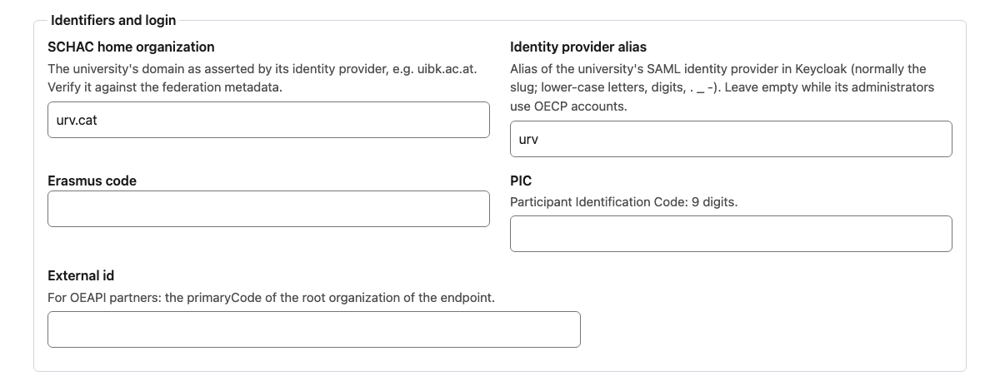

<!-- SPDX-FileCopyrightText: 2026 Lluís Alfons Ariño -->
<!-- SPDX-License-Identifier: EUPL-1.2 -->

# Sign-in paths: federated (eduGAIN) or local accounts

Each organization signs in **one** way, decided by its *Identity provider alias* (`keycloak_idp_alias`) [DL 22]:

- **Local accounts** (alias `null`): Keycloak accounts with a password of at least 12 characters plus a TOTP app, set up from the e-mail Keycloak sends at invitation time. No self-registration and no self-service password reset.
- **Federated** (alias = the organization slug): SAML sign-in through the university's identity provider (IdP) in eduGAIN, brokered by Keycloak, plus a TOTP app that OACC enrols after the first sign-in.

There is no mixed mode: some administrators local and others federated within one organization is not supported and not planned. Both modes reach the same level of authentication (`acr=mfa`) at every sign-in and give the same roles and screens. This page puts the two onboarding paths side by side, with who does what and when. The rule is [decision 22](../decisions-log.md); the technical detail is [spec §4](../spec-v4.1.md#4-identity) and [identity/keycloak/README.md](../../identity/keycloak/README.md#sign-in-mode-per-organization-dl-22). Roles as in the [onboarding README](README.md): alliance administrator, hosting operator, the partner's identity team (partner IT), partner administrator.

## Which mode for a university

| The university | Mode | Alias | How long |
|---|---|---|---|
| Is in eduGAIN **and** its IdP releases the required attributes (`mail`, `givenName`, `sn`, `schacHomeOrganization`, and `subject-id` or `pairwise-id`), through REFEDS Personalized Access or an equivalent attribute release, **and** the IdP has been connected and tested by the hosting operator | Federated | slug | As long as the IdP keeps releasing them |
| Is in eduGAIN, but its IdP does not release those attributes, or is not connected and tested yet | Local for now | `null` | Until the IdP qualifies; then [move to federated](#moving-from-local-to-federated) |
| Is not in eduGAIN, or sits behind a hub federation that OACC cannot reach | Local | `null` | Permanent |
| Is in eduGAIN and the alliance connects through its hosting federation's hub (SIR2 for Aurora) instead of one IdP per university | Federated through the hub | `sir2` | Once the agreements of [Federating through a national hub](#federating-through-a-national-hub-what-must-be-agreed) are met and a test sign-in passed; in 0.11.0 one organization at a time |
| The alliance organization | Local | `null` | Permanent |

In the Aurora seed, `aurora` and `upec` are local; the seed file sets the alias to the slug for the other seven universities, but none of their IdPs is connected in 0.11.0 (see [Known limits](#known-limits-in-0110)).

**Local is a full, permanent mode, not a stopgap.** A university outside eduGAIN stays on local accounts for good; it loses nothing but the single sign-on with its own login. Choose local also when a university in eduGAIN cannot release the attributes: OACC needs them to check the invited person at acceptance (the e-mail, the IdP and the asserted `schacHomeOrganization` must match, otherwise `oecp.invitation.mismatch`), and the principal attribute cannot be changed later without orphaning that IdP's users ([Adding a partner IdP](../../identity/keycloak/README.md#adding-a-partner-idp), step 4).

## The two paths, step by step

| Step | Who | Federated (alias = slug) | Local (alias `null`) | Where documented |
|---|---|---|---|---|
| **Day 0: federation** (once per deployment) | alliance (Foundation), hosting operator | Register one SAML service provider, entity ID `https://<auth host>/realms/oecp`, in the hosting institution's national federation with export to eduGAIN (Aurora: SIR/RedIRIS [DL 15]), requesting REFEDS Personalized Access, REFEDS CoCo v2 and Sirtfi | Not needed | [Guide A §3](alliance.md#3-identity) ("Federation registration") |
| **Day 0: metadata exchange** (per university) | hosting operator, partner identity team | Send the SP entity ID, the per-IdP descriptor `https://<auth host>/realms/oecp/broker/<alias>/endpoint/descriptor` and the requested attributes; receive the IdP's metadata ([list below](#what-your-identity-team-must-provide)) | Not needed | [Guide E §1.1](hosting-operator.md#11-what-to-ask-for-and-decide) (row "Identity provider"), [§2.13](hosting-operator.md#213-connect-an-identity-provider) step 1 |
| **Organization seed** | hosting operator (seed) or alliance administrator (*Organizations* page) | `schac_home_organization` verified against the federation metadata; `keycloak_idp_alias` `null` until the IdP is enabled and tested (set later, row below) | `keycloak_idp_alias` `null`; `schac_home_organization` filled as for every organization | [Guide A §4](alliance.md#4-seed-the-organizations), [Guide E §2.6](hosting-operator.md#26-database-schema-and-seeds) |
| **IdP in the realm** | hosting operator | Copy the `example-partner` block and its mappers in `identity/keycloak/realm-oecp.yaml` (alias = slug, `enabled: true`), then `docker compose run --rm keycloak-config`; edit the file, never the console | Not needed | [Adding a partner IdP](../../identity/keycloak/README.md#adding-a-partner-idp), [Guide E §2.13](hosting-operator.md#213-connect-an-identity-provider) step 2 |
| **Metadata refresh** | hosting operator | Configure the `idp-metadata-refresh` job once the first partner IdP is connected (aggregate URL, its signing certificate checked against a second source, dry run) | Not needed | [Guide A §3](alliance.md#3-identity) ("IdP metadata refresh") |
| **Set the alias** | alliance administrator, after the hosting operator confirms the IdP is enabled and tested | *Identity provider alias* = slug on the organization page; until then OACC refuses invitations (`oecp.invitation.idp_not_enabled`) | Leave it empty (*OACC accounts* in the list) | [Alliance manual §6](../manuals/alliance-admin.md#6-sign-in-mode-oacc-accounts-or-the-universitys-login) |
| **Invitation** | alliance administrator | One e-mail: the OACC invitation link, which carries the alias | Two e-mails: Keycloak's set-up e-mail (authenticator app and password) and the OACC invitation link | [Guide A §8](alliance.md#8-invite-partner-admins) |
| **Acceptance and first sign-in** | partner administrator | *Sign in through your university*: the university's login, then TOTP enrolment; acceptance; sign out and in again | Enrol the TOTP app and set the password from Keycloak's e-mail; open the invitation link and sign in; acceptance; sign out and in again | [Partner manual §1](../manuals/partner-admin.md#the-first-time-accept-your-invitation) |
| **Recovery** | see the row | Password and login: reset by the university | Set-up lost or expired: alliance administrator, *Resend set-up e-mail* on the *Administrators* panel; once set up: hosting operator resets the credential in the Keycloak admin console, or an alliance administrator removes and re-invites | [Administrator lifecycle](administrator-lifecycle.md#the-lifecycle-on-one-page) ("Lost password or authenticator"), [runbook §6](../production/runbook.md#6-identity-operations) |

### What the administrator sees

The screens below are from the development stack, with test accounts and example addresses.

Both paths start with the OACC invitation e-mail, which carries the link. The federated path has this one e-mail only; the local path has it in addition to Keycloak's set-up e-mail (row "Invitation").

Federated path (row "Acceptance and first sign-in"): the person reaches their university's login from *Sign in through your university* on the portal's sign-in prompt (the invitation link carries the alias); the Keycloak login page itself does not list the universities.

*Continue to your university* leads to the university's own login. The screen here is the development test identity provider; in a real deployment it is the university's login page.

Local path (row "Acceptance and first sign-in"): the link in Keycloak's set-up e-mail first asks the person to set up the authenticator app (QR code and one-time code) and then to set a password of at least 12 characters.

Local path, recovery (row "Recovery"): when the set-up is lost or has expired, an alliance administrator chooses *Resend set-up e-mail* on the organization's *Administrators* panel (the button appears only while a local account's set-up is pending).

Both paths, row "Set the alias": the alias is set on the organization page under *Identifiers and login*; empty means local accounts, a slug means federated.

### Moving from local to federated

When a university's IdP qualifies later, in this order ([Guide A §3](alliance.md#3-identity), "From local to federated"):

1. **Hosting operator:** connect and enable the IdP in the realm and test it (rows "Day 0: metadata exchange" to "Metadata refresh" above).
2. **Alliance administrator:** set the *Identity provider alias* on the organization page and save. The old local accounts are refused at sign-in from now on (`oecp.auth.idp_mismatch`).
3. **Alliance administrator:** *Remove* each old local administrator on the *Administrators* panel. This takes the role away, ends the sessions and is audited, but it **keeps the login account** in Keycloak, still holding the person's e-mail address (OACC creates local accounts with the e-mail as username too); the clean-up job would delete it only 12 months later.
4. **Hosting operator:** delete those old accounts in the Keycloak admin console (realm `oecp`, *Users*, search the e-mail, *Delete*). To keep an account instead, change **both** its e-mail **and** its username to something else; the realm does not let the console edit usernames, so switch *Edit username* on under *Realm settings*, *Login* and off again afterwards.
5. **Alliance administrator:** invite the organization's administrators again; they accept through their university.

The order matters: steps 3 and 4 must be done **before the person's first sign-in through the university**. Keycloak never links an account by e-mail, so while a local account holds the person's e-mail address or username, the first university sign-in stops on a Keycloak error page (HTTP 409) with "User with email … already exists" or "User with username … already exists", and nothing is created or linked. Nothing is lost when it happens: do steps 3 and 4 and the person signs in again from the same invitation link. Doing the removal after the first invitation, as earlier versions of this guide said, fails for every person who had a local account.

The way back (for example while a university's login is broken) is the same in reverse: clear the alias, save, invite again ([alliance manual §6](../manuals/alliance-admin.md#6-sign-in-mode-oacc-accounts-or-the-universitys-login)).

## What your identity team must provide

For the federated path only. Send it to the **hosting operator** of the alliance (for Aurora: URV IT), who writes it in the realm file ([Adding a partner IdP](../../identity/keycloak/README.md#adding-a-partner-idp); [Guide E §1.1](hosting-operator.md#11-what-to-ask-for-and-decide), row "Identity provider").

From your IdP's metadata (as published in eduGAIN, or by the hub of a hub-and-spoke federation such as SURFconext or WAYF):

- the IdP **entity ID**;
- the **SingleSignOnService** URL, with its binding (HTTP-POST or HTTP-Redirect);
- the **SingleLogoutService** URL, if your IdP declares one;
- the **signing certificate(s)**, all of them during a rollover.

Released to the OACC service provider `https://<auth host>/realms/oecp`:

- `mail`, `givenName`, `sn` and `displayName`;
- `schacHomeOrganization`, equal to the value the alliance records for your university (OACC compares them at acceptance);
- a persistent identifier: `subject-id` (REFEDS Personalized Access), otherwise `pairwise-id`; `eduPersonPrincipalName` only with your written confirmation that it is never reassigned.

Accepted by your IdP: **signed and encrypted assertions** (the OACC side requires both; its encryption certificate is in the per-IdP descriptor).

**The test.** Once the IdP is applied, an alliance administrator sets the alias and invites one administrator of your university. That person opens the link, which sends them to your IdP (`kc_idp_hint=<slug>`), signs in, enrols the TOTP app and accepts; the API checks the e-mail, the IdP and the asserted `schacHomeOrganization`. Only then are the other administrators invited ([Guide E §2.13](hosting-operator.md#213-connect-an-identity-provider), step 4 and "Check").

## Federating through a national hub: what must be agreed

*In progress: proof of concept for Aurora against the SIR2 test gateway in 0.11.0 ([decision 29](../decisions-log.md), not confirmed). This section lists what the hub model needs from each party; it becomes final with the ADR that amends ADR 0004.*

In the hub model OACC connects **one** identity provider, the hub of the hosting institution's federation (for Aurora: SIR2, run by RedIRIS), instead of one per university. The hub is the service the universities see in eduGAIN: the administrator chooses their university on the hub's discovery page, signs in at home, and the hub passes the result to OACC. One connection reaches every university of the alliance that is in eduGAIN, but OACC no longer talks to each university's IdP, so what each IdP releases, and how each federation on the way treats it, has to be agreed beforehand. The agreements sit at four levels: the alliance, each university, each national federation, and the hub operator. For the diagrams of the parties and of the sign-in flow, the identifier question and a table of who does what, see [Federating through a national hub: parties, flow and rules](federation-hub.md).

### What the alliance must agree

Decided by the alliance (for Aurora: the Foundation with the partners' identity teams), written down and kept with the deployment's records.

1. **The attribute set.** eduGAIN makes no attribute mandatory; it only recommends them ([eduGAIN attribute profile](https://technical.edugain.org/doc/GN3-11-012%20eduGAIN_attribute_profile.pdf)). The service declares what it expects and each IdP decides what it releases, so the alliance agrees on the set and on what happens when an attribute is missing:

   | Attribute | Status | Used for | If it is missing |
   |---|---|---|---|
   | `pairwise-id` | required | the persistent identifier of the administrator in OACC (built by the hub, item 2) | the hub stops with an error; the person never reaches OACC |
   | `schacHomeOrganization` | required | ties the person to their university at invitation acceptance; source of the identifier's scope | as above |
   | `mail` | required | compared with the invited address at acceptance | acceptance refused (`oecp.invitation.mismatch`) |
   | `displayName` | requested | the name shown on the *Administrators* panel | sign-in works; the name stays empty |

2. **The source of the identifier.** SIR2 builds the `pairwise-id` from the university's `uid` and `schacHomeOrganization`, so each university must release **`uid` and `schacHomeOrganization` to the hub**. Many IdPs outside Spain release `eduPersonPrincipalName` but not `uid`; whether the hub can use `eduPersonPrincipalName` when `uid` is missing has been asked to RedIRIS. The identifier is only as stable as its source: each university states that the source value is never reassigned to another person (or after how long it may be). A reassigned value would lead to the previous holder's OACC account, which then still asks for the TOTP app enrolled by that previous holder.
3. **The `schacHomeOrganization` value of each university, as it arrives at OACC.** The alliance records it on the organization page, more than one domain if a university uses several. Some federations and intermediate hubs rewrite the value (for example to the institution's main domain), so it is read from the test sign-in (item 6), not from the university's own configuration.
4. **Who registers the service and who is contacted.** The production registration behind the hub (the hosting institution during a pilot; the operator or the alliance later, depending on the operating model) and its technical, support, security (Sirtfi) and administrative contacts. Certificate changes on either side are announced by hand to these contacts, so they should be role addresses that outlive one person.
5. **Data protection.** The service requests REFEDS Personalized Access and the Data Protection Code of Conduct v2; the privacy notice must be published at the URL given in the registration before the production registration ([privacy notice draft](../production/privacy-notice-draft.md)).
6. **Rollout per university.** A university becomes federated only after one of its administrators has signed in through the hub and accepted an invitation. Until then, and for good if it cannot meet items 1 and 2, it uses local accounts, which lose nothing but the single sign-on.

### What each university's identity team must do

- Keep its IdP in eduGAIN through its national federation.
- Release the agreed attributes to the **hub's service as registered in eduGAIN**, not to OACC's entity ID: behind a hub, the university's IdP only ever sees the hub. For SIR2 that is at least `uid` and `schacHomeOrganization`, plus `mail` and `displayName`; by entity category (REFEDS Personalized Access, CoCo v2) where the IdP supports it, otherwise by an explicit release rule.
- Confirm the identifier policy (item 2) and the `schacHomeOrganization` value (item 3).
- Name a contact for the test sign-in and for incidents.

Multi-factor authentication at the IdP is not required: OACC asks for its own TOTP app at every sign-in.

### What each national federation must support

The alliance has no agreement with the federations themselves; the hosting operator checks these points with each partner's identity team, which knows its federation.

- **eduGAIN in both directions:** the federation exports its IdPs to eduGAIN and imports eduGAIN service metadata, so that its IdPs see the hub's service.
- **Hub-and-spoke federations** (for example SURFconext in the Netherlands or WAYF in Denmark) sit between the university and eduGAIN: the hub's service must be reachable for the university there, which in some federations means the institution enables it explicitly, and attribute release follows that federation's rules.
- **Attribute values passed unchanged, or the change known:** a federation that rewrites `schacHomeOrganization` or filters attributes must say so (item 3).
- **Scope checking:** the hub checks scoped values only for its own federation's IdPs (SIR2: the Spanish ones) and relies on the other federations for theirs. OACC therefore never grants access on an attribute alone: an administrator also needs a personal invitation and their own TOTP app, and the asserted `schacHomeOrganization` must match the organization at acceptance.
- **A security contact (Sirtfi)** for incidents that cross federations.

### What the hub operator provides (for Aurora: RedIRIS, SIR2)

- The registration of OACC behind the hub, first on the test gateway, then in production, and its publication to eduGAIN.
- The hub's IdP metadata: entity ID, sign-in and logout endpoints (HTTP-Redirect) and certificate. They are unsigned, so the certificate is pinned in the deployment's `.env` (`OECP_SIR2_IDP_*`, [SIR2 hub](../../identity/keycloak/README.md#sir2-hub-sir2)) and a change is announced to the contacts of item 4.
- The release of `pairwise-id`, `schacHomeOrganization`, `mail` and `displayName` to OACC, and a clear error when a university does not send the source attributes.

## Known limits in 0.11.0

- **No real partner IdP is connected yet.** The brokered path is verified end to end only against the development test SAML IdP (`tools/e2e-identity`). In a deployment's copy of the Aurora seed, set `keycloak_idp_alias` to `null` for every university whose IdP is not connected and tested, or its invitations are refused ([Guide E §2.6](hosting-operator.md#26-database-schema-and-seeds)).
- **The hub is a proof of concept.** The realm IdP `sir2` exists from 0.11.0 (disabled unless configured), and one real sign-in through the SIR2 **test gateway** worked on 2026-10-28 (findings: unencrypted assertions, the hub's identifier shown as username, a local account of the same person blocking the first sign-in; all handled in the Keycloak README, "SIR2 hub"), but the production registration is still to come, and only **one** organization can have the alias `sir2` (the alias is unique) until decision 29 is confirmed.
- **No custom Keycloak authenticator for missing attributes.** Keycloak creates the user without them; the API then refuses the invitation acceptance. A login error naming the attribute at the Keycloak level is not part of the MVP ([Adding a partner IdP](../../identity/keycloak/README.md#adding-a-partner-idp)).
