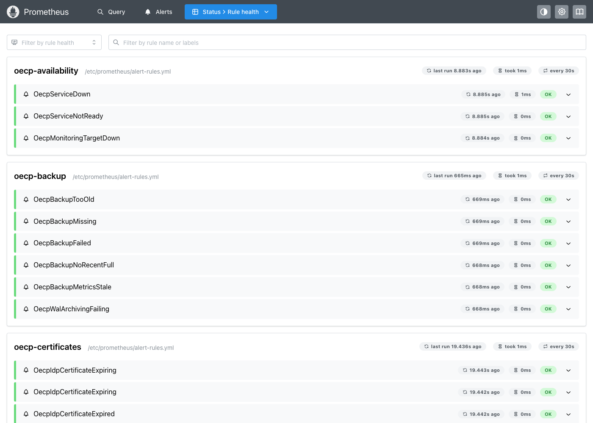
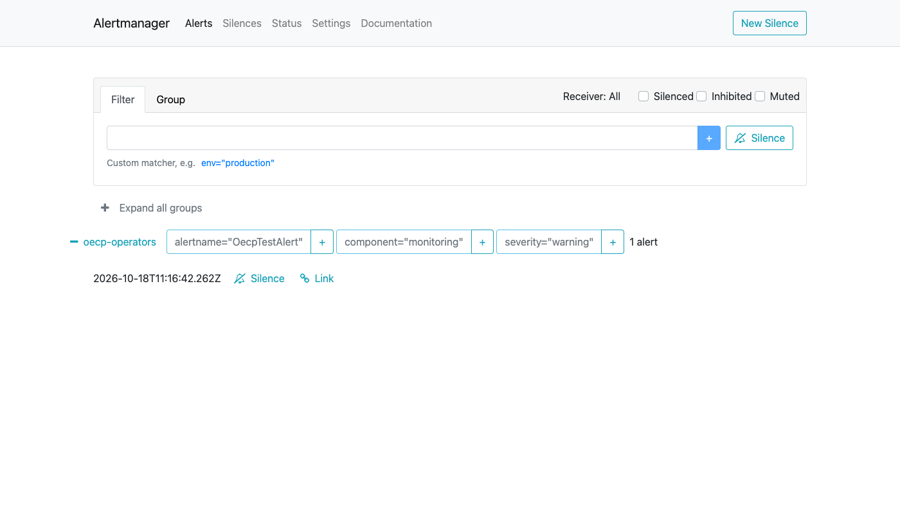

<!-- SPDX-FileCopyrightText: 2026 Lluís Alfons Ariño -->
<!-- SPDX-License-Identifier: EUPL-1.2 -->

# Production runbook: OECP at the hosting institution

For the hosting operator (URV for Aurora). It complements [deploy/compose/README.md](../../deploy/compose/README.md) (installation), [Guide A](../onboarding/alliance.md) (alliance set-up), [identity/keycloak/README.md](../../identity/keycloak/README.md) and [RELEASING.md](../RELEASING.md). Commands run in `deploy/compose` on the production host. Written for release 0.3.0 and updated through release 0.7.0 (maintenance page, account clean-up; pgBackRest backups, restore drill, metrics and alerting; branding; container logs to Loki, certificate expiry alerts; see the CHANGELOG); where something is planned but not built, this runbook says so.

## 1. Topology and environments

One Docker Compose project on one host (spec §3): `traefik` (TLS, routing, rate limits) → `web` (Nuxt; serves the deployment's branding images from `deploy/compose/branding/` or `OECP_BRANDING_DIR`, mounted read-only), `api` (NestJS), `keycloak`; `worker` (same image as `api`: harvests, CSV jobs, maintenance, IdP metadata refresh); `postgres` 16 with pgBackRest (databases `oecp`, `keycloak`; WAL archiving); `valkey` (queues, rebuildable); profile `backup`: `backup` (scheduled pgBackRest backups, uploads archive); profile `observability`: OpenTelemetry Collector, Prometheus, Alertmanager, node-exporter, blackbox exporter, Loki, Grafana Alloy (ships the container logs to Loki), `docker-socket-proxy` (read-only Docker API for Alloy), Grafana; volumes `postgres_data`, `pgbackrest-repo` (backup repository repo1), `uploads`, `idp-metadata`, `traefik_acme`, `valkey_data` (and, with the profiles, `prometheus_data`, `loki_data`, `alloy_data`, `grafana_data`, `alertmanager_data`). Networks: `edge`, `backend` (internal), `egress` (worker → partner OEAPI endpoints only), `docker-api` (internal: Alloy → socket proxy only); `backup` has no network.

| Environment | Hosts | Purpose |
|---|---|---|
| Production | `[TO COMPLETE: portal host]`, `[TO COMPLETE: auth host]` (same registrable domain, spec §4) | Live catalogue |
| Staging | `[TO COMPLETE: or "none"]` | Upgrade rehearsal, restore drills |
| Development | `oecp.localhost` (profile `dev`) | Never with real data |

Server: `[TO COMPLETE: host name, OS, CPU, RAM ≥ 4 GB with 2 GB for the worker, disk]`. Public outbound IP (given to partners for their allowlists): `[TO COMPLETE]`. Never enable the `dev` profile (Mailpit, OEAPI mock, test IdP) or `OECP_ALLOW_INSECURE_PARTNER_HTTP` in production.

## 2. Secrets inventory and rotation

Files in `deploy/compose/secrets/` (mode 700 directory), mounted as Docker secrets ([secrets/README.md](../../deploy/compose/secrets/README.md)). Keep an offline, access-controlled copy of all of them: `[TO COMPLETE: where]`.

| Secret | Used by | Rotation |
|---|---|---|
| `postgres_superuser_password` | postgres | `ALTER ROLE postgres PASSWORD …`, update file; yearly `[TO COMPLETE]` |
| `oecp_db_password`, `keycloak_db_password` | api, worker / keycloak | `ALTER ROLE`, update file, `docker compose up -d --force-recreate api worker` (or `keycloak`) |
| `keycloak_admin_password` | bootstrap of the `master` realm, keycloak-config | Replace the bootstrap admin by a permanent `master` admin with MFA at installation; keep the file in sync with the account keycloak-config-cli uses |
| `oecp_backend_client_secret` | keycloak-config, api, worker | Update file, `docker compose run --rm keycloak-config`, recreate `api` and `worker`. High impact: the client manages realm users |
| `oecp_master_key` (`key_version` 1) | api, worker | **Rotation not implemented**: one key version is supported. Never replace the file alone (stored credentials would no longer decrypt). If compromised: get new credentials from every partner, write a new key, recreate `api` and `worker`, re-enter each credential in *Integration settings* and re-run `store-secret` for `SURFEDUHUB_SECRET_REF` |
| `grafana_admin_password` | grafana (profile `observability`) | Update file and recreate |
| `pgbackrest_repo2_cipher_pass` (and `pgbackrest_repo2_s3_key_secret` or the SFTP key) | postgres, backup: repo2, the second site (section 3) | **Never rotate the passphrase in place**: repo2 cannot be read without it. Keep it in the offline copy. A new passphrase means a new repo2 (new bucket or path, `stanza-create`, full backup) while the old one expires |
| `alert_smtp_password`, if used | alertmanager | Update file and recreate `alertmanager` |
| Federation signing certificate (PEM, public) | worker (`OECP_IDP_METADATA_SIGNING_CERT_FILE`) | Not secret but the only trust anchor of the metadata refresh. Replace before the federation's key rollover, after checking its fingerprint with a second source (Guide A, step 3) |
| Partner OEAPI credentials | `secrets` table | Per access agreement; replace in *Integration settings* (write-only) |
| SURFeduhub credential, if used | `secrets` table (`store-secret`) | `[TO COMPLETE: used or not]` |
| ACME account, TLS keys | volume `traefik_acme` | Automatic renewal |
| Keycloak realm keys (token signing, SAML SP signing and encryption) | `keycloak` database | Rotating SAML SP keys requires new SP metadata at the federation (SIR/RedIRIS) and at every partner IdP: plan it |

## 3. Backups and point-in-time recovery

**What runs** (spec §10; details in the [Compose README, Backups](../../deploy/compose/README.md#backups-profile-backup)): pgBackRest, stanza `oecp`, covering the whole PostgreSQL cluster (`oecp` and `keycloak` databases, roles). `postgres` archives every WAL segment as it completes (at most 5 minutes later, `archive_timeout`); the `backup` service (profile `backup`) takes a **full backup every Sunday and a differential the other days at 02:00 UTC**, keeps a **35-day recovery window** (time-based retention: about six weekly fulls), archives the `uploads` volume daily (`uploads-YYYY-MM-DD.tar.gz`, 35 days) and publishes the backup metrics used by the alerts (section 7). Recovery point: the last archived WAL segment (≤ 5 minutes, at the second site once repo2 exists); recovery time: measured by the drill (section 4).

Production set-up, once:

```sh
docker compose --profile backup up -d --build      # stanza-create, check, first full backup
docker compose exec backup pgbackrest --stanza=oecp info
# then OECP_WAL_ARCHIVE=on in .env and `docker compose up -d postgres`: a failing archive keeps WAL and alerts
```

- **Second site:** repo2 `[TO COMPLETE: S3 bucket or SFTP host at the second site, owner]`, configured in `deploy/compose/.env.pgbackrest` from `postgres/pgbackrest-repo2.env.example`: always encrypted (`aes-256-cbc`, passphrase as Docker secret `pgbackrest_repo2_cipher_pass`, kept with the offline secrets copy of section 2). **Until repo2 exists, every backup lives on the production host only** (volume `pgbackrest-repo`): a host loss loses them. pgBackRest does not copy the uploads archives to repo2: `[TO COMPLETE: daily copy of the volume's uploads/ directory to the second site, tool]`.
- **Encryption:** repo1 is not encrypted (same host and protection as the database volume); repo2 must be. Backups hold personal data, password hashes and TOTP secrets.
- Valkey and `idp-metadata` need no backup (schedules are re-registered at worker start; the aggregate is downloaded again). Secrets are not in the backups (section 2): keep their offline copy current.

**Check:** the alerts of section 7 (backup older than 26 h, failed attempt, WAL archiving failing). By hand: `docker compose exec backup pgbackrest --stanza=oecp info` lists last night's backup; `docker compose logs --since 24h backup | grep -E 'ERROR|WARN'` is empty.

**Point-in-time recovery** (data deleted or corrupted at a known time; also after a host loss, on the new host from repo2):

1. Choose the target: the last moment before the incident, in UTC (`pgbackrest --stanza=oecp info` shows the available range). Rehearse it with `scripts/restore-drill.sh --target-time '<ts>' --keep` and check the data in the scratch container.
2. Stop the writers and PostgreSQL: `docker compose stop api worker keycloak backup postgres`.
3. Restore into the data volume (only differing files are rewritten):
   ```sh
   docker compose run --rm --no-deps postgres pgbackrest --stanza=oecp --delta \
     --type=time --target='<YYYY-MM-DD HH:MM:SS+00>' --target-action=promote restore
   ```
   Without `--type`/`--target`: newest backup plus all archived WAL (host loss). From the second site add `--repo=2` (with `.env.pgbackrest` and its secrets in place).
4. `docker compose up -d --wait` (PostgreSQL replays WAL and promotes to a new timeline); `docker compose run --rm api pnpm db:migrate` reports nothing pending. Uploads, if needed: `docker run --rm -v oecp_pgbackrest-repo:/r:ro -v oecp_uploads:/data alpine tar xzf /r/uploads/uploads-<date>.tar.gz -C /data`.
5. Take a full backup at once (`docker compose exec backup oecp-backup backup full`) and record the incident (section 8).

Steps 3–4 follow pgBackRest's documented restore; they were not exercised on the live development volume (the drill exercises the same restore into a scratch volume). Rehearse them once on staging.

## 4. Restore drill

**Quarterly and before go-live** (spec §10), on the production host (it does not touch production) or on staging with a copy of the repository:

```sh
cd deploy/compose
scripts/restore-drill.sh | tee "drill-$(date -u +%F).txt"                     # latest backup + all WAL
scripts/restore-drill.sh --target-time '<yesterday 12:00+00>'                    # PITR, once a year at least
scripts/restore-drill.sh --repo 2 --env-file .env.pgbackrest                     # from the second site, once repo2 exists
```

The script restores with `pgbackrest restore --delta` into a scratch container (no network, repository read-only, `archive_mode=off`), waits for WAL replay and promotion, and checks: `oecp` reachable, `keycloak` database and realm `oecp` present, Keycloak user count, latest schema migration, page checksums on and no checksum failure, row counts of `courses`, `organizations`, `maintenance_runs` next to the live counts (live may be higher: rows after the target). It prints the backup set, the last replayed transaction, the restore and recovery times (the database part of the recovery time objective) and PASS/FAIL, and removes the scratch container unless `--keep`. Exit status 0 = every check passed.

Then, at least yearly, complete the application part on staging: start a full stack on the restored data, sign in as an administrator, run the smoke test of the Compose README, compare course counts with production; restore one uploads archive (`tar tzf`). Record date, report, duration and problems: `[TO COMPLETE: drill log location]`.

Reference run on the development stack (2026-10-15, 47 MB cluster): restore 6 s, recovery 3 s, every check PASS.

## 5. Upgrades

Order from [RELEASING.md](../RELEASING.md#migrations): read the CHANGELOG (`BREAKING` items, new variables, migration notes); **back up**; `docker compose stop worker`; build or pull the new images; **migrate with the new image**; then start the new `api`, `worker`, `web`:

```sh
OECP_IMAGE_TAG=X.Y.Z docker compose build api web keycloak   # until images are published
OECP_IMAGE_TAG=X.Y.Z docker compose run --rm api pnpm db:migrate
OECP_IMAGE_TAG=X.Y.Z docker compose up -d --wait
```

Back up = `docker compose exec backup oecp-backup backup full` (or `diff`), and note the time: rollback = restore the backup taken before the upgrade (down migrations are a development aid). Only the latest minor is supported. After the upgrade check worker health, `maintenance_runs` and the next harvest.

## 6. Identity operations

**Realm re-import.** `keycloak-config` applies `identity/keycloak/realm-oecp.yaml` on every `docker compose up`: never edit declared objects in the console (reverted), and objects removed from the file are deleted. It also **resets partner IdP certificates and endpoints to the committed values** until the worker's start-up metadata refresh, about 60 s after the worker starts (spec §4). If `OECP_IDP_METADATA_URL` is unset or `OECP_IDP_METADATA_REFRESH_ON_START=false`, the reset lasts until 04:15 UTC: brokered sign-in can fail meanwhile. Keep committed certificates current; after any `up`, check the worker log for the refresh.

**Partner IdP onboarding:** procedure in the Keycloak README ("Adding a partner IdP"): organization first, IdP block (alias = slug), principal `subject-id` or `pairwise-id`, apply, regenerate and resubmit SP metadata, test with an invitation. The sign-in mode is per organization [DL 22]: `keycloak_idp_alias` empty = local accounts (password and TOTP), set = the university's IdP plus TOTP, never a mix; invitations to an organization whose alias is missing or disabled in the realm are refused (`oecp.invitation.idp_not_enabled`), so enable the IdP before inviting. Moving an organization from local to federated: enable the IdP, set the alias, invite the administrators again. Not yet verified with a real eduGAIN IdP (backlog).

**Certificate expiry.** The refresh drops expired IdP certificates and warns 30 days ahead in the worker log; an IdP without a valid certificate fails the run (alert `OecpIdpMetadataRefreshFailed`, section 7). Independently, the worker reads the signing certificates of every IdP in the realm (at start, after each refresh and hourly; client `oecp-backend` needs `view-identity-providers`) and the alerts `OecpIdpCertificateExpiring` (30 and 7 days), `OecpIdpCertificateExpired` and `OecpIdpCertificateCheckStale` fire on them (section 7). Federation signing key: section 2. TLS: Traefik renews; the blackbox exporter probes the certificate Traefik serves on 443 (`OecpTlsCertificateExpiring` at 21 and 7 days), which in production must be the ACME certificate made Traefik's default ([Compose README, Alerting](../../deploy/compose/README.md#alerting)).


## 7. Monitoring and alerts

Profile `observability` ([Compose README, Alerting](../../deploy/compose/README.md#alerting)): Prometheus scrapes the api and worker `/metrics` (internal network only), their `/ready` (blackbox exporter), node-exporter (disk of the data volumes, backup metrics), Traefik, Keycloak, the monitoring services themselves and the TLS certificate on 443 (blackbox exporter); the worker also exports the expiry of the partner IdP signing certificates; `observability/alert-rules.yml` defines the alerts; Alertmanager sends them by e-mail (`OECP_ALERT_EMAIL_TO`, through `OECP_ALERT_SMTP_*` or the application relay) and/or to a webhook (`OECP_ALERT_WEBHOOK_URL`); Alloy ships every container's log to Loki through a read-only Docker socket proxy; Grafana shows the dashboards *OECP overview* and *OECP logs* (log volume by service and level, logs by service with a search box, Traefik access log) and the active alerts. In an incident, search the logs there (or *Explore*, data source Loki, e.g. `{service="api"} |= "error"`) rather than with `docker compose logs`, which only reaches back as far as the json-file rotation. Receivers: `[TO COMPLETE: alert mailbox or on-call address, webhook target]`. After set-up and after every change send a test alert (`amtool alert add`, Compose README) and check that it arrives.


| Alert | Severity | First actions |
|---|---|---|
| `OecpServiceDown`, `OecpServiceNotReady` (api, worker) | critical | `docker compose ps`; `docker compose logs --since 30m api worker`; `/ready` 503 = PostgreSQL or Valkey unreachable: check `postgres`, `valkey` |
| `OecpApiHigh5xxRate`, `OecpEdgeHigh5xxRate` (5xx > 1 %) | warning | Dashboard: 5xx by route; api log for the error codes; Traefik 502/503 = backend down or unhealthy |
| `OecpHarvestFailing` (2 consecutive failed harvests of a partner) | warning | Panel *Network status*, *Sync history* of the partner; contact the partner (endpoint, credential, allowlist of our outbound IP); a disabled partner keeps its last count: silence it in Grafana/Alertmanager |
| `OecpHarvestStuck` | warning | Worker log; restart the worker if the run is hung |
| `OecpMaintenanceJobFailed`, `OecpMaintenanceJobStale` | warning | *Maintenance* page: the run's error and details; *Run now* after fixing |
| `OecpIdpMetadataRefreshFailed`, `…Stale` | warning | *Maintenance* page, job *IdP metadata refresh*: the failing IdP or the aggregate (download, signature, `validUntil`); brokered sign-in keeps the previous certificates meanwhile |
| `OecpBackupTooOld` (> 26 h), `OecpBackupFailed`, `OecpBackupMissing`, `OecpBackupMetricsStale`, `OecpBackupNoRecentFull` | critical / warning | `docker compose --profile backup ps backup`, `docker compose logs backup`; `docker compose exec backup pgbackrest --stanza=oecp check`; run `oecp-backup backup diff` once fixed |
| `OecpWalArchivingFailing` | critical | `docker compose logs postgres` (archive-push errors), repository space or repo2 reachability; `pg_wal` grows meanwhile (disk alert next) |
| `OecpDiskSpaceLow` (> 80 % warning, > 90 % critical) | warning / critical | `docker system df -v`; volumes `postgres_data`, `pgbackrest-repo` (backups, WAL), `uploads`, Docker logs; grow the disk before PostgreSQL stops |
| `OecpIdpCertificateExpiring` (< 30 d warning, < 7 d critical), `OecpIdpCertificateExpired` | warning / critical | The partner IdP's SAML signing certificate in Keycloak (*Identity providers* > alias > *Validating X509 certificates*); *Maintenance* page, last *IdP metadata refresh* run (does the federation metadata publish the successor?); ask the partner for its key rollover; by hand: add the new certificate comma-separated in Keycloak; disable the IdP if the partner has left |
| `OecpIdpCertificateCheckStale` | warning | Worker log `IdP signing certificates not checked`: Keycloak reachable from the worker, client `oecp-backend` has `view-identity-providers` |
| `OecpTlsCertificateExpiring` (< 21 d warning, < 7 d critical), `OecpTlsProbeFailing` | warning / critical | `docker compose logs traefik \| grep -i acme` (port 443 reachable for the TLS-ALPN challenge, DNS, Let's Encrypt rate limits), `traefik_acme` volume; probe failing: Traefik down on 443 or `blackbox-exporter` not on the `edge` network |
| `OecpMonitoringTargetDown` | warning | The exporter or Traefik/Keycloak metrics endpoint; the alerts depending on it cannot fire |

The Prometheus rule health page shows every alert rule and its state; Alertmanager lists the firing alerts and holds the silences.





Still manual:

| Check | How | Frequency |
|---|---|---|
| External availability | HTTPS probe of `/en`, `/oeapi/v5/`, `https://<auth host>/realms/oecp/.well-known/openid-configuration` from outside the host `[TO COMPLETE: monitoring system]`: the in-host Prometheus cannot report its own host down | 1–5 min |
| Monitoring itself | Grafana reachable, *OECP overview* shows current data, *OECP logs* shows lines of the last minutes for every service (else: `docker compose logs alloy docker-socket-proxy loki`); a test alert arrives | Monthly |
| Worker schedules | `docker compose exec worker node -e "fetch('http://127.0.0.1:3001/health').then(r=>r.text()).then(console.log)"` lists jobs and next runs | Weekly |
| Dry runs | *Maintenance* page: `dormancy` and `account-cleanup` dry-run lists (section 10) | Monthly |
| Certificates | Alerted in-host (IdP signing certificates, TLS certificate of the portal); still check the auth host's certificate and the external view from outside the host | Monthly |

Disk metrics come from a node-exporter container that sees the filesystems of the mounted volumes; a node-exporter on the host itself (or the institution's monitoring) covers every filesystem and the host's memory and CPU.

**Mail:** Mailpit is development only. Production needs `OECP_SMTP_HOST` set to the institutional relay `[TO COMPLETE: relay host and port]`: relay by source address, or SMTP AUTH (`OECP_SMTP_USER` and the Docker secret `smtp_password`, `OECP_SMTP_PASSWORD_FILE=/run/secrets/smtp_password`); `OECP_SMTP_STARTTLS=true` (Compose default) requires TLS. With `NODE_ENV=production` the api **refuses to start** without an SMTP host unless `OECP_MAIL_LOG_LINKS=true`; keep it `false`. Without an SMTP host (development) nothing is sent: one warning line per mail, and the text with the invitation link only at `LOG_LEVEL=debug`; treat any such debug line as a leaked credential and revoke the invitation. Alert mail uses the same relay unless `OECP_ALERT_SMTP_HOST` is set.

## 8. Incident response

Breach path and timing: [art. 28 checklist, A.5](art28-processor-checklist.md#a5-personal-data-breaches-art-33-34) (controller notifies the authority within 72 hours, art. 33). First actions:

- **Administrator account compromised.** *Organizations* > organization > *Administrators* > *Remove* (roles and sessions revoked, audit `admin.revoke`; tokens already issued live ≤ 5 min). In the Keycloak console disable the user and remove its OTP credential. Review its actions: `docker compose exec postgres psql -U postgres -d oecp -c "SELECT occurred_at, action, entity_type, entity_id FROM audit_log WHERE actor_sub = '<sub>' ORDER BY occurred_at DESC"`; check integration changes (host approvals) and course status changes; correct through the panel.
- **Partner credential leaked.** Partner revokes it and issues a new one; replace it in *Integration settings*.
- **`oecp_backend_client_secret` or Keycloak master admin compromised.** Rotate at once (section 2); review Keycloak admin events (kept 90 days) and realm roles.
- **Master key and database both exposed.** Treat every partner credential as leaked; rotation procedure of section 2.
- **Invitation link exposed.** Revoke it (*Invitations* > *Revoke*); resend.
- **Bad data published.** Override or withdraw in the panel; disable the partner's harvest if needed.

Record every incident: `[TO COMPLETE: incident register]`.

## 9. Capacity

Worker ≥ **2 GB** RAM when the IdP metadata refresh uses the eduGAIN aggregate (about 750 MB measured for 75 MB; eduGAIN about 94 MB); Compose sets no limit; if needed `NODE_OPTIONS=--max-old-space-size=3072`. Uploads ≤ 5 MiB per file, 10 per hour per organization, kept 90 days. Raw payload history grows with changes only, 12–13 months kept. Search target p95 < 300 ms at 50 req/s is not measured. Backup repository (volume `pgbackrest-repo`, and repo2): about six compressed full backups plus differentials and 35 days of compressed WAL (development: 5.5 MB per full of a 47 MB cluster); keep it on a different disk from `postgres_data` if possible. `[TO COMPLETE: measured sizes after the first months]`.

## 10. Log and data retention

**Logs.** Targets: application logs 90 days, Traefik access logs 30 days (spec §10). Configured in Compose ([Log retention](../../deploy/compose/README.md#log-retention)):

- **Time-based, effective with the `observability` profile:** Alloy (`observability/alloy.alloy`) ships the logs of every container of the Compose project to Loki, labelled `service`, `container`, `project`, and on Traefik `log_type` (`access` or `app`). Loki's compactor (`observability/loki.yaml`) deletes the Traefik access log (`{service="traefik", log_type="access"}`) after **30 days** and everything else after **90 days**. Alloy reads the Docker API through `docker-socket-proxy` (GET containers, events and networks only; internal network). Keep the profile running in production: without it only the size-based json-file bound below applies.
- Fallback and `docker compose logs` source: every container logs to Docker's `json-file` driver with rotation: `OECP_LOG_MAX_SIZE` × `OECP_LOG_MAX_FILE` (default 10m × 5), Traefik `OECP_TRAEFIK_LOG_MAX_SIZE` × `OECP_TRAEFIK_LOG_MAX_FILE` (20m × 10). The bound is **size-based**: measure each container's daily volume (`docker inspect --format '{{.LogPath}}' <container>`) and size the files for about 90 days (Traefik with access log: 30 days, never more) when Loki is not used; with Alloy and Loki running they only need to bridge an outage of either (a few days) and can be reduced. Chosen values: `[TO COMPLETE: sizes per container, date measured]`.
- The Traefik access log is **off by default**; `OECP_TRAEFIK_ACCESS_LOG=true` writes one JSON line per request with the client address but no request headers. Enabled: `[TO COMPLETE: yes/no, reason]`.
- API request logs carry method, URL, status, duration, request id and, for admin requests, the JWT `sub`; never headers, client address or User-Agent. `OECP_LOG_CLIENT_ADDRESSES=true` adds a salted SHA-256 of the address (salt random per process).
- Prometheus keeps 30 days of metrics (no personal data: partner slugs, routes, job names). Keycloak events: 90 days (realm). Backups: 35 days (section 3).

**Data.** The worker's `retention` job (04:45 UTC) deletes, besides old run errors, runs, audit entries, invitations and maintenance runs, the courses, offerings and organizations soft-deleted more than `OECP_RETENTION_SOFT_DELETED_MONTHS` (12) months ago (an organization only once nothing refers to it; counted `soft_deleted_organizations_kept` otherwise). The `account-cleanup` job (05:15 UTC) deletes the Keycloak accounts of former administrators 12 months after their roles were removed (`OECP_ACCOUNT_DELETE_MONTHS`); it runs in **dry run** until `OECP_ACCOUNT_CLEANUP_DRY_RUN=false`: `[TO COMPLETE: date enabled, after the Foundation reviewed a dry run]`. Harvested raw payloads are stored without person data (`coordinators`, `persons`, person members of `ext`). Data deleted by these jobs survives in backups until they expire (35 days, section 3).

## 11. Housekeeping checklist

**Weekly:** no alert left firing or silenced without a reason (Grafana, *OECP overview*); `pgbackrest info` shows the Sunday full; worker log errors.
**Monthly:** test alert delivered (section 7); uploads archives copied to the second site; certificate expiry (row *Certificates* of *OECP overview*; the auth host's certificate from outside); review `Administrators` panels; on the *Maintenance* page, review the latest `account-cleanup` run (dry run: the accounts it would delete and the kept ones with their reason; enabled: the deleted accounts); check the log volumes against the rotation sizes (section 10); apply OS and image security updates; check for a new OECP patch release.
**Quarterly:** restore drill (section 4, `scripts/restore-drill.sh`, report filed); review the dormancy dry run on the *Maintenance* page until it is switched on; secrets offline copy current.
**Yearly:** rotate database and client secrets; review this runbook, the RoPA and the DPIA; recertify administrators with the Foundation (manual review of every *Administrators* panel, [administrator lifecycle](../onboarding/administrator-lifecycle.md), [DL 26]).

## 12. Contacts

| Role | Name | Contact | Hours |
|---|---|---|---|
| Hosting operator on call | `[TO COMPLETE]` | `[TO COMPLETE]` | `[TO COMPLETE]` |
| URV security team / CSIRT | `[TO COMPLETE]` | `[TO COMPLETE]` | |
| URV DPO | `[TO COMPLETE]` | `[TO COMPLETE]` | |
| Aurora Foundation (controller) | `[TO COMPLETE]` | `[TO COMPLETE]` | |
| Foundation DPO | `[TO COMPLETE]` | `[TO COMPLETE]` | |
| Alliance administrators (at least two) | `[TO COMPLETE]` | `[TO COMPLETE]` | |
| Federation operator (SIR/RedIRIS) | `[TO COMPLETE]` | `[TO COMPLETE]` | |
| OECP maintainers (security reports) | see [SECURITY.md](../../SECURITY.md) | `[TO COMPLETE]` | |
